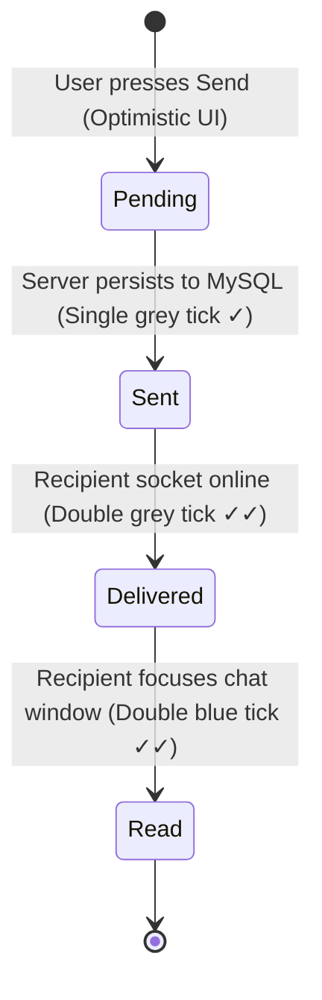

# Phase 06: 1-on-1 Direct Real-Time Messaging Engine

## 1. Phase Overview & Objectives
**Target Workspace**: `web/` (Server #1) & `socket-server/` (Server #2)  
**Primary Goal**: Build the core 1-on-1 direct messaging system over **Fastify & Native `ws`**. Implement real-time text transmission, optimistic UI updates, auto-scrolling message viewports, conversation list ordering, unread badges, and the complete WhatsApp tick receipt state machine (`✓` sent, `✓✓` delivered, blue `✓✓` read).

---

## 2. Context & Prerequisites
- **Previous Phase**: [`05_REALTIME_PRESENCE_AND_STATUS_ENGINE.md`](05_REALTIME_PRESENCE_AND_STATUS_ENGINE.md) (Presence tracking and native WebSocket connection operational).
- **Environment**: Next.js 15, Prisma ORM (`Chat`, `ChatParticipant`, `Message`, `MessageStatus`), Fastify + `ws` daemon.
- **Performance Rule**:
  - Chat history queries must be paginated (40 messages per batch) to prevent memory spikes.
  - Native WebSocket envelopes (`WsEnvelope<T>`) used for all message events.

---

## 3. Architectural Structure & Target Files

```text
WebChat/
├── web/
│   ├── src/
│   │   ├── app/
│   │   │   ├── api/
│   │   │   │   └── chats/
│   │   │   │       ├── route.ts              # GET /api/chats (sidebar list)
│   │   │   │       ├── direct/
│   │   │   │       │   └── route.ts          # POST /api/chats/direct (get or create 1-on-1)
│   │   │   │       └── [chatId]/
│   │   │   │           └── messages/
│   │   │   │               └── route.ts      # GET /api/chats/[chatId]/messages (paginated)
│   │   │   └── chat/
│   │   │       └── [chatId]/
│   │   │           └── page.tsx              # Active conversation route
│   │   ├── components/
│   │   │   ├── chat/
│   │   │   │   ├── MessageList.tsx           # Scrollable message viewport with date dividers
│   │   │   │   ├── MessageBubble.tsx         # Sent / Received WhatsApp message bubble
│   │   │   │   ├── MessageStatusTick.tsx     # Clock, single tick, double tick, blue tick
│   │   │   │   ├── ChatInput.tsx             # Auto-resizing textarea, emoji picker, send button
│   │   │   │   └── DateDivider.tsx           # "Today", "Yesterday", or formatted date badge
│   │   │   └── sidebar/
│   │   │       └── ConversationItem.tsx      # Sidebar conversation row with unread pill
│   │   └── hooks/
│   │       ├── useMessages.ts                # Message fetching, optimistic state & ws listeners
│   │       └── useSound.ts                   # Audio playback for sent.mp3 and receive.mp3
├── socket-server/
│   └── src/
│       └── handlers/
│           └── messageHandler.ts             # Native ws message:send, delivery, read handlers
└── shared/
    └── src/
        └── events.ts                         # Message payload schemas
```

---

## 4. Tick Receipt State Machine & WebSocket Envelope Contracts



### Event Payloads (`shared/src/events.ts`)

```typescript
export interface SendMessagePayload {
  tempId: string; // Client-generated UUID for optimistic reconciliation
  chatId: string;
  recipientId: string;
  content: string;
  messageType: 'text' | 'image' | 'voice';
}

export interface NewMessageBroadcast {
  tempId?: string;
  message: {
    id: string;
    chatId: string;
    senderId: string;
    content: string;
    messageType: string;
    createdAt: string;
    status: 'sent' | 'delivered' | 'read';
  };
}

export interface MessageStatusUpdatePayload {
  chatId: string;
  messageId: string;
  status: 'delivered' | 'read';
  userId: string;
}
```

---

## 5. Detailed Step-by-Step Implementation Tasks

- [ ] **1. Chat Retrieval & Deduplication APIs**:
  - `POST /api/chats/direct`:
    - Checks if a 1-on-1 chat already exists between `currentUserId` and `targetUserId`.
    - If found, returns existing `chatId`.
    - If not found, creates `Chat` record (`isGroup: false`) and inserts both users into `ChatParticipant`.
  - `GET /api/chats`:
    - Returns all chats for the user sorted by `lastMessageAt DESC`.
    - Includes contact alias or display name, contact avatar, last message snippet, timestamp, and unread count.
  - `GET /api/chats/[chatId]/messages?cursor=...&limit=40`:
    - Returns paginated messages ordered by `createdAt DESC`.
- [ ] **2. Fastify + Native `ws` Message Pipeline (`messageHandler.ts`)**:
  - On receiving envelope `{ type: 'message:send', payload }`:
    - Save message to MySQL via Prisma.
    - Create `MessageStatus` record (`status: 'sent'`).
    - Update `Chat.lastMessageAt = NOW()` and `Chat.lastMessageId`.
    - Send confirmation envelope back to sender:
      ```typescript
      socket.send(JSON.stringify({
        type: 'message:ack',
        payload: { tempId: payload.tempId, messageId: message.id, createdAt: message.createdAt, status: 'sent' }
      }));
      ```
    - Check if recipient has an active connection via `roomManager.isUserOnline(recipientId)`:
      - If connected: Send `{ type: 'message:new', payload: message }`, update `MessageStatus.status = 'delivered'`, and send `{ type: 'message:status', payload: { ...status: 'delivered' } }` to sender.
      - If offline: Message remains `sent` until recipient opens the app.
  - On receiving `{ type: 'message:read', payload }`:
    - Update all unread `MessageStatus` records for this chat to `status = 'read'`.
    - Send `{ type: 'message:status', payload: { ...status: 'read' } }` to sender.
- [ ] **3. Frontend Optimistic Message Handling (`useMessages.ts`)**:
  - When user clicks send:
    - Create temporary message with `tempId: crypto.randomUUID()`, `status: 'pending'` (clock icon).
    - Append immediately to local state and play `sent.mp3`.
    - Send envelope:
      ```typescript
      ws.send(JSON.stringify({ type: 'message:send', payload: outgoingMessage }));
      ```
    - On receiving `message:ack`: reconcile `tempId` with confirmed `id` and update status to single grey tick `✓`.
- [ ] **4. Message Viewport & Auto-Scroll (`MessageList.tsx`)**:
  - Auto-scroll to the bottom on first load and when a new message arrives.
  - Insert `<DateDivider />` between messages sent on different calendar days (*"Today"*, *"Yesterday"*, *"October 24, 2026"*).
- [ ] **5. Message Bubbles & Status Ticks**:
  - `MessageBubble.tsx`:
    - Outgoing message: Green background (`#005c4b` dark / `#d9fdd3` light) aligned right with WhatsApp tail.
    - Incoming message: Dark slate background (`#202c33` dark / `#ffffff` light) aligned left with tail.
    - Displays formatted time (`10:45 AM`) and `<MessageStatusTick />` (pending clock, single tick, double tick, cyan double tick `#53bdeb`).
- [ ] **6. Unread Badge & Sidebar Updates**:
  - Increment unread pill badge in sidebar for incoming messages when conversation is not actively focused.
  - Re-order conversations dynamically to the top of the sidebar on incoming message.

---

## 6. Quality Gate & Verification Criteria

Before marking Phase 06 complete, verify:
1. User A sends a message to User B:
   - User A's bubble immediately appears with a clock icon, then changes within 200ms to a single grey tick `✓`.
   - User A hears `sent.mp3`.
2. When User B's browser is open:
   - User A's tick updates to double grey `✓✓`.
   - User B hears `receive.mp3` and the message appears instantly.
3. When User B clicks into the chat window:
   - User A's tick transitions to double blue `✓✓`.
   - User B's unread badge clears to 0.
4. Sending 50 messages and scrolling up smoothly triggers pagination loading without layout jumping.

---

## 7. Handoff to Phase 07
Phase 07 will implement Media Sharing (compressed image sharing, uploads to Hostinger NVMe storage `/public/uploads/images/`, and the image lightbox viewer).
