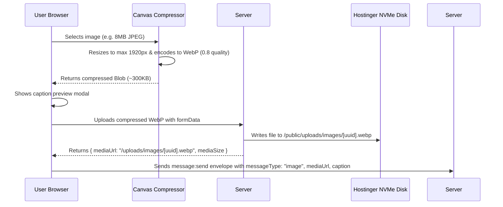

# Phase 07: Media Sharing (Compressed Images via Hostinger Storage)

## 1. Phase Overview & Objectives
**Target Workspace**: `web/` (Server #1)  
**Primary Goal**: Build media attachment sharing for photos and images. Implement client-side canvas WebP compression (reducing file sizes by up to 80%), upload to Hostinger local NVMe storage (`/public/uploads/images/`) at **$0 extra cost**, display image message bubbles with captions, and provide a fullscreen lightbox media viewer with zoom and download capabilities.

---

## 2. Context & Prerequisites
- **Previous Phase**: [`06_ONE_TO_ONE_MESSAGING_ENGINE.md`](06_ONE_TO_ONE_MESSAGING_ENGINE.md) (Text messaging and status receipts operational).
- **Environment**: Next.js 15 App Router, HTML5 Canvas API, LiteSpeed/Nginx static file serving.
- **Strict Guardrail**:
  - **No external paid cloud buckets** (No S3, No Cloudinary). All files must reside in `web/public/uploads/images/` on Hostinger.
  - Client-side compression is mandatory to protect Hostinger disk space and bandwidth.

---

## 3. Architectural Structure & Target Files

```text
web/
├── src/
│   ├── app/
│   │   └── api/
│   │       └── upload/
│   │           └── image/
│   │               └── route.ts         # POST /api/upload/image (multipart handler)
│   ├── components/
│   │   ├── chat/
│   │   │   ├── AttachmentMenu.tsx       # Paperclip button popup (Photos, Documents)
│   │   │   ├── ImagePreviewModal.tsx    # Crop/caption preview dialog before sending
│   │   │   ├── ImageBubble.tsx          # WhatsApp image bubble with caption & tick
│   │   │   └── Lightbox.tsx             # Fullscreen dark lightbox with zoom, pan, download
│   └── lib/
│       └── imageCompression.ts          # Client-side canvas compression to WebP
```

---

## 4. API Contract & Compression Flow



### Upload Endpoint (`POST /api/upload/image`)
- **Content-Type**: `multipart/form-data`
- **Max Upload Size**: 15MB limit on raw input; compressed file is typically `< 500KB`.
- **Response (`201 Created`)**:
  ```json
  {
    "mediaUrl": "/uploads/images/550e8400-e29b-41d4-a716-446655440000.webp",
    "mediaSize": 314572,
    "width": 1280,
    "height": 720
  }
  ```

---

## 5. Detailed Step-by-Step Implementation Tasks

- [ ] **1. Client-Side Image Compression Utility (`imageCompression.ts`)**:
  - Load selected image file into an HTML `Image` object.
  - Calculate scaled dimensions maintaining aspect ratio (maximum width/height: 1920px).
  - Draw image to HTML5 `canvas` and convert to `Blob` using `canvas.toBlob(blob, 'image/webp', 0.82)`.
  - Return compressed file blob and dimension metadata.
- [ ] **2. Hostinger Local File Upload Route (`POST /api/upload/image`)**:
  - Parse `multipart/form-data` using Next.js `request.formData()`.
  - Validate MIME type (must be `image/jpeg`, `image/png`, or `image/webp`).
  - Generate cryptographically secure filename: `${crypto.randomUUID()}.webp`.
  - Write buffer directly to `path.join(process.cwd(), 'public/uploads/images', filename)`.
  - Return static HTTPS URL `/uploads/images/${filename}`.
- [ ] **3. Attachment Menu (`AttachmentMenu.tsx`)**:
  - WhatsApp paperclip icon in chat input bar.
  - Clicking toggles animated popup menu with options:
    - 📷 Photos & Videos (opens file input with `accept="image/*"`).
    - 📄 Document (opens file input for PDFs, max 20MB).
- [ ] **4. Image Preview & Caption Modal (`ImagePreviewModal.tsx`)**:
  - WhatsApp-style full-screen modal showing the compressed image preview.
  - Caption text input at the bottom with emoji picker.
  - Green circular send button.
- [ ] **5. Image Message Bubble (`ImageBubble.tsx`)**:
  - Renders image inside message bubble with rounded corners.
  - Shows blurred placeholder / skeleton while image loads.
  - Dark gradient overlay at the bottom with timestamp and delivery ticks.
  - Displays caption text below image if provided.
- [ ] **6. Fullscreen Lightbox Viewer (`Lightbox.tsx`)**:
  - Clicking any image bubble opens a dark overlay (`rgba(0,0,0,0.9)`).
  - Features:
    - Close button (`Esc` key or top-right `✕`).
    - Zoom In / Zoom Out controls (`+` / `-` and mouse wheel zoom).
    - Pan when zoomed in.
    - Download button (triggers direct download with original filename).

---

## 6. Quality Gate & Verification Criteria

Before marking Phase 07 complete, verify:
1. Selecting an 8MB JPEG image compresses it client-side to `< 500KB WebP` in under 1 second.
2. The image preview modal opens, allowing the user to type a caption.
3. Clicking send uploads the file into `web/public/uploads/images/`.
4. The image bubble displays immediately on both sender and recipient screens.
5. Clicking the image opens the dark fullscreen lightbox with functional zoom and download.

---

## 7. Handoff to Phase 08
Phase 08 will implement Voice Notes & Audio Messaging (in-browser MediaRecorder audio recording, waveform peak visualizer, and scrubbable WhatsApp audio player).
