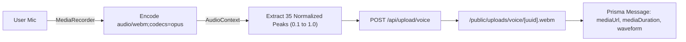

# Phase 08: Voice Notes & Audio Messaging

## 1. Phase Overview & Objectives
**Target Workspace**: `web/` (Server #1)  
**Primary Goal**: Build the WhatsApp voice note recording and playback system. Capture in-browser microphone audio using `MediaRecorder`, compute amplitude peaks using the Web Audio API for waveform rendering, upload compressed Opus audio to Hostinger NVMe storage (`/public/uploads/voice/`), and build the interactive WhatsApp voice note player with scrubbable waveforms, speed controls (`1x`, `1.5x`, `2x`), and listen receipts.

---

## 2. Context & Prerequisites
- **Previous Phase**: [`07_MEDIA_SHARING_AND_ATTACHMENTS.md`](07_MEDIA_SHARING_AND_ATTACHMENTS.md) (Local upload pipeline operational).
- **Environment**: Web Audio API, MediaStream Recording API, Opus audio codec.
- **Cost & Storage Rule**:
  - Voice recordings are compressed using Opus at ~32 kbps (a 1-minute voice note is only ~250 KB).
  - Stored directly on Hostinger NVMe disk (`/public/uploads/voice/`) at $0 extra cost.

---

## 3. Architectural Structure & Target Files

```text
web/
├── src/
│   ├── app/
│   │   └── api/
│   │       └── upload/
│   │           └── voice/
│   │               └── route.ts           # POST /api/upload/voice (audio file handler)
│   ├── components/
│   │   ├── chat/
│   │   │   ├── AudioRecorder.tsx          # Mic button, lock, timer, cancel and send controls
│   │   │   ├── VoiceNotePlayer.tsx        # WhatsApp voice note player with waveform
│   │   │   └── WaveformVisualizer.tsx     # Scrubbable amplitude bar visualizer
│   ├── hooks/
│   │   ├── useAudioRecorder.ts            # MediaRecorder lifecycle & real-time amplitude
│   │   └── useAudioPlayer.ts              # HTMLAudioElement controller (play, pause, seek, speed)
│   └── lib/
│       └── audioUtils.ts                  # AudioContext decoding & peak normalization
```

---

## 4. Audio Pipeline & Data Format



### Voice Upload Endpoint (`POST /api/upload/voice`)
- **Content-Type**: `multipart/form-data`
- **Fields**:
  - `file`: Audio blob (`audio/webm` or `audio/ogg;codecs=opus`)
  - `duration`: Float (seconds, e.g. `14.2`)
  - `peaks`: JSON string array of normalized floats: `[0.2, 0.5, 0.8, 0.3, ...]`
- **Response (`201 Created`)**:
  ```json
  {
    "mediaUrl": "/uploads/voice/9b1deb4d-3b7d-4bad-9bdd-2b0d7b3dcb6d.webm",
    "mediaDuration": 14.2,
    "waveform": [0.2, 0.45, 0.8, 0.9, 0.6, 0.3, 0.7, 0.4]
  }
  ```

---

## 5. Detailed Step-by-Step Implementation Tasks

- [ ] **1. Audio Capture Hook (`useAudioRecorder.ts`)**:
  - Request microphone permissions: `navigator.mediaDevices.getUserMedia({ audio: true })`.
  - Initialize `MediaRecorder` with preferred MIME types:
    - 1st choice: `audio/webm;codecs=opus` (Chrome/Firefox/Edge)
    - Fallback: `audio/mp4` or `audio/aac` (Safari iOS)
  - Accumulate recorded chunks on `dataavailable`.
  - Maintain real-time elapsed timer (`0:05`, `0:06`...).
- [ ] **2. Waveform Peak Extraction Utility (`audioUtils.ts`)**:
  - Read audio blob as `ArrayBuffer`.
  - Decode using `AudioContext.decodeAudioData()`.
  - Divide channel data into 35–40 equal buckets.
  - Calculate the peak amplitude for each bucket and normalize between `0.1` and `1.0`.
- [ ] **3. In-Chat Recording Bar (`AudioRecorder.tsx`)**:
  - Idle state: WhatsApp green microphone icon in input bar.
  - Recording state (replaces text input):
    - Red pulsating recording dot with timer (`0:12`).
    - Trash can button (cancels recording and deletes audio).
    - Lock-to-record toggle (allows hands-free recording).
    - Green send button (stops recording, computes peaks, uploads, and sends).
- [ ] **4. Voice Note Upload API (`POST /api/upload/voice`)**:
  - Validates audio file and writes to `public/uploads/voice/${crypto.randomUUID()}.webm`.
  - Stores file metadata and returns static URL.
- [ ] **5. WhatsApp Voice Note Player (`VoiceNotePlayer.tsx`)**:
  - Displays user avatar with small mic badge:
    - Green badge: unlistened.
    - Cyan/blue badge: listened.
  - Play / Pause button toggle.
  - Interactive scrubbable waveform (`WaveformVisualizer.tsx`):
    - Render vertical SVG/div bars corresponding to amplitude peaks.
    - Color past bars in brand green/blue and upcoming bars in grey.
    - Click or drag on waveform to seek to specific playback position.
  - Playback Speed Button:
    - Cycles between `1x` ➔ `1.5x` ➔ `2x`.
  - Time display:
    - When paused: shows total duration (`0:15`).
    - When playing: shows elapsed playback time (`0:07`).

---

## 6. Quality Gate & Verification Criteria

Before marking Phase 08 complete, verify:
1. Clicking the mic icon prompts for microphone permission and starts the timer.
2. Clicking the trash can cancels the recording without uploading.
3. Recording for 10 seconds and clicking Send uploads the voice note and emits `message:send` with `messageType: "voice"`.
4. The voice note renders with accurate amplitude waveform peaks.
5. Clicking Play plays the audio smoothly; clicking the speed button changes speed to `1.5x` and `2x`.
6. Clicking along the waveform seeks audio playback immediately.

---

## 7. Handoff to Phase 09
Phase 09 will implement Group Chats & Community Administration (multi-user group creation, participant drawer, and admin controls).
