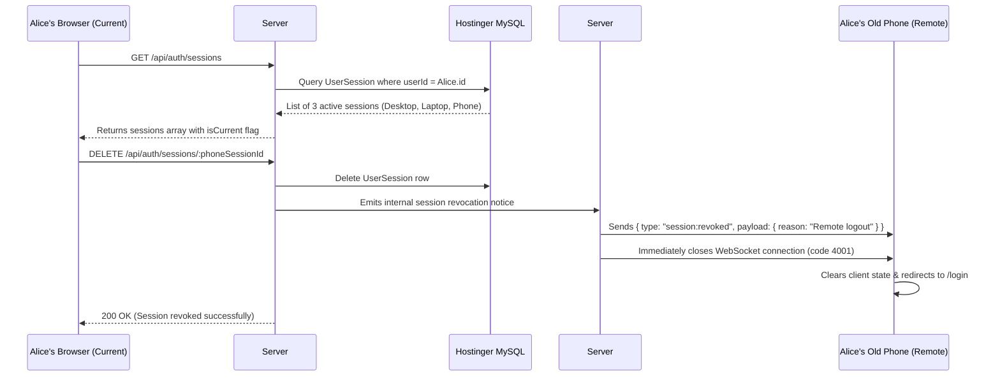

# Phase 15: Device Session Management & Multi-Device Security

## 1. Phase Overview & Objectives
**Target Workspace**: `web/` (Server #1) & `socket-server/` (Server #2)  
**Primary Goal**: Implement multi-device session management, active session tracking, and remote session revocation at **$0.00 additional monthly cost**. Users can view all devices currently logged into their account (with IP address, browser, OS, and relative last active timestamp) and remotely terminate any suspicious or obsolete session with real-time WebSocket disconnection.

> [!IMPORTANT]
> **Authentication Guardrail**: Strictly **NO OTP**, **NO SMS**, **NO phone verification**, and **NO email verification codes**. Authentication and session tracking rely purely on secure HTTP-only session cookies and cryptographic session tokens.

---

## 2. Context & Prerequisites
- **Previous Phase**: [`14_AUTOMATED_CICD_DEPLOYMENT_AND_MONITORING.md`](14_AUTOMATED_CICD_DEPLOYMENT_AND_MONITORING.md) (Production deployment and monitoring established).
- **Environment**: Next.js 15 App Router, Fastify 4+ & Native `ws`, Prisma ORM with MySQL (`connection_limit=10`).
- **Identity Standard**: Strictly `@username`, `email`, and `password` via HTTP-only JWT cookies.

---

## 3. Architectural Structure & Target Files

```text
WebChat/
├── web/
│   ├── src/
│   │   ├── app/api/
│   │   │   └── auth/
│   │   │       └── sessions/
│   │   │           ├── route.ts             # GET /api/auth/sessions (list) & DELETE /api/auth/sessions (revoke other)
│   │   │           └── [id]/route.ts        # DELETE /api/auth/sessions/:id (revoke specific session)
│   │   ├── components/
│   │   │   ├── settings/
│   │   │   │   ├── LinkedDevicesDrawer.tsx  # WhatsApp Web "Linked Devices" drawer
│   │   │   │   ├── DeviceCard.tsx           # Individual device card with OS icon, browser, IP, last active
│   │   │   │   └── RevokeSessionModal.tsx   # Confirmation dialog to log out remote device
│   │   │   └── layout/
│   │   │       └── HeaderMenu.tsx           # Adds "Linked devices" menu item
│   │   └── lib/
│   │       ├── sessionManager.ts            # User-Agent parsing (OS, browser, deviceType) & DB session sync
│   │       └── auth.ts                      # JWT session verification against active UserSession table
├── socket-server/
│   └── src/
│       ├── handlers/
│       │   └── sessionHandler.ts            # Listens for internal session:revoked events to drop sockets
│       └── middleware/
│           └── auth.ts                      # Validates sessionToken against active DB sessions on WS upgrade
└── shared/
    └── src/
        ├── types.ts                         # UserSessionPayload, DeviceInfo interfaces
        └── events.ts                        # session:revoked WebSocket envelope
```

---

## 4. Multi-Device Session Architecture & Sequence



---

## 5. Database Schema & Prisma Migrations (`web/prisma/schema.prisma`)

```prisma
// Extension to User model:
// model User {
//   ...
//   sessions UserSession[]
// }

model UserSession {
  id           String    @id @default(uuid())
  userId       String
  sessionToken String    @unique(map: "idx_sessions_token") @db.VarChar(255)
  ipAddress    String?   @db.VarChar(45)
  userAgent    String?   @db.Text
  deviceType   String    @default("DESKTOP") @db.VarChar(20) // "DESKTOP", "MOBILE", "TABLET", "UNKNOWN"
  browser      String?   @db.VarChar(50)                    // "Chrome", "Firefox", "Safari", "Edge"
  os           String?   @db.VarChar(50)                    // "Windows", "macOS", "Linux", "Android", "iOS"
  lastActiveAt DateTime  @default(now())
  createdAt    DateTime  @default(now())

  user User @relation(fields: [userId], references: [id], onDelete: Cascade)

  @@index([userId, lastActiveAt(sort: Desc)], map: "idx_sessions_user_active")
  @@map("user_sessions")
}
```

---

## 6. Step-by-Step Implementation Tasks

- [ ] **1. User-Agent Parsing & Session Creation (`sessionManager.ts`)**:
  - Implement lightweight regex-based User-Agent parser (no heavy dependencies):
    - Detect OS: Windows, macOS, Linux, Android, iOS.
    - Detect Browser: Chrome, Firefox, Safari, Edge, Opera.
    - Determine Device Type: Desktop vs Mobile vs Tablet.
  - On every successful login (`/api/auth/login`) or registration (`/api/auth/register`):
    - Generate cryptographically secure `sessionToken` (UUIDv4 or 32-byte hex).
    - Store `UserSession` record in MySQL with client IP (via `x-forwarded-for` or `remoteAddress`).
    - Encode `sessionToken` into the HTTP-only JWT cookie payload.
- [ ] **2. Active Session Listing API (`GET /api/auth/sessions`)**:
  - Authenticate current JWT cookie.
  - Query all active sessions for `userId` ordered by `lastActiveAt DESC`.
  - Mark `isCurrent: true` for the session matching the requesting client's `sessionToken`.
  - Format response:
    ```json
    [
      {
        "id": "sess-uuid-1",
        "deviceType": "DESKTOP",
        "browser": "Chrome",
        "os": "Windows",
        "ipAddress": "192.168.1.50",
        "lastActiveAt": "2026-10-27T01:30:00Z",
        "isCurrent": true
      }
    ]
    ```
- [ ] **3. Remote Session Revocation APIs (`DELETE /api/auth/sessions/:id`)**:
  - Route: `DELETE /api/auth/sessions/[id]`:
    - Verify target session belongs to the authenticated user.
    - Delete `UserSession` record.
    - Call internal socket server endpoint or emit event to drop any active WebSocket socket with that `sessionToken`.
  - Route: `DELETE /api/auth/sessions`:
    - "Log out from all other devices": Deletes all user sessions except the current one.
- [ ] **4. "Linked Devices" Settings Drawer (`LinkedDevicesDrawer.tsx`)**:
  - Create WhatsApp Web style "Linked Devices" drawer:
    - Top illustration showing connected laptop and mobile phone.
    - "Device status" section listing all active sessions.
    - Each session card displays:
      - Device icon (Laptop / Monitor for Desktop, Phone for Android/iOS).
      - Title: `[Browser] on [OS]` (e.g. *"Chrome on Windows"*).
      - Subtitle: `Last active [date-fns relative time]` (e.g. *"Active now"*, *"Last active 2 hours ago"*).
      - Current device pill: *"This device"*.
    - Clicking a non-current device opens `<RevokeSessionModal />`:
      - Shows device details and IP address.
      - Red "Log out" button.
    - "Log out from all other devices" destructive action button at the bottom.
- [ ] **5. Password Change Session Invalidation**:
  - When user updates password in profile settings, delete all `UserSession` records except the current session token to protect against account hijacking.
- [ ] **6. Server #2 WebSocket Session Enforcement**:
  - In `socket-server/src/middleware/auth.ts`:
    - On WebSocket upgrade handshake, extract `sessionToken` from JWT cookie.
    - Query `user_sessions` to verify the session exists and has not been revoked.
    - Reject connection with `4001 (Unauthorized - Session Revoked)` if not found.

---

## 7. Quality Gate & Verification Criteria

1. Logging in from Browser A creates a new `UserSession` record in MySQL.
2. Logging in from Browser B creates a second session record.
3. In Browser A, opening "Linked devices" shows Browser A as *"This device"* and Browser B as a remote device.
4. Clicking "Log out" for Browser B in Browser A immediately terminates Browser B's WebSocket connection and redirects Browser B to `/login`.
5. Changing password logs out all other sessions while preserving the current active session.
6. **Strict Verification**: No OTP or verification codes exist in any user flow.

---

## 8. Autonomous Multi-Agent Handoff Instructions
The next phase is [`16_CLIENT_SIDE_END_TO_END_ENCRYPTION_E2EE.md`](16_CLIENT_SIDE_END_TO_END_ENCRYPTION_E2EE.md). That agent should build upon this multi-device foundation to implement client-side End-to-End Encryption (E2EE) using WebCrypto SubtleCrypto and device-local private keys.