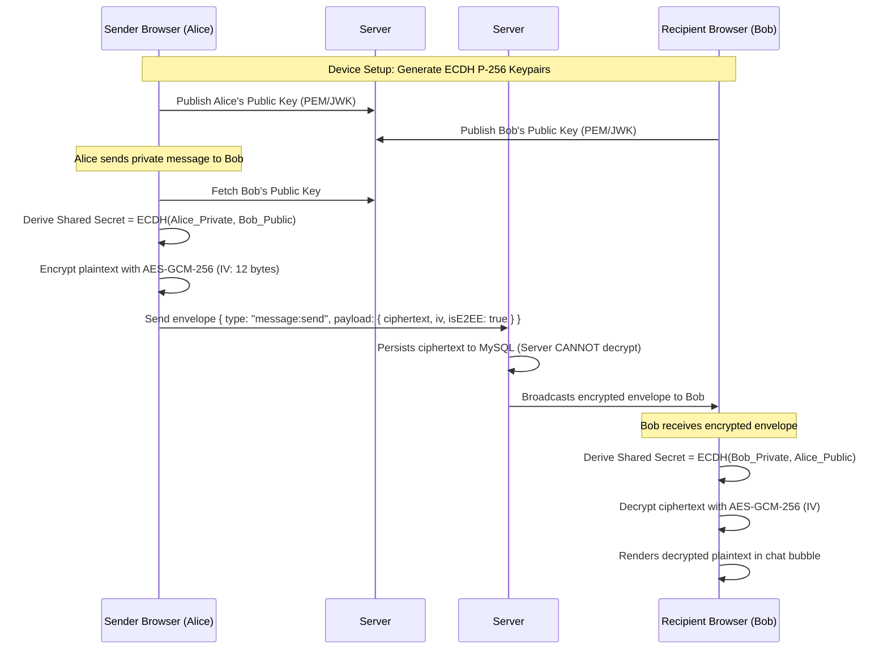

# Phase 15: Enterprise Security, 2FA (TOTP) & End-to-End Encryption (E2EE)

## 1. Phase Overview & Objectives
**Target Workspace**: `web/` (Server #1) & `socket-server/` (Server #2)  
**Primary Goal**: Elevate the platform to enterprise security standards at **$0.00 additional monthly cost**. Implement Time-Based One-Time Password Two-Factor Authentication (2FA / TOTP) via authenticator apps with backup recovery codes, device session tracking with remote revocation, and client-side End-to-End Encryption (E2EE) for 1-on-1 private messaging using the browser's native Web Cryptography API (SubtleCrypto ECDH + AES-GCM-256).

---

## 2. Context & Prerequisites
- **Previous Phase**: [`14_AUTOMATED_CICD_DEPLOYMENT_AND_MONITORING.md`](14_AUTOMATED_CICD_DEPLOYMENT_AND_MONITORING.md) (Core production deployment and monitoring operational).
- **Environment**: Next.js 15, Fastify + Native `ws`, Web Cryptography API (`window.crypto.subtle`), `otplib`, `qrcode`.
- **Zero Cost Rule**: All 2FA runs via standard open RFC 6238 TOTP (Google/Microsoft Authenticator) with zero paid SMS gateways. E2EE uses browser native cryptography with zero external encryption APIs.

---

## 3. Architectural Structure & Target Files

```text
WebChat/
├── web/
│   ├── src/
│   │   ├── app/
│   │   │   ├── (auth)/
│   │   │   │   └── 2fa/
│   │   │   │       └── page.tsx             # 2FA challenge page during login
│   │   │   └── api/
│   │   │       ├── auth/
│   │   │       │   ├── 2fa/
│   │   │       │   │   ├── setup/route.ts   # POST /api/auth/2fa/setup (generate QR & secret)
│   │   │       │   │   ├── verify/route.ts  # POST /api/auth/2fa/verify (confirm & activate)
│   │   │       │   │   └── challenge/route.ts # POST /api/auth/2fa/challenge (verify during login)
│   │   │       │   └── sessions/
│   │   │       │       ├── route.ts         # GET /api/auth/sessions & DELETE /api/auth/sessions (revoke)
│   │   │       │       └── [id]/route.ts    # DELETE specific session
│   │   │       └── users/
│   │   │           └── keys/
│   │   │               └── route.ts         # GET/POST public encryption keys
│   │   ├── components/
│   │   │   ├── security/
│   │   │   │   ├── TwoFactorSettings.tsx    # Enable/Disable 2FA with QR code & backup codes
│   │   │   │   ├── ActiveSessionsModal.tsx  # View active devices with IP, OS, and Revoke buttons
│   │   │   │   └── SecurityFingerprint.tsx  # E2EE Safety Number verification modal
│   │   │   └── chat/
│   │   │       └── E2EEBadge.tsx            # Green padlock badge: "End-to-End Encrypted"
│   │   └── lib/
│   │       ├── crypto/
│   │       │   ├── keyManagement.ts         # ECDH keypair generation & IndexedDB private key store
│   │       │   ├── e2ee.ts                  # AES-GCM-256 encrypt & decrypt wrappers
│   │       │   └── fingerprint.ts           # Safety number generation (SHA-256 hash formatted)
│   │       └── totp.ts                      # otplib TOTP generator & validator
├── socket-server/
│   └── src/
│       └── middleware/
│           └── rateLimiter.ts               # Fastify IP and user rate-limiter
└── shared/
    └── src/
        └── types.ts                         # Session, 2FA, and KeyExchange interfaces
```

---

## 4. End-to-End Encryption (E2EE) Cryptographic Architecture



---

## 5. Prisma Schema Additions (`web/prisma/schema.prisma`)

```prisma
model UserSecurity {
  id               String    @id @default(uuid())
  userId           String    @unique
  twoFactorEnabled Boolean   @default(false)
  twoFactorSecret  String?   @db.VarChar(255) // Encrypted base32 TOTP secret
  recoveryCodes    String?   @db.Text         // JSON array of bcrypt-hashed recovery codes
  publicKey        String?   @db.Text         // ECDH P-256 Public Key (JWK or PEM)
  createdAt        DateTime  @default(now())
  updatedAt        DateTime  @updatedAt

  user User @relation(fields: [userId], references: [id], onDelete: Cascade)
  @@map("user_security")
}

model UserSession {
  id           String    @id @default(uuid())
  userId       String
  tokenHash    String    @unique @db.VarChar(255)
  deviceName   String    @db.VarChar(100) // e.g. "Chrome 128 on Windows 11"
  ipAddress    String    @db.VarChar(45)
  userAgent    String    @db.Text
  isCurrent    Boolean   @default(false)
  lastActiveAt DateTime  @default(now())
  createdAt    DateTime  @default(now())

  user User @relation(fields: [userId], references: [id], onDelete: Cascade)
  @@index([userId, lastActiveAt(sort: Desc)], map: "idx_sessions_user_active")
  @@map("user_sessions")
}
```

---

## 6. Detailed Step-by-Step Implementation Tasks

- [ ] **1. Two-Factor Authentication (TOTP Engine)**:
  - Implement `web/src/lib/totp.ts`:
    - `generateSecret()`: Returns base32 secret and `otpauth://` URI.
    - `generateQRCode(otpauthUrl)`: Uses `qrcode` to generate data URL.
    - `verifyTOTP(token, secret)`: Validates 6-digit code with window tolerance.
    - `generateRecoveryCodes()`: Generates 10 8-character random alphanumeric codes and hashes them with bcrypt.
  - Setup endpoints:
    - `POST /api/auth/2fa/setup`: Generates secret and QR code.
    - `POST /api/auth/2fa/verify`: Validates first token and stores active status in `UserSecurity`.
    - `POST /api/auth/2fa/challenge`: During login, if `twoFactorEnabled = true`, requires TOTP token or recovery code before issuing the session JWT.
- [ ] **2. Device Session Management & Remote Revocation**:
  - Middleware & Login: Extract `userAgent` and `ipAddress`, generate a unique `sessionId`, hash it, and record in `UserSession`.
  - UI Component `ActiveSessionsModal.tsx`:
    - Displays list of active devices (Desktop, Mobile, Tablet) with icons, last active relative time, and IP.
    - Highlights current device badge.
    - "Revoke" button on specific sessions and "Log Out of All Other Devices" button.
- [ ] **3. Web Cryptography API E2EE Engine (`web/src/lib/crypto/`)**:
  - `keyManagement.ts`:
    - Check browser IndexedDB (`idb`) for local device ECDH keypair.
    - If absent: Generate `{ name: 'ECDH', namedCurve: 'P-256' }` keypair using `window.crypto.subtle.generateKey`.
    - Export public key as JWK and upload to `POST /api/users/keys`.
    - Store private key securely in device IndexedDB (non-extractable).
  - `e2ee.ts`:
    - `deriveSharedKey(peerPublicKey, myPrivateKey)`: Runs `subtle.deriveKey` producing AES-GCM-256 key.
    - `encryptMessage(text, sharedKey)`: Generates 12-byte random IV (`crypto.getRandomValues`), encrypts text, returns `{ ciphertext: base64, iv: base64 }`.
    - `decryptMessage(ciphertext, iv, sharedKey)`: Decrypts AES-GCM data back to UTF-8 plaintext.
- [ ] **4. E2EE Safety Number Verification (`SecurityFingerprint.tsx`)**:
  - Computes a deterministic 60-digit safety fingerprint (displayed as 12 blocks of 5 digits) by hashing the sorted public keys of User A and User B with SHA-256.
  - WhatsApp-style verification popup: Compare safety numbers or scan QR code in person to verify no man-in-the-middle.
- [ ] **5. In-Chat E2EE Presentation**:
  - Yellow system badge at top of new 1-on-1 chats: *"🔒 Messages and calls are end-to-end encrypted. No one outside of this chat, not even WebChat, can read or listen to them. Click to verify."*
  - Message bubble displays green padlock icon indicating encrypted transport and verified decryption.

---

## 7. Quality Gate & Verification Criteria

Before marking Phase 15 complete, verify:
1. Enabling 2FA in settings displays a valid QR code that can be scanned by Google/Microsoft Authenticator.
2. Logging in with 2FA enabled rejects invalid codes and grants access only on a valid 6-digit TOTP code or backup code.
3. Active Sessions list shows the current browser; clicking "Revoke" on another session terminates its connection immediately.
4. Sending a 1-on-1 message writes **only encrypted ciphertext** to the MySQL `messages` table (verifiable via Prisma Studio: plaintext is never stored).
5. Both sender and recipient can read the decrypted message, while inspecting network requests confirms encrypted transport.

---

## 8. Handoff to Phase 16
Phase 16 will implement Enterprise Channels, Interactive Multi-Choice Polls, Pinned Messages, and Starred / Bookmarked Messages.
