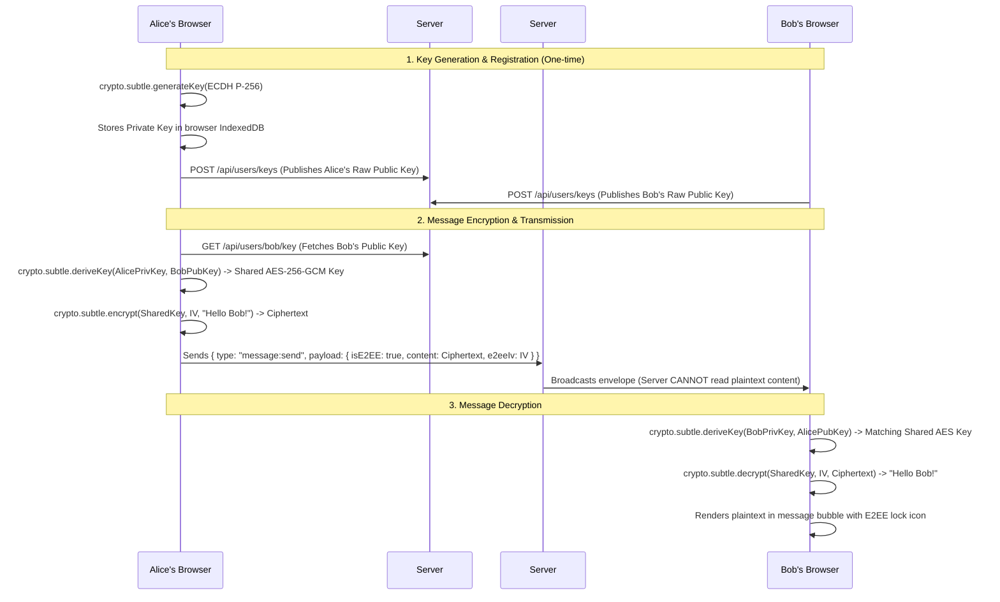

# Phase 16: Client-Side End-to-End Encryption (E2EE)

## 1. Phase Overview & Objectives
**Target Workspace**: `web/` (Server #1) & `socket-server/` (Server #2)  
**Primary Goal**: Implement true client-side End-to-End Encryption (E2EE) for 1-on-1 private messaging using the browser's native **Web Cryptography API (`window.crypto.subtle`)** at **$0.00 additional monthly cost**. Private keys never leave the client's browser, and public keys are exchanged via Server #1. Messages are encrypted with AES-GCM-256 before transmission over WebSockets and decrypted only on recipient devices.

> [!IMPORTANT]
> **Authentication Guardrail**: Strictly **NO OTP**, **NO SMS**, and **NO phone verification**. Key exchange and verification rely entirely on public-key cryptography and in-app Safety Numbers.

---

## 2. Context & Prerequisites
- **Previous Phase**: [`15_DEVICE_SESSIONS_AND_MULTI_DEVICE_SECURITY.md`](15_DEVICE_SESSIONS_AND_MULTI_DEVICE_SECURITY.md) (Device session tracking and secure JWT tokens operational).
- **Environment**: Next.js 15, Web Cryptography API (`SubtleCrypto` ECDH + AES-GCM), Browser IndexedDB (`idb`).
- **Cost Constraint**: Utilizes native browser cryptography standards. Zero paid KMS or external encryption APIs.

---

## 3. Architectural Structure & Target Files

```text
WebChat/
├── web/
│   ├── src/
│   │   ├── app/api/
│   │   │   └── users/
│   │   │       ├── keys/
│   │   │       │   └── route.ts             # POST /api/users/keys (publish user's public key)
│   │   │       └── [id]/
│   │   │           └── key/
│   │   │               └── route.ts         # GET /api/users/:id/key (fetch recipient's public key)
│   │   ├── components/
│   │   │   ├── chat/
│   │   │   │   ├── E2EEHeaderBadge.tsx      # Green lock icon: "Messages are end-to-end encrypted"
│   │   │   │   └── E2EEBubbleIndicator.tsx  # Small lock symbol next to delivered ticks
│   │   │   └── security/
│   │   │       ├── SafetyNumberModal.tsx    # 60-digit safety number comparison modal
│   │   │       └── KeyGenerationModal.tsx   # "Generating your encryption keys..." initial setup banner
│   │   └── lib/
│   │       └── crypto/
│   │           ├── keyStore.ts              # IndexedDB secure storage for ECDH private key
│   │           ├── keyExchange.ts           # ECDH P-256 keypair generation & derivation of shared AES key
│   │           ├── e2eeCipher.ts            # AES-GCM-256 encrypt & decrypt with 96-bit IV
│   │           └── safetyNumber.ts          # SHA-256 fingerprint formatted into 12 groups of 5 digits
├── socket-server/
│   └── src/
│       └── handlers/
│           └── messageHandler.ts            # Passes encrypted ciphertext and IV transparently
└── shared/
    └── src/
        └── types.ts                         # E2EEKeyExchange, EncryptedPayload interfaces
```

---

## 4. End-to-End Encryption Cryptographic Flow



---

## 5. Database Schema & Prisma Migrations (`web/prisma/schema.prisma`)

```prisma
// Extension to User model:
// model User {
//   ...
//   publicKey  UserPublicKey?
// }

model UserPublicKey {
  id        String   @id @default(uuid())
  userId    String   @unique(map: "idx_user_public_key")
  publicKey String   @db.Text // Base64 encoded exported SPKI public key
  algorithm String   @default("ECDH-P256") @db.VarChar(50)
  createdAt DateTime @default(now())
  updatedAt DateTime @updatedAt

  user User @relation(fields: [userId], references: [id], onDelete: Cascade)

  @@map("user_public_keys")
}

// Extension to Message model:
// model Message {
//   ...
//   isE2EE    Boolean  @default(false)
//   e2eeIv    String?  @db.VarChar(50) // Base64 encoded 12-byte IV for AES-GCM
// }
```

---

## 6. Step-by-Step Implementation Tasks

- [ ] **1. Cryptographic Key Management (`keyStore.ts` & `keyExchange.ts`)**:
  - Implement `initializeUserKeys()`:
    - Check if private key exists in IndexedDB (`dbName: "webchat_crypto"`, store: `"keys"`).
    - If missing:
      - Call `window.crypto.subtle.generateKey({ name: "ECDH", namedCurve: "P-256" }, false, ["deriveKey", "deriveBits"])`.
      - Store non-extractable CryptoKey private key in IndexedDB.
      - Export public key to SPKI Base64 string via `crypto.subtle.exportKey("spki", keyPair.publicKey)`.
      - Upload public key: `POST /api/users/keys`.
- [ ] **2. Public Key Registry APIs (`/api/users/keys`)**:
  - `POST /api/users/keys`:
    - Authenticate user via JWT session cookie.
    - Upsert `UserPublicKey` record in MySQL.
  - `GET /api/users/[id]/key`:
    - Return target user's Base64 public key.
    - Cache in-memory on client to prevent repeated REST lookups during active chats.
- [ ] **3. AES-GCM-256 Encryption & Decryption (`e2eeCipher.ts`)**:
  - `deriveSharedKey(recipientPublicKeySPKI: string)`:
    - Import recipient public key via `crypto.subtle.importKey("spki", ...)`.
    - Derive AES-GCM 256-bit key via `crypto.subtle.deriveKey`.
    - Cache derived CryptoKey in in-memory session map.
  - `encryptMessage(plaintext: string, sharedKey: CryptoKey)`:
    - Generate cryptographically random 12-byte (96-bit) IV via `window.crypto.getRandomValues(new Uint8Array(12))`.
    - Encode plaintext via `TextEncoder()`.
    - Encrypt via `crypto.subtle.encrypt({ name: "AES-GCM", iv }, sharedKey, encoded)`.
    - Return `{ ciphertextBase64, ivBase64 }`.
  - `decryptMessage(ciphertextBase64: string, ivBase64: string, sharedKey: CryptoKey)`:
    - Decrypt via `crypto.subtle.decrypt`.
    - Decode via `TextDecoder()`.
- [ ] **4. Safety Number Calculation (`safetyNumber.ts`)**:
  - Generate a 60-digit fingerprint to verify encryption authenticity:
    - Sort Alice's and Bob's public keys lexicographically.
    - Compute SHA-256 hash of concatenated public keys.
    - Convert hash to big integer and format into 12 blocks of 5 decimal digits (e.g. `34892 01842 98402 ...`).
- [ ] **5. Safety Number Comparison Modal (`SafetyNumberModal.tsx`)**:
  - Accessed via chat contact options -> "Verify security code".
  - Displays formatted 60-digit safety number.
  - Generates visual matrix QR code for in-person device scanning (using lightweight SVG canvas).
  - Explanatory banner: *"Compare this number with your contact's device to confirm that messages and calls are end-to-end encrypted."*
- [ ] **6. UI Indicators (`E2EEHeaderBadge.tsx`)**:
  - Top system banner in 1-on-1 chats:
    - Yellow/Grey WhatsApp-style banner: *"Messages and calls are end-to-end encrypted. No one outside of this chat, not even WebChat, can read or listen to them."*
  - Message bubble padlock icon next to timestamps for encrypted messages.

---

## 7. Quality Gate & Verification Criteria

1. On first login, client automatically generates an ECDH keypair and uploads public key to Server #1.
2. In a 1-on-1 chat between Alice and Bob, messages sent from Alice are encrypted before leaving Alice's browser.
3. In MySQL database records, `messages.content` contains Base64 ciphertext, and `isE2EE` is `true`. Plaintext is never stored in the database.
4. Bob receives the ciphertext over WebSocket, decrypts it locally, and sees the readable plaintext.
5. Opening "Verify security code" on Alice's device shows the exact same 60-digit safety number as Bob's device.
6. **Strict Verification**: No OTP, SMS, or verification codes are used anywhere.

---

## 8. Autonomous Multi-Agent Handoff Instructions
The next phase is [`17_BROADCAST_ANNOUNCEMENT_CHANNELS.md`](17_BROADCAST_ANNOUNCEMENT_CHANNELS.md). That agent will implement one-to-many broadcast announcement channels with granular publisher permissions.