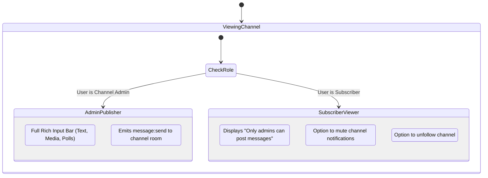

# Phase 17: Broadcast Announcement Channels & Permissions

## 1. Phase Overview & Objectives
**Target Workspace**: `web/` (Server #1) & `socket-server/` (Server #2)  
**Primary Goal**: Implement WhatsApp-style Broadcast Announcement Channels at **$0.00 additional monthly cost**. Channels allow organization leaders, community creators, and administrators to broadcast updates, news, and rich media to unlimited subscribers. Subscribers have a clean, read-only experience (no spam or typing indicators), while admins have full broadcasting and analytics privileges.

> [!IMPORTANT]
> **Authentication Guardrail**: Strictly **NO OTP**, **NO SMS**, and **NO phone verification**. Channel creation and subscription are instant based on `@username` identity.

---

## 2. Context & Prerequisites
- **Previous Phase**: [`16_CLIENT_SIDE_END_TO_END_ENCRYPTION_E2EE.md`](16_CLIENT_SIDE_END_TO_END_ENCRYPTION_E2EE.md) (Private messaging & encryption architecture operational).
- **Environment**: Next.js 15, Fastify 4+ & Native `ws` `RoomManager`, Hostinger MySQL via Prisma (`connection_limit=10`).
- **Performance Rule**: Channel broadcasting must not trigger individual delivery ticks or typing events to subscribers, preserving server memory within Hostinger CloudLinux limits.

---

## 3. Architectural Structure & Target Files

```text
WebChat/
├── web/
│   ├── src/
│   │   ├── app/
│   │   │   ├── api/
│   │   │   │   └── channels/
│   │   │   │       ├── route.ts             # GET (list/explore) & POST (create channel)
│   │   │   │       ├── [id]/
│   │   │   │       │   ├── route.ts         # GET channel details & PATCH channel settings
│   │   │   │       │   └── subscribe/
│   │   │   │       │       └── route.ts     # POST (subscribe) & DELETE (unsubscribe)
│   │   │   │       └── slug/[slug]/
│   │   │   │           └── route.ts         # GET /api/channels/slug/:slug (public lookup)
│   │   │   └── channel/
│   │   │       └── [slug]/page.tsx          # Public channel preview & invite landing page
│   │   ├── components/
│   │   │   ├── channels/
│   │   │   │   ├── ChannelsSidebarTab.tsx   # Sidebar tab switcher (Chats vs Channels)
│   │   │   │   ├── ChannelListItem.tsx      # Channel card with avatar, name, subscriber count, badge
│   │   │   │   ├── CreateChannelModal.tsx   # Modal to create channel with name, description, avatar, slug
│   │   │   │   ├── ChannelInfoDrawer.tsx    # Channel profile drawer with subscriber count & admin list
│   │   │   │   └── ChannelReadOnlyBar.tsx   # Bottom bar for subscribers: "Only admins can post messages"
│   │   │   └── chat/
│   │   │       └── ChatInput.tsx            # Conditionally rendered based on channel admin role
│   │   └── lib/
│   │       └── channelUtils.ts              # Slug sanitization & subscriber counting
├── socket-server/
│   └── src/
│       └── handlers/
│           └── channelHandler.ts            # High-throughput broadcast handler for channel rooms
└── shared/
    └── src/
        └── types.ts                         # ChannelMetadata, ChannelSubscription interfaces
```

---

## 4. Channel Architecture & Permission Flow



---

## 5. Database Schema & Prisma Migrations (`web/prisma/schema.prisma`)

```prisma
// Extension to Chat model:
// model Chat {
//   ...
//   isChannel       Boolean          @default(false)
//   channelMetadata ChannelMetadata?
// }

model ChannelMetadata {
  id              String   @id @default(uuid())
  chatId          String   @unique(map: "idx_channel_chat_id")
  isBroadcastOnly Boolean  @default(true)
  subscriberCount Int      @default(0)
  publicSlug      String?  @unique(map: "idx_channel_slug") @db.VarChar(50)
  description     String?  @db.VarChar(500)
  isVerified      Boolean  @default(false)
  createdAt       DateTime @default(now())
  updatedAt       DateTime @updatedAt

  chat Chat @relation(fields: [chatId], references: [id], onDelete: Cascade)

  @@map("channel_metadata")
}
```

---

## 6. Step-by-Step Implementation Tasks

- [ ] **1. Channels Data Model & API Routes (`/api/channels`)**:
  - `POST /api/channels`:
    - Authenticate user.
    - Validate inputs: `name` (max 50 chars), `description` (max 500 chars), optional `publicSlug` (alphanumeric kebab-case).
    - Create `Chat` with `isGroup: true`, `isChannel: true`, and `groupAdminId: user.id`.
    - Create associated `ChannelMetadata` with `subscriberCount: 1`.
    - Add user as `ChatParticipant` with `role: "admin"`.
  - `GET /api/channels`:
    - Fetch list of channels user is subscribed to, plus top 10 recommended public channels.
  - `POST /api/channels/:id/subscribe`:
    - Add user to `chat_participants` with `role: "subscriber"`.
    - Increment `subscriberCount` atomically via Prisma `increment: 1`.
  - `DELETE /api/channels/:id/subscribe`:
    - Remove user from `chat_participants`.
    - Decrement `subscriberCount` atomically.
- [ ] **2. Channels Sidebar Navigation (`ChannelsSidebarTab.tsx`)**:
  - Add WhatsApp-style top navigation tabs in the left sidebar:
    - **Chats icon**: 1-on-1 and Group chats.
    - **Channels icon** (Bullhorn / megaphone icon): Channel directory and subscribed channels.
  - Channels directory list:
    - Search bar to find channels by name or `@slug`.
    - "Create Channel" button (green plus icon).
    - Channel row showing channel avatar, verified checkmark badge, title, last broadcast preview, and subscriber count (e.g. *"14.2K followers"*).
- [ ] **3. Channel Message Composer & Read-Only Guard (`ChannelReadOnlyBar.tsx`)**:
  - In `ChatArea.tsx`, inspect `chat.isChannel`:
    - If user is channel admin:
      - Render full `<ChatInput />` allowing broadcasts with text, attachments, and polls.
    - If user is regular subscriber:
      - Replace input area with `<ChannelReadOnlyBar />`:
        - Background: `#202c33`.
        - Centered text with padlock icon: *"Only channel admins can post updates."*
- [ ] **4. Channel Profile & Settings Drawer (`ChannelInfoDrawer.tsx`)**:
  - Header with large channel avatar, title, and verified badge.
  - Description card.
  - Subscriber count and creation date.
  - Channel Invite Link: `https://chat.yourdomain.com/channel/[slug]` with one-click "Copy Link" and "Forward Channel" buttons.
  - "Mute notifications" toggle switch.
  - "Unfollow / Leave Channel" confirmation dialog.
- [ ] **5. Fastify WebSocket Channel Room Broadcasting**:
  - When a message is sent to a channel room (`room: channel:${chatId}`):
    - Do NOT emit status ticks (`message:status`) back to the sender for every subscriber (prevents connection starvation).
    - Server #2 broadcasts the single `message:new` envelope to the channel room.

---

## 7. Quality Gate & Verification Criteria

1. Channel creator can create a channel with title, description, and custom public slug.
2. Channel creator can post text and images into the channel.
3. Another user can browse to the channel and click "Follow / Subscribe".
4. The subscriber receives channel broadcasts in real-time.
5. The subscriber's UI renders the read-only bar and does not show message typing or send input.
6. Unsubscribing removes the channel from the user's active list and decrements the follower count.

---

## 8. Autonomous Multi-Agent Handoff Instructions
The next phase is [`18_INTERACTIVE_REALTIME_POLLS.md`](18_INTERACTIVE_REALTIME_POLLS.md). That agent will build interactive multi-choice polls with live voting tallies in both group chats and channels.