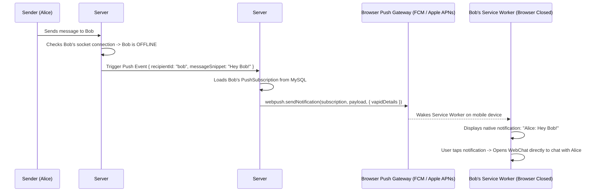

# Phase 18: Background Web Push Notifications & Local-First Offline Sync

## 1. Phase Overview & Objectives
**Target Workspace**: `web/` (Server #1) & `socket-server/` (Server #2)  
**Primary Goal**: Achieve native mobile-app reliability even when the browser is completely closed or when the network drops. Implement background Web Push Notifications using the open W3C Web Push Protocol (VAPID) at **$0.00 extra cost**, and build a resilient Local-First Offline Synchronization engine powered by browser IndexedDB (`idb`) that queues messages offline and flushes them upon reconnection with zero data loss.

---

## 2. Context & Prerequisites
- **Previous Phase**: [`17_DOCUMENT_SHARING_CODE_BLOCKS_AND_EPHEMERAL.md`](17_DOCUMENT_SHARING_CODE_BLOCKS_AND_EPHEMERAL.md) (Documents, code blocks, and ephemeral messages complete).
- **Environment**: Next.js 15, Service Worker API, Push API, `web-push` npm package, IndexedDB (`idb`).
- **Cost Rule**: Web Push uses free browser push services (Google FCM, Apple WebPush, Mozilla Autopush) using free VAPID keys. Zero third-party paid notification services (No OneSignal, No Pusher, No Firebase paid tier).

---

## 3. Architectural Structure & Target Files

```text
WebChat/
├── web/
│   ├── public/
│   │   └── sw.js                    # Service worker with 'push' and 'notificationclick' handlers
│   ├── src/
│   │   ├── app/api/
│   │   │   └── push/
│   │   │       ├── subscribe/route.ts # POST /api/push/subscribe (store VAPID endpoint & keys)
│   │   │       └── unsubscribe/route.ts # POST /api/push/unsubscribe
│   │   ├── components/
│   │   │   └── notifications/
│   │   │       ├── NotificationPermissionPrompt.tsx # WhatsApp prompt: "Enable desktop & mobile notifications"
│   │   │       └── OfflineSyncBadge.tsx     # Yellow pill: "Working offline. 3 messages queued."
│   │   ├── hooks/
│   │   │   ├── useWebPush.ts        # VAPID subscription lifecycle
│   │   │   └── useOfflineSync.ts    # Online/offline detector and queue sync manager
│   │   └── lib/
│   │       ├── db/
│   │       │   └── indexedDb.ts     # idb wrapper: stores messages, chats, and pending queue
│   │       ├── pushServer.ts        # web-push sender utility (VAPID)
│   │       └── syncManager.ts       # FIFO offline queue reconciler
├── socket-server/
│   └── src/
│       └── handlers/
│           └── offlineNotificationDispatcher.ts # Sends web-push if recipient socket is offline
└── shared/
    └── src/
        └── types.ts                 # PushSubscription and QueuedMessage interfaces
```

---

## 4. Web Push Notification Architecture (VAPID)



---

## 5. Prisma Schema Additions (`web/prisma/schema.prisma`)

```prisma
model UserPushSubscription {
  id        String   @id @default(uuid())
  userId    String
  endpoint  String   @unique(map: "idx_push_endpoint") @db.VarChar(500)
  p256dh    String   @db.VarChar(255) // Public key
  auth      String   @db.VarChar(255) // Auth secret
  userAgent String?  @db.VarChar(255)
  createdAt DateTime @default(now())

  user User @relation(fields: [userId], references: [id], onDelete: Cascade)
  @@index([userId], map: "idx_push_user")
  @@map("user_push_subscriptions")
}
```

---

## 6. Detailed Step-by-Step Implementation Tasks

- [ ] **1. VAPID Keys & Push Server Utility (`pushServer.ts`)**:
  - Generate VAPID keypair:
    ```bash
    npx web-push generate-vapid-keys
    ```
  - Configure `web/.env`:
    ```env
    NEXT_PUBLIC_VAPID_PUBLIC_KEY="BK...your_public_key"
    VAPID_PRIVATE_KEY="your_private_key"
    VAPID_SUBJECT="mailto:admin@yourdomain.com"
    ```
  - Implement `sendPushNotification(subscription, { title, body, icon, url, data })` using `web-push`.
- [ ] **2. Service Worker Push Handlers (`web/public/sw.js`)**:
  - Listen for `'push'` event:
    - Parse JSON payload.
    - Call `self.registration.showNotification(payload.title, { body, icon: '/icons/icon-192x192.png', badge: '/icons/badge.png', data: { url: payload.url }, vibrate: [200, 100, 200] })`.
  - Listen for `'notificationclick'` event:
    - Focus existing WebChat browser tab or open new tab to `payload.url`.
- [ ] **3. In-App Notification Permission Banner (`NotificationPermissionPrompt.tsx`)**:
  - Unobtrusive banner: *"Turn on notifications to never miss incoming messages and calls on this device."*
  - Button **"Allow Notifications"**:
    - Calls `Notification.requestPermission()`.
    - If granted: Calls `registration.pushManager.subscribe()`.
    - Posts subscription object to `POST /api/push/subscribe`.
- [ ] **4. Local-First IndexedDB Engine (`web/src/lib/db/indexedDb.ts`)**:
  - Create IndexedDB database `webchat_db` with object stores:
    - `messages`: Cached messages indexed by `chatId` and `createdAt`.
    - `chats`: Cached conversation list.
    - `pending_queue`: Messages written while offline (`{ tempId, chatId, content, messageType, queuedAt }`).
- [ ] **5. Offline Queue & Reconciliation Manager (`syncManager.ts`)**:
  - When browser is offline (`!navigator.onLine` or WebSocket disconnected):
    - User clicks Send ➔ Message renders immediately with an orange clock icon (`status: 'queued'`).
    - Persists message to `pending_queue` in IndexedDB.
  - When connection is restored (`window.addEventListener('online')` or WebSocket reconnects):
    - `syncManager.flush()` reads all queued messages in FIFO order.
    - Sends each envelope over WebSocket.
    - Upon server confirmation: moves message from `pending_queue` to `messages` and updates status to single grey tick `✓`.

---

## 7. Quality Gate & Verification Criteria

Before marking Phase 18 complete, verify:
1. Granting notification permission stores a valid `UserPushSubscription` in MySQL.
2. Closing the WebChat browser tab completely and sending a message from another device triggers an OS native system push notification.
3. Clicking the native notification opens the browser and focuses the relevant chat.
4. Setting browser to "Offline" in Chrome DevTools:
   - User can type and send 3 messages; they appear with an orange queued clock icon without error.
   - Restoring network automatically sends all 3 queued messages in order and updates ticks to single/double checkmarks.

---

## 8. Handoff to Phase 19
Phase 19 will implement Enterprise Automations: Inbound/Outbound Webhooks, Automated System Bots, and Custom Slash Commands (`/poll`, `/remind`, `/announce`).
