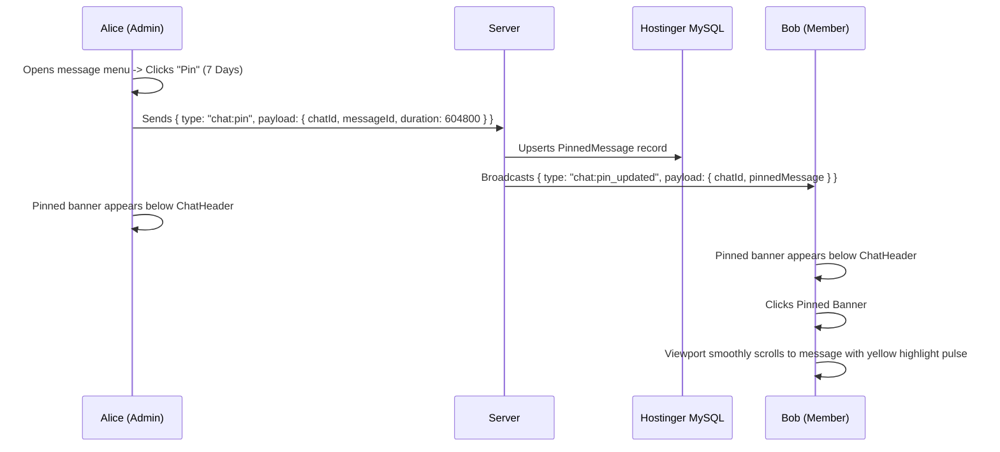

# Phase 19: Pinned Messages Strip & Starred Message Bookmarks

## 1. Phase Overview & Objectives
**Target Workspace**: `web/` (Server #1) & `socket-server/` (Server #2)  
**Primary Goal**: Implement WhatsApp Web Pinned Messages and Starred Messages at **$0.00 additional monthly cost**. Users can pin important messages to the top of any chat for quick reference by all members, and star personal bookmarks across any conversation with a searchable global "Starred Messages" drawer.

> [!IMPORTANT]
> **Zero Friction & Verification Guardrail**: Strictly **NO OTP**, **NO SMS**, and **NO phone verification**. Pinning and bookmarking are immediate user actions.

---

## 2. Context & Prerequisites
- **Previous Phase**: [`18_INTERACTIVE_REALTIME_POLLS.md`](18_INTERACTIVE_REALTIME_POLLS.md) (Interactive messaging and polling operational).
- **Environment**: Next.js 15, Fastify 4+ & Native `ws` `RoomManager`, Prisma ORM with MySQL (`connection_limit=10`).
- **Interaction Standard**: Smooth-scroll viewport jump with a CSS highlight pulse when clicking a pinned or starred item.

---

## 3. Architectural Structure & Target Files

```text
WebChat/
├── web/
│   ├── src/
│   │   ├── app/api/
│   │   │   ├── chats/
│   │   │   │   └── [id]/
│   │   │   │       └── pin/
│   │   │   │           └── route.ts         # POST /api/chats/:id/pin (pin) & DELETE /api/chats/:id/pin (unpin)
│   │   │   └── messages/
│   │   │       ├── [id]/
│   │   │       │   └── star/
│   │   │       │       └── route.ts         # POST /api/messages/:id/star & DELETE /api/messages/:id/star
│   │   │       └── starred/
│   │   │           └── route.ts             # GET /api/messages/starred (fetch all starred messages for user)
│   │   ├── components/
│   │   │   ├── chat/
│   │   │   │   ├── PinnedMessagesStrip.tsx  # Horizontal banner below ChatHeader showing active pins
│   │   │   │   ├── PinDurationModal.tsx     # Choose pin duration: 24h, 7 Days, 30 Days
│   │   │   │   ├── MessageDropdownMenu.tsx  # Adds "Pin" and "Star message" action buttons
│   │   │   │   └── StarredBadge.tsx         # Subtle star icon rendered on starred message bubbles
│   │   │   └── starred/
│   │   │       ├── StarredMessagesDrawer.tsx# Global drawer with search bar listing all starred messages
│   │   │       └── StarredMessageCard.tsx   # Card with sender, original chat name, date, and unstar button
│   │   └── hooks/
│   │       ├── usePinnedMessages.ts         # Real-time state of pinned items in current chat
│   │       └── useStarredMessages.ts        # Global client store for starred message IDs
├── socket-server/
│   └── src/
│       └── handlers/
│           └── pinHandler.ts                # Broadcasts chat:pin_updated envelopes to room participants
└── shared/
    └── src/
        └── types.ts                         # PinnedMessagePayload, StarredMessagePayload interfaces
```

---

## 4. Pinned & Starred Message Flow



---

## 5. Database Schema & Prisma Migrations (`web/prisma/schema.prisma`)

```prisma
// Extension to Chat model:
// model Chat {
//   ...
//   pinnedMessages PinnedMessage[]
// }

// Extension to Message model:
// model Message {
//   ...
//   pinnedIn  PinnedMessage[]
//   starredBy StarredMessage[]
// }

model PinnedMessage {
  id         String    @id @default(uuid())
  chatId     String
  messageId  String
  pinnedById String
  expiresAt  DateTime? // Optional duration auto-unpin
  pinnedAt   DateTime  @default(now())

  chat     Chat    @relation(fields: [chatId], references: [id], onDelete: Cascade)
  message  Message @relation(fields: [messageId], references: [id], onDelete: Cascade)
  pinnedBy User    @relation(fields: [pinnedById], references: [id], onDelete: Cascade)

  @@unique([chatId, messageId], map: "idx_chat_pinned_unique")
  @@index([chatId, pinnedAt(sort: Desc)], map: "idx_pinned_chat_time")
  @@map("pinned_messages")
}

model StarredMessage {
  id        String   @id @default(uuid())
  userId    String
  messageId String
  starredAt DateTime @default(now())

  user    User    @relation(fields: [userId], references: [id], onDelete: Cascade)
  message Message @relation(fields: [messageId], references: [id], onDelete: Cascade)

  @@unique([userId, messageId], map: "idx_user_starred_unique")
  @@index([userId, starredAt(sort: Desc)], map: "idx_starred_user_time")
  @@map("starred_messages")
}
```

---

## 6. Step-by-Step Implementation Tasks

- [ ] **1. Message Actions Menu Additions (`MessageDropdownMenu.tsx`)**:
  - In the hover action dropdown on any message bubble, add:
    - **"Pin message"** (Thumbtack icon).
    - **"Star message" / "Unstar message"** (Star icon, dynamic label based on whether user already starred it).
- [ ] **2. Pinned Message Duration Selector (`PinDurationModal.tsx`)**:
  - When user clicks "Pin message", show duration picker:
    - **24 Hours**
    - **7 Days** (Default)
    - **30 Days**
  - Sends request to `POST /api/chats/:id/pin` with `{ messageId, durationDays }`.
  - Enforce max 3 pinned messages per chat (if a 4th is pinned, unpin the oldest).
- [ ] **3. Pinned Message Header Banner (`PinnedMessagesStrip.tsx`)**:
  - Rendered directly underneath `<ChatHeader />`.
  - Design:
    - Subtle background (`bg-[#202c33] border-b border-[#222d34]`).
    - Green pin icon on left.
    - Message author and text snippet: *"Alice: Meet at the lobby at 5pm"*.
    - If multiple pinned messages exist: Carousel navigation with count indicator (e.g. `2 of 3`).
    - Right icon: Close/Unpin button (if admin).
  - Clicking the banner:
    - Uses DOM `document.getElementById('msg-${messageId}')?.scrollIntoView({ behavior: 'smooth', block: 'center' })`.
    - Triggers temporary flash animation (`animate-pulse bg-[#00a884]/20`) on the target message bubble for 1.5 seconds.
- [ ] **4. Starred Message Toggle API (`/api/messages/:id/star`)**:
  - `POST /api/messages/:id/star`: Creates `StarredMessage` for current user.
  - `DELETE /api/messages/:id/star`: Deletes `StarredMessage`.
  - Starred state is per-user (private personal bookmarks; other chat members do not see what you star).
  - Message bubble displays subtle gold star icon next to the timestamp if starred by current user.
- [ ] **5. Global "Starred Messages" Drawer (`StarredMessagesDrawer.tsx`)**:
  - Accessed via main left sidebar top menu (`HeaderMenu` -> "Starred messages").
  - Header: Search input allowing instant text filtering of starred bookmarks.
  - List of starred messages:
    - Original chat title (with group icon or user avatar).
    - Message sender display name.
    - Timestamp.
    - Content preview (text snippet, voice note pill, or document preview).
    - Unstar icon button to remove from bookmarks.
  - Clicking a starred card:
    - Switches active chat in sidebar to the message's conversation.
    - Scrolls viewport directly to the message with a highlight pulse.

---

## 7. Quality Gate & Verification Criteria

1. Pinning a message immediately displays the pinned banner for all members of the chat via WebSockets.
2. Multiple pinned messages can be paged through using the carousel arrow.
3. Clicking the pinned strip smoothly scrolls the chat viewport and pulses the target message.
4. Starred messages display a star icon on the user's view only.
5. Opening the "Starred messages" drawer shows all bookmarks across different chats.
6. Searching in the starred drawer filters bookmarks in real-time.

---

## 8. Autonomous Multi-Agent Handoff Instructions
The next phase is [`20_ENTERPRISE_DOCUMENT_SHARING.md`](20_ENTERPRISE_DOCUMENT_SHARING.md). That agent will implement enterprise document attachments (PDF, Excel, Word, Zip files up to 25MB) with an in-app PDF previewer and local NVMe storage.