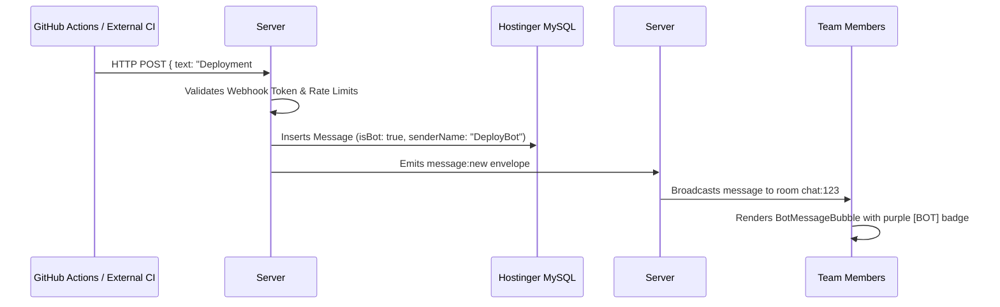

# Phase 19: Enterprise Automations: Inbound/Outbound Webhooks & Bot System

## 1. Phase Overview & Objectives
**Target Workspace**: `web/` (Server #1) & `socket-server/` (Server #2)  
**Primary Goal**: Turn WebChat into an integrated enterprise communication hub at **$0.00 extra cost**. Build Inbound Webhooks allowing external systems (GitHub, Jira, CI/CD pipelines, monitoring alerts) to post messages directly into channels, Outbound Webhooks for event dispatching, and a native Slash Commands engine (`/poll`, `/remind`, `/announce`) with automated bot responses.

---

## 2. Context & Prerequisites
- **Previous Phase**: [`18_BACKGROUND_WEB_PUSH_AND_OFFLINE_SYNC.md`](18_BACKGROUND_WEB_PUSH_AND_OFFLINE_SYNC.md) (Web push notifications and offline sync operational).
- **Environment**: Next.js 15 App Router, Fastify native WebSocket broadcasting, HMAC SHA-256 signature verification.
- **Constraints**:
  - Inbound webhook endpoints must be strictly rate-limited to prevent abuse.
  - Bot messages must be clearly flagged with a distinct visual badge to prevent impersonation.

---

## 3. Architectural Structure & Target Files

```text
WebChat/
├── web/
│   ├── src/
│   │   ├── app/api/
│   │   │   ├── webhooks/
│   │   │   │   ├── [token]/route.ts         # POST /api/webhooks/[token] (inbound webhook receiver)
│   │   │   │   └── manage/route.ts          # GET/POST webhook configurations for chat
│   │   │   └── commands/
│   │   │       └── execute/route.ts         # POST /api/commands/execute (slash command processor)
│   │   ├── components/
│   │   │   ├── webhooks/
│   │   │   │   ├── WebhookManagerDrawer.tsx # Create, copy URL, and test inbound webhooks
│   │   │   │   └── BotMessageBubble.tsx     # Message bubble displaying verified "BOT" badge
│   │   │   └── chat/
│   │   │       └── SlashCommandAutocomplete.tsx # Popover when user types '/' in chat input
│   │   └── lib/
│   │       ├── slashCommands.ts             # Parser and router for /poll, /remind, /announce
│   │       └── webhookSecurity.ts           # Token verification & HMAC signature validator
├── socket-server/
│   └── src/
│       └── jobs/
│           └── reminderCronJob.ts           # Cron checking and delivering scheduled /remind alerts
└── shared/
    └── src/
        └── types.ts                         # InboundWebhookPayload and SlashCommand types
```

---

## 4. Inbound Webhook Execution Flow



---

## 5. Prisma Schema Additions (`web/prisma/schema.prisma`)

```prisma
model Webhook {
  id          String   @id @default(uuid())
  chatId      String
  creatorId   String
  name        String   @db.VarChar(100) // e.g. "GitHub Deployments"
  token       String   @unique @db.VarChar(64)
  secret      String?  @db.VarChar(64)  // Optional HMAC secret for signature verification
  avatarUrl   String?  @db.VarChar(500)
  isActive    Boolean  @default(true)
  createdAt   DateTime @default(now())
  updatedAt   DateTime @updatedAt

  chat    Chat @relation(fields: [chatId], references: [id], onDelete: Cascade)
  creator User @relation(fields: [creatorId], references: [id], onDelete: Cascade)

  @@index([chatId], map: "idx_webhooks_chat")
  @@map("webhooks")
}

model ScheduledReminder {
  id          String    @id @default(uuid())
  userId      String
  chatId      String
  message     String    @db.VarChar(500)
  remindAt    DateTime
  isDelivered Boolean   @default(false)
  createdAt   DateTime  @default(now())

  user User @relation(fields: [userId], references: [id], onDelete: Cascade)
  chat Chat @relation(fields: [chatId], references: [id], onDelete: Cascade)

  @@index([remindAt, isDelivered], map: "idx_reminders_pending")
  @@map("scheduled_reminders")
}
```

---

## 6. Detailed Step-by-Step Implementation Tasks

- [ ] **1. Inbound Webhook Ingestion API (`POST /api/webhooks/[token]`)**:
  - Validates token against active records in `webhooks` table.
  - Rate limiting: max 30 requests per minute per webhook token.
  - Accepts standard JSON payload:
    ```json
    {
      "text": "Build #104 passed on branch main",
      "senderName": "GitHub Actions",
      "avatarUrl": "https://github.githubassets.com/images/modules/logos_page/GitHub-Mark.png"
    }
    ```
  - Inserts message record in MySQL with `messageType: "system_bot"` and `senderId: webhook.creatorId`.
  - Dispatches WebSocket envelope `{ type: 'message:new', payload: message }` to Server #2.
- [ ] **2. Webhook Management Drawer (`WebhookManagerDrawer.tsx`)**:
  - Accessible to Channel/Group Admins under Chat Settings > Integrations > Webhooks.
  - "Create Webhook" button: Enter name, optional avatar URL.
  - Generates unique URL: `https://chat.yourdomain.com/api/webhooks/wh_9f8b2c1...`.
  - One-click "Copy URL" button and "Send Test Message" button.
- [ ] **3. Bot Message Presentation (`BotMessageBubble.tsx`)**:
  - Displays message with:
    - Sender name in bold (e.g. **DeployBot**).
    - Purple rounded tag: **`BOT`** next to the name.
    - Custom bot avatar.
- [ ] **4. Slash Commands Engine (`web/src/lib/slashCommands.ts`)**:
  - When user types `/` in chat input, trigger `<SlashCommandAutocomplete />` showing available commands:
    - `/poll <question> | <opt1> | <opt2>`: Quick poll creator.
    - `/remind <duration> <message>`: Schedule a reminder (e.g. `/remind 30m Submit code review`).
    - `/announce <message>`: Broadcast high-priority announcement (admins only).
    - `/help`: Displays formatted private cheat sheet of commands.
  - Command execution endpoint: `POST /api/commands/execute`.
- [ ] **5. Scheduled Reminder Cron (`reminderCronJob.ts`)**:
  - Fastify background interval running every 60 seconds:
    - Queries `scheduled_reminders` where `remindAt <= NOW()` and `isDelivered = false`.
    - Automatically posts bot reminder into the chat: *"⏰ Reminder for @username: Submit code review"*.
    - Marks `isDelivered = true`.

---

## 7. Quality Gate & Verification Criteria

Before marking Phase 19 complete, verify:
1. Creating an inbound webhook generates a valid endpoint URL.
2. Sending a `curl -X POST -H "Content-Type: application/json" -d '{"text":"Hello from cURL"}' https://chat...` instantly renders the message in the channel with the purple **`BOT`** badge.
3. Typing `/poll "Lunch?" | "Pizza" | "Tacos"` creates the interactive poll in the chat feed.
4. Typing `/remind 1m Check staging server` delivers the reminder message exactly 1 minute later.

---

## 8. Handoff to Phase 20
Phase 20 will implement the final enterprise module: Enterprise Audit Logging, Compliance Data Export, and Legal Hold.
