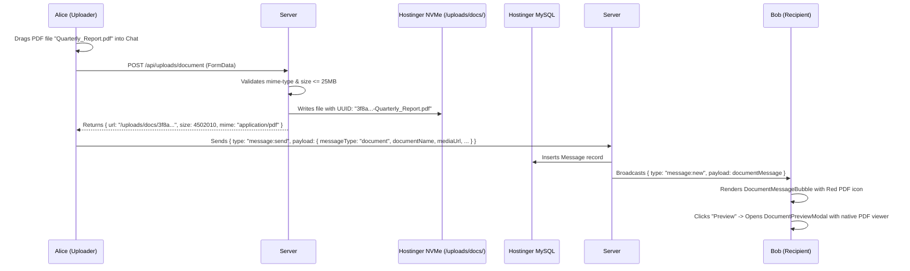

# Phase 20: Document Sharing & File Attachments

## 1. Phase Overview & Objectives
**Target Workspace**: `web/` (Server #1) & `socket-server/` (Server #2)  
**Primary Goal**: Implement document sharing at **$0.00 additional monthly cost**. Users can share PDFs, Excel spreadsheets (`.xlsx`, `.xls`), Word documents (`.docx`, `.doc`), PowerPoint decks (`.pptx`), and Zip archives up to **25MB**. Files are securely stored on Hostinger local NVMe disk (`/public/uploads/docs/`) and served statically. Includes drag-and-drop upload, upload progress, filetype badges, and an in-app PDF preview modal.

> [!IMPORTANT]
> **Authentication Guardrail**: Strictly **NO OTP**, **NO SMS**, and **NO phone verification**. Document sharing permissions are tied directly to active chat membership.

---

## 2. Context & Prerequisites
- **Previous Phase**: [`19_PINNED_AND_STARRED_MESSAGES.md`](19_PINNED_AND_STARRED_MESSAGES.md) (Chat interaction and bookmarking operational).
- **Environment**: Next.js 15, Node.js `fs` / `path` on Hostinger NVMe disk, Fastify + Native `ws`.
- **Cost Constraint**: Zero external cloud storage (No AWS S3, No Google Cloud Storage). Local disk `/public/uploads/docs/` served via Next.js static asset routing.

---

## 3. Architectural Structure & Target Files

```text
WebChat/
├── web/
│   ├── public/
│   │   └── uploads/
│   │       └── docs/                        # Local NVMe document storage directory
│   ├── src/
│   │   ├── app/api/
│   │   │   └── uploads/
│   │   │       └── document/
│   │   │           └── route.ts             # POST /api/uploads/document (multipart form-data, 25MB max)
│   │   ├── components/
│   │   │   ├── chat/
│   │   │   │   ├── AttachmentMenu.tsx       # Adds "Document" (purple document icon)
│   │   │   │   ├── DocumentMessageBubble.tsx# WhatsApp document card with icon, size, download button
│   │   │   │   ├── DocumentPreviewModal.tsx # In-app PDF viewer drawer / modal
│   │   │   │   └── FileUploadProgressBar.tsx# Upload progress bar with cancel button
│   │   │   └── ui/
│   │   │       └── FileTypeIcon.tsx         # Color-coded icon (Red=PDF, Green=XLS, Blue=DOC, Orange=ZIP)
│   │   └── lib/
│   │       └── fileValidation.ts            # Mime-type whitelist & 25MB file size validator
├── socket-server/
│   └── src/
│       └── handlers/
│           └── messageHandler.ts            # Broadcasts document message envelopes
└── shared/
    └── src/
        └── types.ts                         # DocumentMessagePayload interface
```

---

## 4. Document Upload & Preview Flow



---

## 5. Database Schema & Prisma Migrations (`web/prisma/schema.prisma`)

```prisma
// Extension to Message model:
// model Message {
//   ...
//   messageType   String   @default("text") @db.VarChar(20) // "text", "image", "voice", "document"
//   mediaUrl      String?  @db.VarChar(500)
//   documentName  String?  @db.VarChar(255)
//   documentSize  Int?     // Size in bytes
//   documentMime  String?  @db.VarChar(100)
// }
```

---

## 6. Step-by-Step Implementation Tasks

- [ ] **1. Mime-Type Whitelist & Validation (`fileValidation.ts`)**:
  - Allowed document extensions and mime-types:
    - PDF: `application/pdf` (`.pdf`)
    - Excel: `application/vnd.openxmlformats-officedocument.spreadsheetml.sheet` (`.xlsx`), `application/vnd.ms-excel` (`.xls`)
    - Word: `application/vnd.openxmlformats-officedocument.wordprocessingml.document` (`.docx`), `application/msword` (`.doc`)
    - PowerPoint: `application/vnd.openxmlformats-officedocument.presentationml.presentation` (`.pptx`), `application/vnd.ms-powerpoint` (`.ppt`)
    - Zip / Archives: `application/zip`, `application/x-zip-compressed` (`.zip`)
    - Plain Text: `text/plain` (`.txt`, `.csv`)
  - Strict maximum file size: **25 * 1024 * 1024 bytes (25MB)**.
- [ ] **2. Document Upload API Route (`/api/uploads/document`)**:
  - `POST /api/uploads/document`:
    - Authenticate user via JWT session cookie.
    - Parse multipart form-data stream.
    - Validate file extension and mime magic bytes.
    - Sanitize original filename (strip path traversal characters like `..`, `/`, `\`).
    - Generate unique disk path: `web/public/uploads/docs/${crypto.randomUUID()}-${safeName}`.
    - Pipe stream to disk.
    - Return JSON:
      ```json
      {
        "url": "/uploads/docs/948293-report.pdf",
        "name": "report.pdf",
        "size": 2450000,
        "mime": "application/pdf"
      }
      ```
- [ ] **3. Document Attachment Trigger & Drag-and-Drop (`AttachmentMenu.tsx`)**:
  - Add purple document icon (**"Document"**) to attachment menu.
  - Hidden `<input type="file" accept=".pdf,.doc,.docx,.xls,.xlsx,.ppt,.pptx,.zip,.txt,.csv" />`.
  - Add drag-and-drop listener to main chat viewport: Dragging file shows translucent green overlay *"Drop document to share"*.
- [ ] **4. Document Message Bubble (`DocumentMessageBubble.tsx`)**:
  - WhatsApp Web card layout:
    - Card background: `#202c33` with rounded borders.
    - Left: `<FileTypeIcon />` badge:
      - Red badge for PDF.
      - Green badge for Excel (`.xlsx`).
      - Blue badge for Word (`.docx`).
      - Orange/Yellow badge for Zip archives.
    - Center column:
      - Document title: Truncated with ellipsis if over 30 chars.
      - Document metadata: File size in human-readable format (`2.4 MB`) and extension (`PDF`).
    - Right action:
      - Download icon button (triggers direct download).
      - For PDF files: "Eye" preview icon.
- [ ] **5. In-App PDF Previewer Modal (`DocumentPreviewModal.tsx`)**:
  - Clicking on a PDF message opens a full-screen or large modal viewer:
    - Header: Document name, page count (if available), zoom controls, download button, and close `X`.
    - Content: Embedded iframe/object rendering `/uploads/docs/${filename}` using browser's native hardware-accelerated PDF engine.
    - Works seamlessly on both Desktop Chrome and Mobile Chrome.

---

## 7. Quality Gate & Verification Criteria

1. User can attach a 15MB PDF or Excel file using either the attachment menu or drag-and-drop.
2. File is successfully uploaded to `/public/uploads/docs/` and stored with a unique name.
3. Message bubble renders the correct color-coded badge, file name, and human-readable size.
4. Clicking download triggers browser download of the exact file with its original name.
5. Clicking preview on a PDF message displays the document inside `<DocumentPreviewModal />`.
6. Files exceeding 25MB are rejected with an explicit error toast before upload.

---

## 8. Autonomous Multi-Agent Handoff Instructions
The next phase is [`21_MARKDOWN_CODE_BLOCKS_AND_SYNTAX_HIGHLIGHTING.md`](21_MARKDOWN_CODE_BLOCKS_AND_SYNTAX_HIGHLIGHTING.md). That agent will build syntax-highlighted markdown code blocks with one-click copy for technical and engineering collaboration.