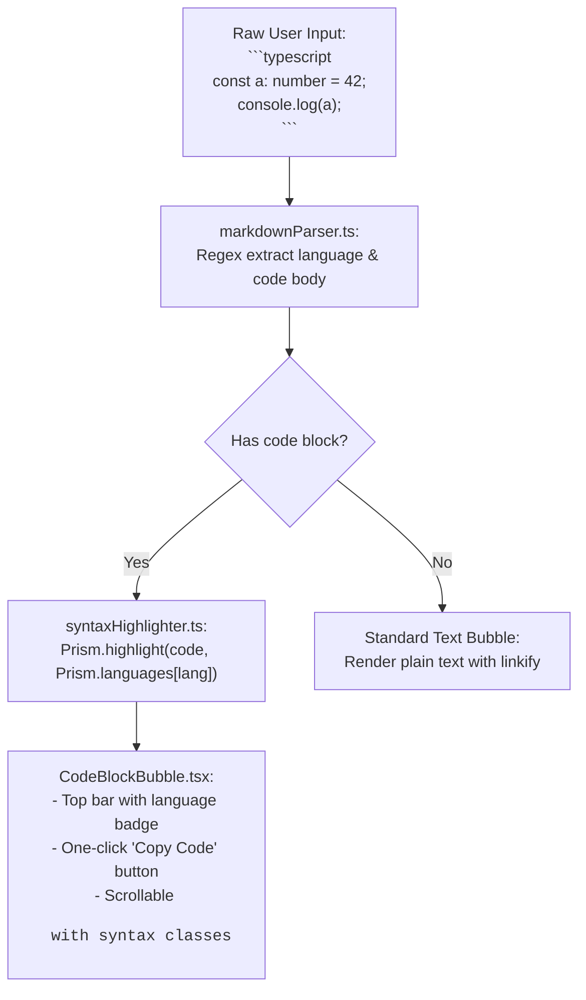

# Phase 21: Markdown Code Blocks & Syntax Highlighting

## 1. Phase Overview & Objectives
**Target Workspace**: `web/` (Server #1)  
**Primary Goal**: Implement syntax-highlighted code blocks for technical teams, developers, and IT collaboration at **$0.00 additional monthly cost**. Users can share code snippets using standard Markdown triple backticks (e.g. ` ```typescript ... ``` `). The chat client automatically parses code blocks, renders line numbers, formats code with Prism.js using WhatsApp dark design tokens, displays a language badge, and provides a one-click "Copy Code" button.

> [!IMPORTANT]
> **Authentication Guardrail**: Strictly **NO OTP**, **NO SMS**, and **NO phone verification**. Markdown code block formatting is a pure client rendering enhancement.

---

## 2. Context & Prerequisites
- **Previous Phase**: [`20_ENTERPRISE_DOCUMENT_SHARING.md`](20_ENTERPRISE_DOCUMENT_SHARING.md) (Document attachments and media rendering operational).
- **Environment**: Next.js 15, `prismjs` (`^1.29.0`) + `@types/prismjs`, Tailwind CSS.
- **Visual Design**: Themed with WhatsApp Web dark mode palette (`#111b21` background, `#202c33` sidebar/bubble, `#00a884` accents).

---

## 3. Architectural Structure & Target Files

```text
WebChat/
├── web/
│   ├── src/
│   │   ├── components/
│   │   │   ├── chat/
│   │   │   │   ├── CodeBlockBubble.tsx      # Formatted code card with header, language badge, copy button
│   │   │   │   ├── MessageTextRenderer.tsx  # Markdown regex parser detecting inline `code` and triple backtick blocks
│   │   │   │   └── CopyCodeButton.tsx       # Interactive clipboard button with checkmark feedback
│   │   │   └── ui/
│   │   │       └── LanguageBadge.tsx        # Pill displaying language name (e.g. "TypeScript", "Python")
│   │   └── lib/
│   │       ├── markdownParser.ts            # Lightweight parser separating regular text from ```code``` blocks
│   │       └── syntaxHighlighter.ts         # Prism.js runner with dark theme syntax tokens
└── shared/
    └── src/
        └── types.ts                         # Message content interfaces
```

---

## 4. Markdown Code Block Parsing Flow



---

## 5. Database Schema & Prisma Migrations (`web/prisma/schema.prisma`)

```prisma
// Extension to Message model:
// model Message {
//   ...
//   isCodeBlock   Boolean  @default(false)
//   codeLanguage  String?  @db.VarChar(30) // "typescript", "python", "sql", "json", etc.
// }
```

---

## 6. Step-by-Step Implementation Tasks

- [ ] **1. Markdown Code Parsing Engine (`markdownParser.ts`)**:
  - Regex pattern matching fenced code blocks:
    ```regexp
    /^```([a-zA-Z0-9_-]*)\n([\s\S]*?)\n```$/
    ```
  - Parses input into structured tokens:
    - Text blocks (with support for inline single backtick `` `variable` ``).
    - Fenced code blocks with extracted `language` and clean `code` content.
- [ ] **2. Prism.js Syntax Highlighter Setup (`syntaxHighlighter.ts`)**:
  - Import Prism core and register language grammars:
    - JavaScript, TypeScript, JSX, TSX
    - Python
    - HTML, CSS, SCSS
    - SQL
    - JSON, YAML
    - Bash, Shell
    - Rust, Go, Java, C, C++
  - Safe fallback: If language is unspecified or unsupported, highlight as `clike` or plain text.
  - Custom Tailwind-compatible CSS theme (`styles/prism-whatsapp.css`) matching WhatsApp Dark:
    - Keywords: `#53bdeb` (Cyan/Blue)
    - Strings: `#25d366` (Green)
    - Functions: `#e9edef` (Bright text)
    - Comments: `#8696a0` (Secondary muted grey italic)
    - Numbers/Booleans: `#f15c6d` (Coral red)
- [ ] **3. Code Block UI Component (`CodeBlockBubble.tsx`)**:
  - Layout:
    - Outer container: `bg-[#182229] rounded-lg border border-[#2a3942] overflow-hidden my-1`.
    - Header Bar:
      - Left: `<LanguageBadge />` showing canonical name (e.g. *"TypeScript"*, *"Python"*, *"SQL"*).
      - Right: `<CopyCodeButton code={cleanCode} />`.
    - Code Viewport:
      - Line numbers gutter (`text-[#8696a0] select-none text-right pr-3 font-mono text-xs`).
      - Horizontal scrolling container (`overflow-x-auto p-3`).
      - Font family: `font-mono text-sm leading-relaxed`.
- [ ] **4. Copy Code Interaction (`CopyCodeButton.tsx`)**:
  - Button with clipboard icon and text *"Copy"*.
  - Clicking calls `navigator.clipboard.writeText(code)`:
    - State transitions to green checkmark with text *"Copied!"*.
    - Reverts back to *"Copy"* after 2 seconds.
- [ ] **5. Integration into `MessageBubble.tsx`**:
  - Replace raw text rendering with `<MessageTextRenderer />`:
    - Normal conversational text renders as usual.
    - Fenced blocks render cleanly as `<CodeBlockBubble />` without stretching or breaking the WhatsApp bubble layout.

---

## 7. Quality Gate & Verification Criteria

1. Sending a message formatted with ` ```python\ndef hello():\n    print("World")\n``` ` renders a syntax-highlighted block.
2. The language badge correctly reads "Python".
3. Keywords (`def`) and strings (`"World"`) are distinctively colored.
4. Clicking "Copy" copies the exact code snippet without backticks or language tags.
5. Inline backtick snippets (e.g. `` `npm run build` ``) render with grey background pills.
6. Long lines of code horizontally scroll inside the bubble without breaking the responsive layout.

---

## 8. Autonomous Multi-Agent Handoff Instructions
The next phase is [`22_EPHEMERAL_AND_DISAPPEARING_MESSAGES.md`](22_EPHEMERAL_AND_DISAPPEARING_MESSAGES.md). That agent will implement ephemeral disappearing messages with auto-deletion timers (24h, 7d, 90d) and Fastify 24/7 background cron cleanup.