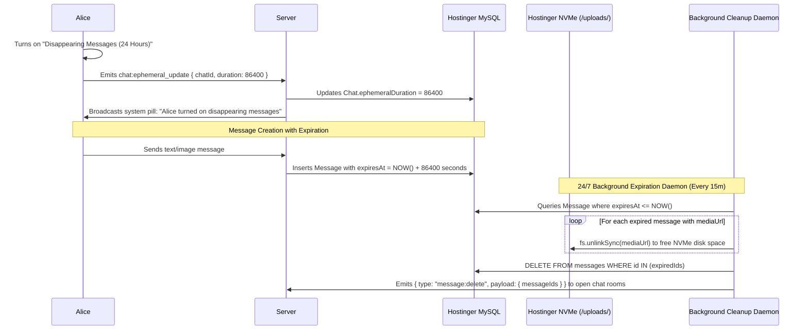

# Phase 22: Ephemeral & Disappearing Messages

## 1. Phase Overview & Objectives
**Target Workspace**: `web/` (Server #1) & `socket-server/` (Server #2)  
**Primary Goal**: Implement WhatsApp-style Ephemeral / Disappearing Messages at **$0.00 additional monthly cost**. Users can enable auto-deletion for any 1-on-1 or group conversation with durations of **24 Hours**, **7 Days**, or **90 Days**. Expired messages and their associated local media files (images, audio clips, documents) are permanently and automatically purged by a 24/7 background Fastify cleanup daemon on Server #2.

> [!IMPORTANT]
> **Zero Friction & Verification Guardrail**: Strictly **NO OTP**, **NO SMS**, and **NO phone verification**. Disappearing message timers are configured directly by chat participants.

---

## 2. Context & Prerequisites
- **Previous Phase**: [`21_MARKDOWN_CODE_BLOCKS_AND_SYNTAX_HIGHLIGHTING.md`](21_MARKDOWN_CODE_BLOCKS_AND_SYNTAX_HIGHLIGHTING.md) (Rich chat formatting complete).
- **Environment**: Next.js 15, Fastify 4+ & Native `ws`, Node.js `fs` module, Hostinger MySQL via Prisma (`connection_limit=10`).
- **Storage Rule**: Auto-deletion must completely purge both the MySQL database row AND any disk files in `/public/uploads/` to maintain NVMe disk hygiene.

---

## 3. Architectural Structure & Target Files

```text
WebChat/
├── web/
│   ├── src/
│   │   ├── app/api/
│   │   │   └── chats/
│   │   │       └── [id]/
│   │   │           └── ephemeral/
│   │   │               └── route.ts         # PATCH /api/chats/:id/ephemeral (set duration: 86400, 604800, 7776000, null)
│   │   ├── components/
│   │   │   ├── chat/
│   │   │   │   ├── DisappearingSettingsModal.tsx # WhatsApp modal with radio buttons (24h, 7d, 90d, Off)
│   │   │   │   ├── EphemeralSystemPill.tsx  # In-chat notice: "X changed the timer to 24 hours"
│   │   │   │   └── EphemeralClockBadge.tsx  # Small clock icon badge next to message timestamp
│   │   │   └── sidebar/
│   │   │       └── ChatListItem.tsx         # Displays clock icon on chat avatar if ephemeral active
│   │   └── lib/
│   │       └── ephemeralUtils.ts            # Duration formatting helpers (e.g. 86400 -> "24 hours")
├── socket-server/
│   └── src/
│       └── jobs/
│           └── ephemeralCleanupJob.ts       # 24/7 background timer (every 15 mins) purging expired messages & disk files
└── shared/
    └── src/
        └── events.ts                        # chat:ephemeral_updated and message:delete envelopes
```

---

## 4. Ephemeral Lifecycle & Deletion Architecture



---

## 5. Database Schema & Prisma Migrations (`web/prisma/schema.prisma`)

```prisma
// Extension to Chat model:
// model Chat {
//   ...
//   ephemeralDuration Int? // Duration in seconds: 86400 (24h), 604800 (7d), 7776000 (90d), null = off
// }

// Extension to Message model:
// model Message {
//   ...
//   expiresAt  DateTime? // Calculated at creation: createdAt + Chat.ephemeralDuration
// }

// Index optimization for high-speed expiration queries:
// @@index([expiresAt], map: "idx_messages_expires_at")
```

---

## 6. Step-by-Step Implementation Tasks

- [ ] **1. Chat Ephemeral Settings API (`/api/chats/:id/ephemeral`)**:
  - `PATCH /api/chats/:id/ephemeral`:
    - Authenticate user and verify chat membership.
    - Accept `duration`: `86400` (24h), `604800` (7d), `7776000` (90d), or `null` (Off).
    - Update `Chat.ephemeralDuration`.
    - Create a system message in the chat:
      - Content: `"[User] set disappearing messages to [duration text]"`.
      - Broadcast over WebSocket.
- [ ] **2. Disappearing Messages Modal (`DisappearingSettingsModal.tsx`)**:
  - Header: Timer icon illustration with title *"Disappearing messages"*.
  - Explanatory copy: *"When turned on, new messages in this chat will disappear after the selected duration. Existing messages won't be affected."*
  - Radio options:
    - `24 Hours`
    - `7 Days`
    - `90 Days`
    - `Off` (Default)
  - Save button persists to Server #1 and broadcasts real-time update.
- [ ] **3. In-Chat Visual Indicators (`EphemeralClockBadge.tsx`)**:
  - Chat list avatar badge: Render small white clock icon over the chat avatar when `ephemeralDuration !== null`.
  - Chat header subtitle: Display *"disappearing messages on"* beneath chat title.
  - Message bubble: Render subtle clock symbol beside the message timestamp.
  - System pill: Render centered rounded pill `<EphemeralSystemPill />` marking when the timer was changed.
- [ ] **4. Message Creation Expiration Hook**:
  - In `messageHandler.ts` on Server #2 (and REST send route on Server #1):
    - When inserting a new `Message`:
      - Fetch `Chat.ephemeralDuration`.
      - If duration is set, compute: `expiresAt = new Date(Date.now() + ephemeralDuration * 1000)`.
- [ ] **5. Fastify 24/7 Background Cleanup Daemon (`ephemeralCleanupJob.ts`)**:
  - Scheduled interval on Server #2 running every 15 minutes (`900,000 ms`):
    - Query expired messages in chunks of 100:
      ```typescript
      const expiredMessages = await prisma.message.findMany({
        where: {
          expiresAt: { lte: new Date() },
          chat: { isLegalHold: false }, // Respect legal hold governance
        },
        select: { id: true, chatId: true, mediaUrl: true },
        take: 100,
      });
      ```
    - For each message with `mediaUrl`:
      - Verify file path is within `/public/uploads/`.
      - If file exists on disk, delete it via `fs.promises.unlink()`.
    - Batch delete database rows:
      ```typescript
      await prisma.message.deleteMany({
        where: { id: { in: expiredMessages.map((m) => m.id) } },
      });
      ```
    - Group by `chatId` and broadcast `{ type: 'message:delete', payload: { messageIds } }` so clients update viewports instantly.

---

## 7. Quality Gate & Verification Criteria

1. Setting disappearing timer to "24 Hours" generates a system announcement pill in the chat.
2. A clock icon badge appears on the chat avatar and beside new message timestamps.
3. In MySQL, new messages have `expiresAt` set to 24 hours in the future.
4. Setting a test message's `expiresAt` to the past triggers automated deletion on the next background cleanup cycle.
5. If the expired message has an attached image or document, the file is unlinked from NVMe disk.
6. The message disappears from active chat viewports without requiring a browser refresh.

---

## 8. Autonomous Multi-Agent Handoff Instructions
The next phase is [`23_BACKGROUND_WEB_PUSH_NOTIFICATIONS.md`](23_BACKGROUND_WEB_PUSH_NOTIFICATIONS.md). That agent will implement background Web Push notifications using the open W3C VAPID protocol so users receive notifications even when browser tabs are closed.