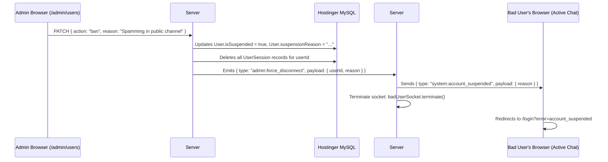

# Phase 22: User Administration, Account Moderation & Session Enforcement

## 1. Phase Overview & Objectives
**Target Workspace**: `web/` (Server #1) & `socket-server/` (Server #2)  
**Primary Goal**: Build the enterprise User Administration & Moderation Console (`/admin/users`). Implement a full-featured searchable data grid, account suspension/banning with real-time WebSocket disconnection, role elevation (RBAC), global registration policies (Open vs Invite-Only vs Admin-Approval), and session termination across all devices.

---

## 2. Context & Prerequisites
- **Previous Phase**: [`21_ADMIN_CONSOLE_AND_SYSTEM_METRICS.md`](21_ADMIN_CONSOLE_AND_SYSTEM_METRICS.md) (Admin shell, metrics, and role guards operational).
- **Environment**: Next.js 15, Prisma ORM, Fastify Native `ws` `RoomManager`.
- **Enforcement Rule**: Suspending or banning a user must immediately kick all active WebSocket connections for that user across all devices in real time.

---

## 3. Architectural Structure & Target Files

```text
WebChat/
├── web/
│   ├── src/
│   │   ├── app/
│   │   │   ├── admin/
│   │   │   │   ├── users/
│   │   │   │   │   ├── page.tsx             # User management data grid with search & filters
│   │   │   │   │   └── [userId]/
│   │   │   │   │       └── page.tsx         # User detail drilldown (activity, sessions, storage, logs)
│   │   │   │   └── invites/
│   │   │   │       └── page.tsx             # Invite codes manager (when invite-only mode is active)
│   │   │   └── api/
│   │   │       └── admin/
│   │   │           ├── users/
│   │   │           │   ├── route.ts         # GET /api/admin/users (paginated & filtered)
│   │   │           │   └── [userId]/
│   │   │           │       ├── route.ts     # GET user details
│   │   │           │       ├── status/route.ts # PATCH (suspend, ban, reactivate)
│   │   │           │       ├── role/route.ts   # PATCH (promote, demote)
│   │   │           │       └── sessions/route.ts # DELETE (terminate all sessions)
│   │   │           └── invites/
│   │   │               └── route.ts         # GET/POST/DELETE invite codes
│   │   ├── components/
│   │   │   └── admin/
│   │   │       ├── UserTable.tsx            # Data table with multi-select & batch actions
│   │   │       ├── SuspendUserModal.tsx     # Reason selector & duration (Temporary vs Permanent)
│   │   │       ├── ChangeRoleModal.tsx      # System role selector with confirmation
│   │   │       └── UserActivityTimeline.tsx # Chronological login and messaging activity
│   │   └── lib/
│   │       └── adminUserService.ts          # Business logic for user administration
├── socket-server/
│   └── src/
│       └── handlers/
│           └── adminKickHandler.ts          # Disconnects and purges sockets for banned users
└── shared/
    └── src/
        └── types.ts                         # AdminUserSummary and AdminUserAction types
```

---

## 4. Real-Time Account Suspension Flow



---

## 5. Prisma Schema Additions (`web/prisma/schema.prisma`)

```prisma
model SystemSetting {
  id          String   @id @default(uuid())
  key         String   @unique @db.VarChar(50) // e.g. "registration_mode"
  value       String   @db.Text                // "OPEN", "INVITE_ONLY", "ADMIN_APPROVAL"
  description String?  @db.VarChar(255)
  updatedAt   DateTime @updatedAt

  @@map("system_settings")
}

model InviteCode {
  id         String    @id @default(uuid())
  code       String    @unique @db.VarChar(32) // e.g. "INV-CORP-9842"
  creatorId  String
  maxUses    Int       @default(1)
  usedCount  Int       @default(0)
  expiresAt  DateTime?
  createdAt  DateTime  @default(now())

  creator User @relation(fields: [creatorId], references: [id], onDelete: Cascade)
  @@map("invite_codes")
}
```

---

## 6. Detailed Step-by-Step Implementation Tasks

- [ ] **1. Searchable User Directory Data Grid (`UserTable.tsx`)**:
  - Endpoint `GET /api/admin/users`:
    - Full-text search matching `username`, `email`, and `displayName`.
    - Filters:
      - System Role: `All`, `SUPER_ADMIN`, `ADMIN`, `MODERATOR`, `USER`.
      - Status: `All`, `Active`, `Suspended`.
      - 2FA Status: `All`, `2FA Enabled`, `2FA Disabled`.
    - Columns: User Avatar, Display Name, `@username`, Email, Role badge, Status badge, 2FA icon, Joined Date, Actions menu (`⋮`).
    - Pagination (25 users per page) and sorting.
- [ ] **2. Account Suspension & Ban Actions (`SuspendUserModal.tsx`)**:
  - Endpoint `PATCH /api/admin/users/[userId]/status`:
    - Body: `{ action: "suspend" | "reactivate", reason: string, durationDays?: number }`.
    - Prevents suspending oneself or the root `SUPER_ADMIN`.
    - Updates `isSuspended` and `suspensionReason` in MySQL.
    - Purges all active tokens from `user_sessions`.
    - Notifies Server #2 to terminate any live WebSocket connections for this user.
    - Logs audit log event `admin.user.suspended`.
- [ ] **3. Fastify Real-Time Force Disconnect (`adminKickHandler.ts`)**:
  - When Server #2 receives internal command to kick user:
    - Finds all sockets registered under `roomManager.userSockets.get(userId)`.
    - Sends WebSocket envelope:
      ```typescript
      socket.send(JSON.stringify({
        type: 'system:account_suspended',
        payload: { reason }
      }));
      ```
    - Immediately terminates the underlying TCP socket: `socket.terminate()`.
    - Rejects any subsequent connection attempts from that user.
- [ ] **4. Role Elevation & RBAC Delegation (`ChangeRoleModal.tsx`)**:
  - Endpoint `PATCH /api/admin/users/[userId]/role`:
    - Available only to `SUPER_ADMIN`.
    - Options: `USER`, `MODERATOR`, `ADMIN`, `SUPER_ADMIN`.
    - Confirmation modal requiring current admin's password or 2FA code.
- [ ] **5. Global Registration Policies (`registration_mode`)**:
  - Setting stored in `system_settings`:
    - **OPEN**: Anyone can register with username & email.
    - **INVITE_ONLY**: Registration requires a valid, unexpired `inviteCode`.
    - **ADMIN_APPROVAL**: Account created in `status: "PENDING_APPROVAL"`; admin must approve before login is granted.
  - Admin page `/admin/invites` to generate single-use or multi-use invite codes with expiration dates.

---

## 7. Quality Gate & Verification Criteria

Before marking Phase 22 complete, verify:
1. Searching for a username in the Admin User Table filters results dynamically.
2. An admin can suspend a test user account with a reason (e.g. *"Violation of terms"*).
3. The suspended user's active browser session is disconnected within 500ms, their socket is terminated, and attempting to log back in shows the suspension reason banner.
4. Reactivating the user immediately restores normal login capability.
5. Setting registration to "INVITE_ONLY" prevents registration without a valid invitation code.

---

## 8. Handoff to Phase 23
Phase 23 will implement Content Moderation, User Abuse Reporting, and Automated Data Loss Prevention (DLP) Regex Filtering.
