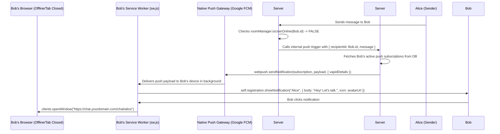

# Phase 23: Background Web Push Notifications (VAPID)

## 1. Phase Overview & Objectives
**Target Workspace**: `web/` (Server #1) & `socket-server/` (Server #2)  
**Primary Goal**: Implement background Web Push notifications using the open **W3C VAPID protocol** via the `web-push` library at **$0.00 additional monthly cost**. Users receive real-time message alerts on Android Mobile Chrome and desktop browsers even when browser tabs or the entire browser application are closed. Includes custom vibration patterns, sender avatars, and click-to-open window navigation.

> [!IMPORTANT]
> **Zero Friction & Verification Guardrail**: Strictly **NO OTP**, **NO SMS**, and **NO phone verification**. Push subscriptions are tied directly to the authenticated browser session via Web Push VAPID keys.

---

## 2. Context & Prerequisites
- **Previous Phase**: [`22_EPHEMERAL_AND_DISAPPEARING_MESSAGES.md`](22_EPHEMERAL_AND_DISAPPEARING_MESSAGES.md) (Ephemeral messaging and cleanup complete).
- **Environment**: Next.js 15, Service Worker (`public/sw.js`), `web-push` (`^3.6.7`), VAPID public/private keypair.
- **Zero Cost Rule**: Uses native browser push gateways (Google FCM for Chrome, Mozilla Push, Apple Push Service for Safari) via open W3C VAPID headers. Zero paid push services (No OneSignal, No Pusher).

---

## 3. Architectural Structure & Target Files

```text
WebChat/
├── web/
│   ├── public/
│   │   └── sw.js                            # Service worker handling 'push' and 'notificationclick' events
│   ├── src/
│   │   ├── app/api/
│   │   │   └── push/
│   │   │       ├── subscribe/route.ts       # POST /api/push/subscribe (register device push subscription)
│   │   │       ├── unsubscribe/route.ts     # POST /api/push/unsubscribe (remove subscription)
│   │   │       └── vapid-public-key/route.ts# GET /api/push/vapid-public-key
│   │   ├── components/
│   │   │   ├── settings/
│   │   │   │   └── NotificationSettings.tsx # WhatsApp notifications toggle, sound picker, preview switch
│   │   │   └── ui/
│   │   │       └── PushPermissionBanner.tsx # Top prompt: "Enable notifications to stay alerted"
│   │   ├── hooks/
│   │   │   └── useWebPush.ts                # ServiceWorker registration, VAPID subscription, permission checker
│   │   └── lib/
│   │       └── pushService.ts               # web-push dispatcher utility on Server #1
├── socket-server/
│   └── src/
│       └── handlers/
│           └── messageHandler.ts            # Dispatches push notification when recipient is offline
└── shared/
    └── src/
        └── types.ts                         # PushSubscriptionPayload interface
```

---

## 4. Web Push Notification Sequence



---

## 5. Database Schema & Prisma Migrations (`web/prisma/schema.prisma`)

```prisma
// Extension to User model:
// model User {
//   ...
//   pushSubscriptions UserPushSubscription[]
// }

model UserPushSubscription {
  id        String   @id @default(uuid())
  userId    String
  endpoint  String   @unique(map: "idx_push_endpoint") @db.VarChar(500)
  p256dh    String   @db.VarChar(255)
  auth      String   @db.VarChar(255)
  userAgent String?  @db.VarChar(255)
  createdAt DateTime @default(now())
  updatedAt DateTime @updatedAt

  user User @relation(fields: [userId], references: [id], onDelete: Cascade)

  @@index([userId], map: "idx_push_user")
  @@map("user_push_subscriptions")
}
```

---

## 6. Step-by-Step Implementation Tasks

- [ ] **1. VAPID Key Configuration & Helper (`pushService.ts`)**:
  - Configure `.env`:
    - `NEXT_PUBLIC_VAPID_PUBLIC_KEY`: Generated via `web-push generate-vapid-keys`.
    - `VAPID_PRIVATE_KEY`: Secret private key stored on Server #1.
    - `VAPID_SUBJECT`: `mailto:support@yourdomain.com`.
  - In `pushService.ts`:
    ```typescript
    import webpush from 'web-push';

    webpush.setVapidDetails(
      process.env.VAPID_SUBJECT!,
      process.env.NEXT_PUBLIC_VAPID_PUBLIC_KEY!,
      process.env.VAPID_PRIVATE_KEY!
    );

    export async function sendPushToUser(userId: string, payload: any) {
      const subscriptions = await prisma.userPushSubscription.findMany({ where: { userId } });
      for (const sub of subscriptions) {
        try {
          await webpush.sendNotification(
            { endpoint: sub.endpoint, keys: { p256dh: sub.p256dh, auth: sub.auth } },
            JSON.stringify(payload)
          );
        } catch (err: any) {
          if (err.statusCode === 410 || err.statusCode === 404) {
            // Expired subscription, clean up from DB
            await prisma.userPushSubscription.delete({ where: { id: sub.id } });
          }
        }
      }
    }
    ```
- [ ] **2. Service Worker Push Listener (`public/sw.js`)**:
  - Add event listeners to `sw.js`:
    ```javascript
    self.addEventListener('push', (event) => {
      if (!event.data) return;
      const data = event.data.json();
      const options = {
        body: data.body || 'New message',
        icon: data.avatarUrl || '/icons/icon-192x192.png',
        badge: '/icons/badge-72x72.png',
        vibrate: [100, 50, 100],
        data: { url: data.url || '/chat' },
        tag: data.chatId || 'webchat-msg',
        renotify: true,
      };
      event.waitUntil(self.registration.showNotification(data.title || 'WebChat', options));
    });

    self.addEventListener('notificationclick', (event) => {
      event.notification.close();
      event.waitUntil(
        clients.matchAll({ type: 'window', includeUncontrolled: true }).then((clientList) => {
          for (const client of clientList) {
            if (client.url === event.notification.data.url && 'focus' in client) {
              return client.focus();
            }
          }
          if (clients.openWindow) {
            return clients.openWindow(event.notification.data.url);
          }
        })
      );
    });
    ```
- [ ] **3. Push Subscription Hook (`useWebPush.ts`)**:
  - Check browser support: `'serviceWorker' in navigator && 'PushManager' in window`.
  - Check permission: `Notification.permission === 'granted'`.
  - Convert Base64 VAPID public key to `Uint8Array`.
  - Subscribe via:
    ```typescript
    const sub = await registration.pushManager.subscribe({
      userVisibleOnly: true,
      applicationServerKey: urlB64ToUint8Array(process.env.NEXT_PUBLIC_VAPID_PUBLIC_KEY!),
    });
    ```
  - Send JSON to `POST /api/push/subscribe`.
- [ ] **4. Push Settings & Notification Banner (`NotificationSettings.tsx`)**:
  - In Settings -> Notifications:
    - Master switch: *"Desktop and mobile push notifications"*.
    - Toggle: *"Message preview in notification"* (Show sender & text vs Show "New message").
    - Toggle: *"Audio notification chime"*.
  - Render discreet banner for new users: *"Turn on desktop notifications to get notified when friends message you."*
- [ ] **5. Fastify Server #2 Offline Interceptor**:
  - In `messageHandler.ts`:
    - When a message is sent to a room:
      - For each participant in the chat:
        - Check `roomManager.isUserOnline(participantId)`.
        - If offline: Call Server #1 internal push trigger with sender name, message snippet, and avatar URL.

---

## 7. Quality Gate & Verification Criteria

1. User can grant browser notification permission and register a VAPID push subscription in MySQL.
2. Closing the WebChat browser tab entirely simulates an offline user.
3. Sending a message from another device triggers a native desktop/mobile Chrome background notification.
4. The notification displays the sender's avatar, name, and message preview.
5. Clicking the notification focuses or opens the WebChat tab directly to the relevant conversation.
6. Revoked or expired push subscriptions (HTTP 410) are automatically cleaned up from the database.

---

## 8. Autonomous Multi-Agent Handoff Instructions
The next phase is [`24_LOCAL_FIRST_OFFLINE_SYNC_AND_INDEXEDDB.md`](24_LOCAL_FIRST_OFFLINE_SYNC_AND_INDEXEDDB.md). That agent will implement local-first offline message caching and an automatic FIFO sync queue using browser IndexedDB (`idb`).