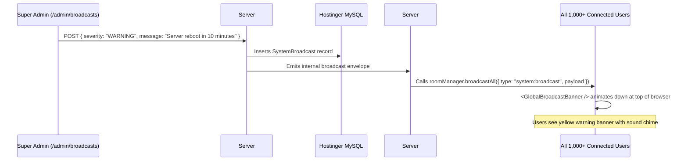

# Phase 24: Global System Broadcasts, Maintenance Mode & Emergency Controls

## 1. Phase Overview & Objectives
**Target Workspace**: `web/` (Server #1) & `socket-server/` (Server #2)  
**Primary Goal**: Equip system administrators with enterprise-grade operational controls: Send instant real-time Global Broadcast Banners to all connected users over native WebSockets, toggle System Maintenance Mode with an administrative bypass, and trigger on-demand emergency database backups from the Admin Portal at **$0.00 additional monthly cost**.

---

## 2. Context & Prerequisites
- **Previous Phase**: [`23_CONTENT_MODERATION_AND_ABUSE_REPORTING.md`](23_CONTENT_MODERATION_AND_ABUSE_REPORTING.md) (Content moderation and DLP filtering operational).
- **Environment**: Next.js 15, Fastify Native `ws` `RoomManager`, Hostinger native shell commands (`mysqldump`).
- **Safety Rule**: Maintenance mode must never lock out `SUPER_ADMIN` accounts, ensuring administrators can always access the system to complete upgrades.

---

## 3. Architectural Structure & Target Files

```text
WebChat/
├── web/
│   ├── src/
│   │   ├── app/
│   │   │   ├── admin/
│   │   │   │   ├── broadcasts/
│   │   │   │   │   └── page.tsx             # Broadcast manager: compose, send, history
│   │   │   │   └── maintenance/
│   │   │   │       └── page.tsx             # Maintenance mode switch, notice editor, countdown
│   │   │   ├── maintenance/
│   │   │   │   └── page.tsx                 # Public "Under Maintenance" landing page
│   │   │   └── api/
│   │   │       └── admin/
│   │   │           ├── broadcasts/route.ts  # POST /api/admin/broadcasts (triggers real-time alert)
│   │   │           ├── maintenance/route.ts # PATCH /api/admin/maintenance (toggle state)
│   │   │           └── backup/route.ts      # POST /api/admin/backup (on-demand mysqldump trigger)
│   │   ├── components/
│   │   │   ├── admin/
│   │   │   │   ├── CreateBroadcastModal.tsx # Compose announcement with severity level
│   │   │   │   └── MaintenanceToggleCard.tsx# Switch with confirmation modal
│   │   │   └── layout/
│   │   │       └── GlobalBroadcastBanner.tsx# Top banner displayed to all active users
│   │   └── middleware.ts                    # Intercepts requests during maintenance mode
├── socket-server/
│   └── src/
│       └── handlers/
│           └── globalBroadcastHandler.ts    # Broadcasts system announcements to all sockets
└── shared/
    └── src/
        └── events.ts                        # SystemBroadcast envelope schemas
```

---

## 4. Real-Time Global Broadcast Architecture



---

## 5. Prisma Schema Additions (`web/prisma/schema.prisma`)

```prisma
model SystemBroadcast {
  id        String    @id @default(uuid())
  creatorId String
  severity  String    @default("INFO") @db.VarChar(20) // "INFO", "WARNING", "CRITICAL"
  message   String    @db.VarChar(500)
  isActive  Boolean   @default(true)
  expiresAt DateTime?
  createdAt DateTime  @default(now())

  creator User @relation(fields: [creatorId], references: [id], onDelete: Cascade)
  @@map("system_broadcasts")
}
```

---

## 6. Detailed Step-by-Step Implementation Tasks

- [ ] **1. Global Broadcast Composer (`CreateBroadcastModal.tsx`)**:
  - Message input (max 500 characters).
  - Severity level selector:
    - 🔵 **INFO**: General announcements (Blue banner).
    - 🟡 **WARNING**: Upcoming maintenance (Yellow banner).
    - 🔴 **CRITICAL**: Immediate outages / emergency security advisories (Red pulsing banner).
  - Optional auto-expiration timer (e.g. 1 hour, 24 hours).
  - Preview widget showing exactly how it will appear to end users.
- [ ] **2. Fastify Real-Time Broadcast Dispatcher (`globalBroadcastHandler.ts`)**:
  - When broadcast is published:
    - Server #2 receives envelope and executes:
      ```typescript
      const envelope: WsEnvelope<SystemBroadcastPayload> = {
        type: 'system:broadcast',
        payload: { id, severity, message, timestamp: new Date().toISOString() }
      };
      roomManager.broadcastAll(envelope);
      ```
  - Broadcasts instantaneously across all open sockets in under 50ms.
- [ ] **3. In-App User Broadcast Banner (`GlobalBroadcastBanner.tsx`)**:
  - Pinned at the very top of the application shell (above chat headers).
  - Slides down with smooth spring animation.
  - Displays icon matching severity (ℹ️ Info, ⚠️ Warning, 🚨 Critical).
  - Close button (`✕`) allows users to dismiss non-critical broadcasts (dismissal stored in `sessionStorage`).
- [ ] **4. System Maintenance Mode (`/admin/maintenance`)**:
  - Switch: **"Maintenance Mode Active"**.
  - Notice text editor: *"We are performing scheduled database upgrades. WebChat will return online at 04:00 AM UTC."*
  - State persisted in `system_settings` (`key: "maintenance_mode"`).
  - When enabled:
    - Server #2 broadcasts `{ type: 'system:maintenance_mode', payload: { active: true } }` and closes non-admin sockets.
    - Next.js Middleware in `web/src/middleware.ts` redirects all non-admin requests to `/maintenance`.
    - Admins (`systemRole in ["SUPER_ADMIN", "ADMIN"]`) bypass the redirect, maintaining full access.
- [ ] **5. On-Demand Emergency Database Backup (`POST /api/admin/backup`)**:
  - Super admin button: **"Create On-Demand Database Backup"**.
  - Executes native `mysqldump` command securely on Hostinger:
    ```bash
    mysqldump -u USER -p'PASS' DBNAME | gzip > ~/backups/manual_db_backup_$(date +\%s).sql.gz
    ```
  - Returns direct download link for the administrator and logs audit event `admin.backup.manual_trigger`.

---

## 7. Quality Gate & Verification Criteria

Before marking Phase 24 complete, verify:
1. Publishing a "WARNING" global broadcast immediately renders the yellow banner on all open browser tabs without refreshing.
2. Clicking dismiss (`✕`) hides the banner for the duration of the user's session.
3. Enabling Maintenance Mode redirects logged-in regular users to the `/maintenance` screen.
4. An admin account can still browse `/admin` and `/chat` during Maintenance Mode.
5. Triggering an on-demand database backup generates a valid `.sql.gz` archive on Hostinger disk.

---

## 8. Master 24-Phase Enterprise Standard Sign-Off
With Phase 24 complete, the WebChat platform represents a complete, enterprise-grade collaboration ecosystem:
- **Part I: Core Production Platform (Phases 01 – 14)**: Fastify + ws dual server, PWA, Audio Calling, Testing & CI/CD.
- **Part II: Enterprise Suite & Compliance (Phases 15 – 20)**: 2FA, E2EE, Channels, Polls, Documents, Push, Webhooks, Audit Logs.
- **Part III: Enterprise Administration & Operations (Phases 21 – 24)**: Admin Console, User Directory, Abuse Moderation, DLP Filters, Global Broadcasts, and Maintenance Mode.
