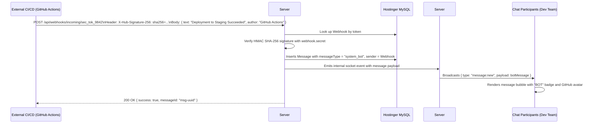

# Phase 25: Inbound & Outbound Webhooks Engine

## 1. Phase Overview & Objectives
**Target Workspace**: `web/` (Server #1) & `socket-server/` (Server #2)  
**Primary Goal**: Build an enterprise Webhooks Engine at **$0.00 additional monthly cost**. Organizations can connect external developer tools (GitHub Actions, GitLab, Jira, CircleCI, internal microservices) directly to WebChat conversations and announcement channels. Inbound webhooks post formatted automated updates with a distinct `BOT` badge, while outbound webhooks deliver chat events to external HTTP endpoints with HMAC SHA-256 signature verification.

> [!IMPORTANT]
> **Zero Friction & Verification Guardrail**: Strictly **NO OTP**, **NO SMS**, and **NO phone verification**. Webhooks are created and authenticated using secure 256-bit API tokens and HMAC secrets.

---

## 2. Context & Prerequisites
- **Previous Phase**: [`24_LOCAL_FIRST_OFFLINE_SYNC_AND_INDEXEDDB.md`](24_LOCAL_FIRST_OFFLINE_SYNC_AND_INDEXEDDB.md) (Offline sync and reliable messaging operational).
- **Environment**: Next.js 15 App Router, Node.js `crypto` module, Fastify 4+ & Native `ws` `RoomManager`.
- **Security Rule**: Inbound payloads are verified using secret HMAC SHA-256 tokens to prevent spoofing or unauthorized injections.

---

## 3. Architectural Structure & Target Files

```text
WebChat/
├── web/
│   ├── src/
│   │   ├── app/api/
│   │   │   ├── chats/
│   │   │   │   └── [id]/
│   │   │   │       └── webhooks/
│   │   │   │           ├── route.ts         # GET (list) & POST (create new webhook for chat)
│   │   │   │           └── [webhookId]/
│   │   │   │               └── route.ts     # PATCH (toggle/regenerate) & DELETE (remove)
│   │   │   └── webhooks/
│   │   │       └── incoming/
│   │   │           └── [token]/
│   │   │               └── route.ts         # POST /api/webhooks/incoming/:token (Public ingest endpoint)
│   │   ├── components/
│   │   │   ├── chat/
│   │   │   │   └── BotMessageBadge.tsx      # Dark-blue/Purple "BOT" pill next to webhook messages
│   │   │   └── settings/
│   │   │       ├── WebhooksManagementDrawer.tsx # List of active webhooks with copy URL button
│   │   │       └── CreateWebhookModal.tsx   # Modal: Name, Target Chat, Events, Secret display
│   │   └── lib/
│   │       ├── webhookValidator.ts          # HMAC SHA-256 signature checker
│   │       └── outboundDispatcher.ts        # Async fetch sender for outbound webhook subscriptions
├── socket-server/
│   └── src/
│       └── handlers/
│           └── webhookBroadcastHandler.ts   # Injects validated webhook message into Fastify RoomManager
└── shared/
    └── src/
        └── types.ts                         # WebhookPayload, InboundMessageSchema interfaces
```

---

## 4. Inbound Webhook Ingestion Architecture



---

## 5. Database Schema & Prisma Migrations (`web/prisma/schema.prisma`)

```prisma
// Extension to Chat model:
// model Chat {
//   ...
//   webhooks Webhook[]
// }

model Webhook {
  id          String    @id @default(uuid())
  chatId      String
  creatorId   String
  name        String    @db.VarChar(100)
  token       String    @unique(map: "idx_webhook_token") @db.VarChar(64)
  secret      String    @db.VarChar(64)
  direction   String    @default("INBOUND") @db.VarChar(20) // "INBOUND" or "OUTBOUND"
  targetUrl   String?   @db.VarChar(500)                    // Only for OUTBOUND
  events      String    @default("message:created") @db.VarChar(255)
  isActive    Boolean   @default(true)
  lastFiredAt DateTime?
  createdAt   DateTime  @default(now())
  updatedAt   DateTime  @updatedAt

  chat    Chat @relation(fields: [chatId], references: [id], onDelete: Cascade)
  creator User @relation("WebhookCreator", fields: [creatorId], references: [id], onDelete: Cascade)

  @@index([chatId], map: "idx_webhooks_chat")
  @@map("webhooks")
}
```

---

## 6. Step-by-Step Implementation Tasks

- [ ] **1. Webhook Management API Routes (`/api/chats/:id/webhooks`)**:
  - `POST /api/chats/:id/webhooks`:
    - Verify requesting user is admin or group creator.
    - Generate cryptographically secure `token` (32 bytes hex) and `secret` (32 bytes hex) using `crypto.randomBytes(32).toString('hex')`.
    - Create `Webhook` row in MySQL.
    - Return webhook details including full incoming webhook URL:
      `https://chat.yourdomain.com/api/webhooks/incoming/${token}`.
  - `PATCH /api/chats/:id/webhooks/:webhookId`:
    - Toggle `isActive` or regenerate secret token.
  - `DELETE /api/chats/:id/webhooks/:webhookId`:
    - Remove webhook record.
- [ ] **2. Public Inbound Webhook Endpoint (`/api/webhooks/incoming/[token]`)**:
  - Accept `POST /api/webhooks/incoming/:token`:
    - Find active webhook record in MySQL by token.
    - Validate optional `X-Signature-SHA256` or `X-Hub-Signature-256` header:
      ```typescript
      const expected = crypto.createHmac('sha256', webhook.secret).update(rawBody).digest('hex');
      ```
    - Parse JSON body:
      - Field `text` (Markdown formatted string, max 2000 chars).
      - Field `author` (e.g. *"GitHub Actions"*, *"Jira Alert"*).
      - Field `avatarUrl` (optional bot icon).
    - Save message in MySQL:
      - `chatId: webhook.chatId`
      - `messageType: "system_bot"`
      - `content: body.text`
    - Trigger Fastify Server #2 broadcast via internal HTTP endpoint or shared socket.
    - Update `lastFiredAt` on webhook.
    - Return `200 OK`.
- [ ] **3. Bot Message Visual Styling (`BotMessageBadge.tsx`)**:
  - When rendering message bubbles where `messageType === 'system_bot'`:
    - Display purple/blue badge next to author name: `<BotMessageBadge />` with text **`BOT`**.
    - Markdown rendering enabled for CI/CD status highlights (bolding, links to commits).
- [ ] **4. Outbound Webhook Dispatcher (`outboundDispatcher.ts`)**:
  - When a new message is posted in a chat:
    - Query active `OUTBOUND` webhooks for that `chatId`.
    - For each webhook:
      - Construct event payload: `{ event: "message:created", chatId, message }`.
      - Compute HMAC signature header `X-WebChat-Signature: sha256=${hash}`.
      - Dispatch via background non-blocking HTTP POST (`fetch(webhook.targetUrl, { timeout: 5000 })`).
- [ ] **5. Webhook Management UI Drawer (`WebhooksManagementDrawer.tsx`)**:
  - Group settings drawer section: "Integrations & Webhooks".
  - List configured webhooks with active status toggle.
  - "Add Webhook" button opening `<CreateWebhookModal />`.
  - One-click "Copy URL" with clipboard confirmation.
  - Test Webhook button that dispatches a sample message: *"Hello from WebChat Webhook!"*.

---

## 7. Quality Gate & Verification Criteria

1. Group admin can create an inbound webhook and receive a unique incoming URL.
2. Sending a `curl -X POST https://chat.../api/webhooks/incoming/:token -d '{"text":"Build passed!","author":"CI Bot"}'` inserts the message.
3. Message appears immediately in the chat for all group members with a `BOT` badge.
4. Supplying an invalid token returns `404 Not Found`.
5. Inactive/disabled webhooks reject incoming requests with `403 Forbidden`.
6. Outbound webhooks successfully POST chat events to external endpoints with HMAC signatures.

---

## 8. Autonomous Multi-Agent Handoff Instructions
The next phase is [`26_CHATBOTS_AND_SLASH_COMMANDS.md`](26_CHATBOTS_AND_SLASH_COMMANDS.md). That agent will build interactive in-chat slash commands (`/poll`, `/remind`, `/announce`) and automated scheduled reminder bots.