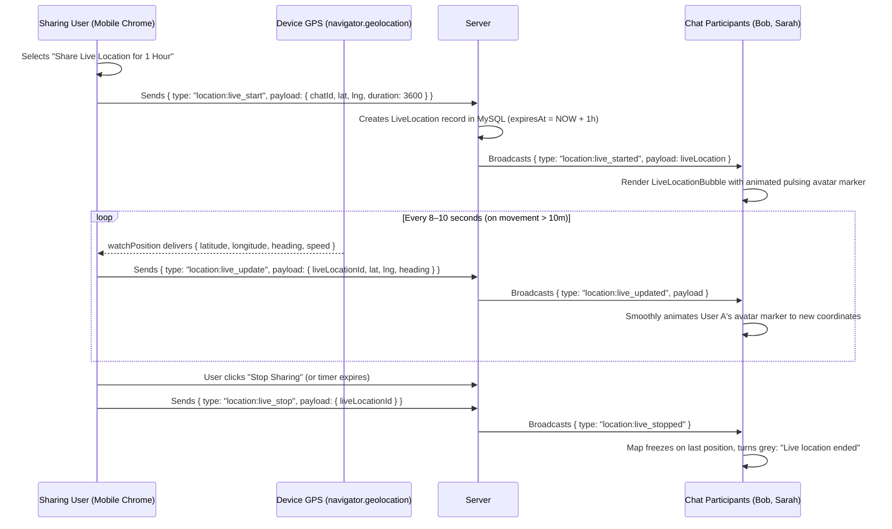

# Phase 25: Real-Time Live & Current GPS Location Sharing (Leaflet & OpenStreetMap)

## 1. Phase Overview & Objectives
**Target Workspace**: `web/` (Server #1) & `socket-server/` (Server #2)  
**Primary Goal**: Build WhatsApp-style GPS location sharing for mobile and desktop browsers at **$0.00 additional monthly cost**. Implement **Current Location Sharing** (static pin with reverse-geocoded street address) and **Real-Time Live Location Sharing** (multi-user dynamic GPS tracking for 15m, 1h, or 8h with heading, speed, countdown timer, and stop sharing controls) using the browser Geolocation API, **Leaflet.js**, and free **OpenStreetMap (OSM)** tiles.

---

## 2. Context & Prerequisites
- **Previous Phase**: [`24_GLOBAL_BROADCASTS_AND_MAINTENANCE_MODE.md`](24_GLOBAL_BROADCASTS_AND_MAINTENANCE_MODE.md) (All core messaging, enterprise, and admin operations operational).
- **Environment**: Next.js 15, Fastify + Native `ws` `RoomManager`, Browser Geolocation API (`navigator.geolocation`), Leaflet.js (`leaflet`), OpenStreetMap tiles.
- **Zero Cost & Privacy Rule**:
  - **No Google Maps API or Mapbox keys**: All mapping runs via open-source Leaflet and free OpenStreetMap raster tiles.
  - GPS coordinate streaming uses existing Fastify native WebSockets.
  - Battery optimization: Live GPS updates are throttled to once every 8 seconds (or on > 10m displacement) to preserve mobile battery.

---

## 3. Architectural Structure & Target Files

```text
WebChat/
├── web/
│   ├── src/
│   │   ├── app/api/
│   │   │   └── location/
│   │   │       ├── reverse-geocode/route.ts # GET /api/location/reverse-geocode?lat=...&lng=... (OSM Nominatim cache)
│   │   │       └── live/
│   │   │           ├── start/route.ts       # POST /api/location/live/start
│   │   │           └── stop/route.ts        # POST /api/location/live/stop
│   │   ├── components/
│   │   │   ├── location/
│   │   │   │   ├── LocationPickerModal.tsx  # Map picker: "Send Current Location" vs "Share Live Location"
│   │   │   │   ├── LiveDurationSelector.tsx # 15 Minutes / 1 Hour / 8 Hours picker with comment input
│   │   │   │   ├── StaticLocationBubble.tsx # Chat card with map thumbnail, address, and navigation links
│   │   │   │   ├── LiveLocationBubble.tsx   # Interactive Leaflet map with moving avatar pins & countdown
│   │   │   │   └── MultiUserMapViewer.tsx   # Collaborative map showing all active live locations in group
│   │   │   └── chat/
│   │   │       └── AttachmentMenu.tsx       # Adds "Location" (green pin icon) to attachment options
│   │   ├── hooks/
│   │   │   ├── useGeolocation.ts            # Wrapper for getCurrentPosition & watchPosition
│   │   │   └── useLiveLocationTracker.ts    # Socket dispatcher & battery-friendly GPS watcher
│   │   └── lib/
│   │       ├── mapUtils.ts                  # Leaflet tile providers, custom avatar markers & distance math
│   │       └── reverseGeocoder.ts           # Cached reverse geocoding via OpenStreetMap Nominatim
├── socket-server/
│   └── src/
│       ├── handlers/
│       │   └── liveLocationHandler.ts       # WebSocket envelopes for location:live_start, update, stop
│       └── jobs/
│           └── liveLocationCleanupJob.ts    # Background timer deactivating expired live locations
└── shared/
    └── src/
        └── events.ts                        # LiveLocationPayload and LocationEnvelope interfaces
```

---

## 4. Real-Time Live Location Architecture



---

## 5. Prisma Schema Additions (`web/prisma/schema.prisma`)

```prisma
// Extension to Message model:
// model Message {
//   ...
//   latitude         Float?
//   longitude        Float?
//   locationAddress  String?  @db.VarChar(255)
//   liveLocationId   String?
//   liveLocation     LiveLocation? @relation(fields: [liveLocationId], references: [id], onDelete: SetNull)
// }

model LiveLocation {
  id         String    @id @default(uuid())
  chatId     String
  userId     String
  latitude   Float
  longitude  Float
  heading    Float?    // Direction in degrees (0–360)
  speed      Float?    // Speed in m/s
  accuracy   Float?    // Accuracy in meters
  comment    String?   @db.VarChar(255)
  isActive   Boolean   @default(true)
  startedAt  DateTime  @default(now())
  expiresAt  DateTime
  updatedAt  DateTime  @updatedAt

  chat     Chat      @relation(fields: [chatId], references: [id], onDelete: Cascade)
  user     User      @relation(fields: [userId], references: [id], onDelete: Cascade)
  messages Message[]

  @@index([chatId, isActive], map: "idx_live_location_chat")
  @@index([expiresAt, isActive], map: "idx_live_location_expires")
  @@map("live_locations")
}
```

---

## 6. Detailed Step-by-Step Implementation Tasks

- [ ] **1. Location Attachment Option & Geolocation Hook (`useGeolocation.ts`)**:
  - Add green map pin icon (**"Location"**) to `<AttachmentMenu />`.
  - Implement `useGeolocation.ts`:
    - `getCurrentLocation()`: Calls `navigator.geolocation.getCurrentPosition({ enableHighAccuracy: true, timeout: 10000 })`.
    - Handles permission states: `prompt`, `granted`, `denied` (with explanatory retry instructions).
- [ ] **2. Reverse Geocoding with Caching (`reverseGeocoder.ts`)**:
  - `GET /api/location/reverse-geocode?lat=...&lng=...`:
    - Queries OpenStreetMap Nominatim: `https://nominatim.openstreetmap.org/reverse?format=json&lat=${lat}&lon=${lng}`.
    - Extracts formatted address (street, neighborhood, city).
    - In-memory LRU cache on Server #1 to prevent hitting OSM rate limits.
- [ ] **3. Location Picker Modal (`LocationPickerModal.tsx`)**:
  - Interactive Leaflet map centered on user's current GPS coordinates with a blue pulsing pin.
  - Two primary action buttons:
    1. **"Send Your Current Location"**: Accurately sends static snapshot with street name.
    2. **"Share Live Location"**: Opens `<LiveDurationSelector />`.
- [ ] **4. Static Location Message Bubble (`StaticLocationBubble.tsx`)**:
  - Renders map thumbnail card with custom red/green WhatsApp marker.
  - Displays reverse-geocoded place name (e.g. *"Starbucks, 5th Avenue, New York"*).
  - Displays coordinates (`40.7128° N, 74.0060° W`).
  - Clicking opens modal map or external navigation:
    - **Google Maps**: `https://www.google.com/maps/search/?api=1&query=${lat},${lng}`
    - **OpenStreetMap**: `https://www.openstreetmap.org/?mlat=${lat}&mlon=${lng}`
    - **Apple Maps** on iOS devices.
- [ ] **5. Live Location Sharing Engine (`useLiveLocationTracker.ts`)**:
  - `<LiveDurationSelector />`:
    - Choose duration: **15 Minutes**, **1 Hour**, or **8 Hours**.
    - Optional message input: *"On the highway, arriving shortly"*.
  - Starts `navigator.geolocation.watchPosition`:
    - Computes displacement using Haversine formula; emits updates only when user moves > 10 meters or after 8 seconds have elapsed.
    - Sends WebSocket envelope `{ type: 'location:live_update', payload: { liveLocationId, lat, lng, heading, speed } }`.
  - Pinned `<LiveLocationBubble />`:
    - Live embedded Leaflet map showing user's circular avatar marker with a directional arrow.
    - Pulsing green aura indicating active transmission.
    - Countdown timer: *"Live until 04:30 PM (28m remaining)"*.
    - Red **"Stop Sharing"** button immediately ending tracking.
- [ ] **6. Collaborative Multi-User Map in Groups (`MultiUserMapViewer.tsx`)**:
  - If multiple group members share live location at the same time:
    - Leaflet automatically adjusts bounding box to fit all active members.
    - Each member's marker displays their avatar and initials.
    - Distance indicator showing how far each member is from the viewer (e.g. *"1.2 km away"*).
- [ ] **7. Fastify Background Expiration Timer (`liveLocationCleanupJob.ts`)**:
  - Fastify scheduled interval running every 60 seconds:
    - Queries `live_locations` where `expiresAt <= NOW()` and `isActive = true`.
    - Updates `isActive = false`.
    - Broadcasts `{ type: 'location:live_ended', payload: { liveLocationId } }` so clients freeze map rendering.

---

## 7. Quality Gate & Verification Criteria

Before marking Phase 25 complete, verify:
1. Clicking "Location" in the attachment menu prompts for browser geolocation permission and centers the Leaflet map on current coordinates.
2. Clicking "Send Current Location" sends a static location card with reverse-geocoded street name and functional Google Maps / OSM links.
3. Starting a "15 Minutes" live location sends `{ type: "location:live_start" }` and renders the live map with a countdown timer.
4. Moving coordinates smoothly animates the avatar marker on all recipient devices in real time over WebSockets.
5. In a group chat, two users sharing live location appear simultaneously on the same map view.
6. Clicking "Stop Sharing" terminates the GPS watcher, updates the database, and freezes the card to *"Live location ended"*.

---

## 8. Master 25-Phase Architecture Completion
With Phase 25 complete, the WebChat platform includes full consumer, enterprise, administrative, and geolocation mobility capabilities at **$0.00 / month added cost** on Hostinger.
