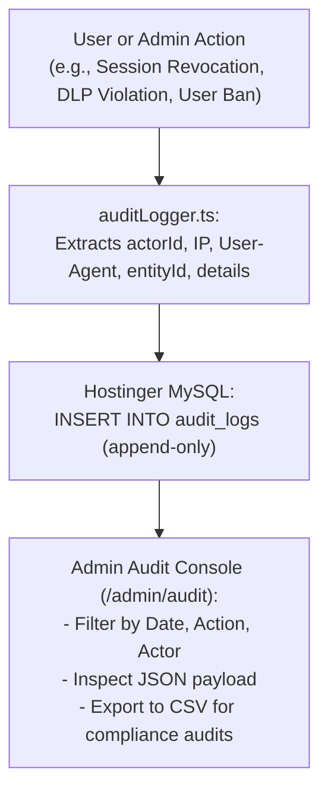

# Phase 27: Immutable Security Audit Logging

## 1. Phase Overview & Objectives
**Target Workspace**: `web/` (Server #1) & `socket-server/` (Server #2)  
**Primary Goal**: Implement an enterprise-grade, tamper-resistant Security Audit Logging system at **$0.00 additional monthly cost**. All critical security, administrative, governance, and user lifecycle events (authentication, session revocation, role changes, member kicks, channel broadcasts, DLP violations) are logged into an append-only database table with actor ID, IP address, user agent, and timestamp. Compliance officers can query, filter, and export audit trails to CSV.

> [!IMPORTANT]
> **Zero Friction & Verification Guardrail**: Strictly **NO OTP**, **NO SMS**, and **NO phone verification**. Audit logging tracks authenticated actor IDs and session tokens automatically in the background.

---

## 2. Context & Prerequisites
- **Previous Phase**: [`26_CHATBOTS_AND_SLASH_COMMANDS.md`](26_CHATBOTS_AND_SLASH_COMMANDS.md) (Interactive messaging and bot pipelines established).
- **Environment**: Next.js 15, Fastify 4+ & Native `ws`, Hostinger MySQL via Prisma (`connection_limit=10`).
- **Integrity Rule**: Audit log records are strictly append-only. No `UPDATE` or `DELETE` API endpoints or application logic may ever be exposed for audit log records.

---

## 3. Architectural Structure & Target Files

```text
WebChat/
├── web/
│   ├── src/
│   │   ├── app/
│   │   │   ├── admin/
│   │   │   │   └── audit/
│   │   │   │       └── page.tsx             # Enterprise Audit Log search and filter console
│   │   │   └── api/
│   │   │       └── admin/
│   │   │           └── audit/
│   │   │               ├── route.ts         # GET /api/admin/audit (paginated, filtered search)
│   │   │               └── export/
│   │   │                   └── route.ts     # GET /api/admin/audit/export (streams CSV file)
│   │   ├── components/
│   │   │   └── admin/
│   │   │       ├── AuditLogTable.tsx        # Filterable table with actor pill, event type, IP, timestamp
│   │   │       ├── AuditDetailsModal.tsx    # JSON viewer for full event payload and metadata
│   │   │       └── AuditFilterBar.tsx       # Date picker, action type dropdown, actor search
│   │   └── lib/
│   │       ├── auditLogger.ts               # Core utility function to record an audit log event
│   │       └── csvExporter.ts               # Memory-efficient CSV generator for compliance records
├── socket-server/
│   └── src/
│       └── lib/
│           └── auditLogger.ts               # Socket server audit logger instance
└── shared/
    └── src/
        └── types.ts                         # AuditLogEvent, AuditActionEnum definitions
```

---

## 4. Immutable Audit Log Architecture



---

## 5. Database Schema & Prisma Migrations (`web/prisma/schema.prisma`)

```prisma
// Extension to User model:
// model User {
//   ...
//   auditLogs AuditLog[]
// }

model AuditLog {
  id         String   @id @default(uuid())
  actorId    String
  action     String   @db.VarChar(50) // e.g. "AUTH_LOGIN", "SESSION_REVOKED", "USER_BANNED", "DLP_VIOLATION"
  entityType String   @db.VarChar(50) // e.g. "USER", "CHAT", "MESSAGE", "SYSTEM"
  entityId   String?  @db.VarChar(100)
  ipAddress  String?  @db.VarChar(45)
  userAgent  String?  @db.Text
  details    String?  @db.Text        // JSON metadata string
  createdAt  DateTime @default(now())

  actor User @relation(fields: [actorId], references: [id], onDelete: Cascade)

  @@index([action, createdAt(sort: Desc)], map: "idx_audit_action_time")
  @@index([actorId, createdAt(sort: Desc)], map: "idx_audit_actor_time")
  @@index([entityType, entityId], map: "idx_audit_entity")
  @@map("audit_logs")
}
```

---

## 6. Step-by-Step Implementation Tasks

- [ ] **1. Core Audit Logger Utility (`auditLogger.ts`)**:
  - Implement reusable helper for Server #1 and Server #2:
    ```typescript
    export async function recordAuditLog(params: {
      actorId: string;
      action: string;
      entityType: string;
      entityId?: string;
      ipAddress?: string;
      userAgent?: string;
      details?: Record<string, any>;
    }) {
      try {
        await prisma.auditLog.create({
          data: {
            actorId: params.actorId,
            action: params.action,
            entityType: params.entityType,
            entityId: params.entityId,
            ipAddress: params.ipAddress,
            userAgent: params.userAgent,
            details: params.details ? JSON.stringify(params.details) : null,
          },
        });
      } catch (err) {
        console.error('Failed to write audit log:', err);
      }
    }
    ```
- [ ] **2. Standardized Audit Action Enums (`types.ts`)**:
  - **Authentication Events**: `AUTH_LOGIN`, `AUTH_LOGOUT`, `PASSWORD_UPDATED`, `SESSION_REVOKED`.
  - **Governance Events**: `GROUP_CREATED`, `GROUP_ADMIN_PROMOTED`, `MEMBER_KICKED`, `CHANNEL_BROADCAST_SENT`.
  - **Compliance Events**: `EPHEMERAL_TIMER_CHANGED`, `LEGAL_HOLD_ENABLED`, `LEGAL_HOLD_DISABLED`, `CHAT_EXPORT_DOWNLOADED`.
  - **Administrative Events**: `USER_ROLE_ELEVATED`, `USER_SUSPENDED`, `USER_UNBANNED`, `DLP_VIOLATION_BLOCKED`, `GLOBAL_BROADCAST_CREATED`, `MAINTENANCE_TOGGLED`.
- [ ] **3. Event Interceptors Integration**:
  - In `/api/auth/login`: Record `AUTH_LOGIN` with client IP and User-Agent.
  - In `/api/auth/sessions`: Record `SESSION_REVOKED` with target device info.
  - In `/admin/users/[id]/suspend`: Record `USER_SUSPENDED` with mandatory reason.
  - In WebSocket message handler: Record `DLP_VIOLATION_BLOCKED` when regex catches sensitive leak.
- [ ] **4. Audit Log Query API (`GET /api/admin/audit`)**:
  - Protected by `systemRole: "SUPER_ADMIN" | "ADMIN"`.
  - Supports query filters:
    - `action` (optional string)
    - `actorId` (optional user ID)
    - `startDate` and `endDate`
    - `page` (default 1) and `limit` (default 50)
  - Returns paginated list with actor details (`displayName`, `@username`).
- [ ] **5. Compliance CSV Exporter (`GET /api/admin/audit/export`)**:
  - Queries filtered audit logs and streams formatted CSV:
    `Timestamp,Actor Username,Action,Entity Type,Entity ID,IP Address,Details`
  - Content-Type: `text/csv; charset=utf-8`.
  - Header: `Content-Disposition: attachment; filename="webchat_audit_logs_[date].csv"`.
- [ ] **6. Admin Audit Log Console (`AuditLogTable.tsx`)**:
  - Filter bar: Action type selector, user search input, date range picker.
  - Table columns:
    - Timestamp (formatted with timezone).
    - Actor (avatar, `@username`, and display name).
    - Action badge (Color-coded: Blue for Auth, Purple for Governance, Red for Moderation/DLP).
    - IP Address.
    - Details button (opens modal displaying parsed JSON metadata).
  - "Export CSV" button in header.

---

## 7. Quality Gate & Verification Criteria

1. Logging in, revoking a session, or changing a role immediately inserts a row into `audit_logs`.
2. Admin accessing `/admin/audit` can see the chronological list of security events.
3. Filtering by action (e.g. `SESSION_REVOKED`) updates the grid instantly.
4. Clicking "Details" opens a modal displaying the exact JSON metadata.
5. Clicking "Export CSV" downloads a valid CSV file matching the filtered results.
6. Attempting to access the audit route without Admin privileges returns `403 Forbidden`.

---

## 8. Autonomous Multi-Agent Handoff Instructions
The next phase is [`28_COMPLIANCE_DATA_EXPORT_AND_LEGAL_HOLD.md`](28_COMPLIANCE_DATA_EXPORT_AND_LEGAL_HOLD.md). That agent will build the Enterprise Legal Hold governance lock and compliance `.zip` chat export containing standalone HTML transcripts and JSON metadata.