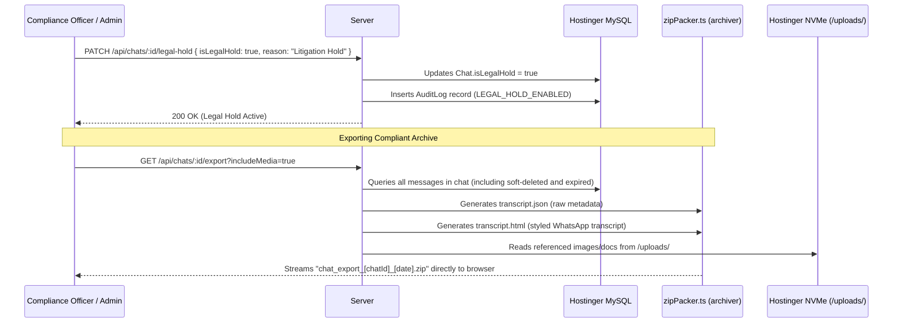

# Phase 28: Compliance Data Export & Legal Hold Governance

## 1. Phase Overview & Objectives
**Target Workspace**: `web/` (Server #1)  
**Primary Goal**: Implement enterprise Compliance Data Export and Legal Hold Governance at **$0.00 additional monthly cost**. Corporate compliance officers and administrators can place any conversation under **Legal Hold**, which halts disappearing message timers and prevents message deletion to preserve evidentiary integrity. In addition, authorized users and administrators can export complete chat transcripts into a downloadable `.zip` archive (via `archiver`) containing both a standalone, styled offline HTML transcript (`transcript.html`) and a machine-readable JSON dump (`transcript.json`).

> [!IMPORTANT]
> **Zero Friction & Verification Guardrail**: Strictly **NO OTP**, **NO SMS**, and **NO phone verification**. Export and legal hold access are controlled strictly by user session identity and system RBAC roles.

---

## 2. Context & Prerequisites
- **Previous Phase**: [`27_IMMUTABLE_SECURITY_AUDIT_LOGGING.md`](27_IMMUTABLE_SECURITY_AUDIT_LOGGING.md) (Audit logging operational).
- **Environment**: Next.js 15, `archiver` (`^7.0.1`) + `@types/archiver`, Hostinger MySQL via Prisma (`connection_limit=10`).
- **Data Protection Rule**: User data exports comply with GDPR "Right of Access" and corporate e-discovery standards with zero external compliance SaaS billing.

---

## 3. Architectural Structure & Target Files

```text
WebChat/
├── web/
│   ├── src/
│   │   ├── app/api/
│   │   │   ├── chats/
│   │   │   │   └── [id]/
│   │   │   │       ├── export/
│   │   │   │       │   └── route.ts         # GET /api/chats/:id/export (generates .zip archive)
│   │   │   │       └── legal-hold/
│   │   │   │           └── route.ts         # PATCH /api/chats/:id/legal-hold (toggle isLegalHold)
│   │   │   └── user/
│   │   │       └── data-export/
│   │   │           └── route.ts             # GET /api/user/data-export (GDPR user archive)
│   │   ├── components/
│   │   │   ├── chat/
│   │   │   │   ├── LegalHoldBanner.tsx      # Yellow header banner: "This chat is under Legal Hold"
│   │   │   │   └── ExportChatModal.tsx      # Modal: Include media checkbox, date range, start export
│   │   │   └── admin/
│   │   │       └── LegalHoldToggle.tsx      # Admin governance switch with reason prompt
│   │   └── lib/
│   │       ├── htmlTranscriptGenerator.ts   # Renders offline HTML template with WhatsApp CSS styling
│   │       └── zipPacker.ts                 # Uses archiver to bundle HTML, JSON, and media attachments
└── shared/
    └── src/
        └── types.ts                         # ExportOptions, LegalHoldPayload interfaces
```

---

## 4. Legal Hold & Compliance Export Architecture



---

## 5. Database Schema & Prisma Migrations (`web/prisma/schema.prisma`)

```prisma
// Extension to Chat model:
// model Chat {
//   ...
//   isLegalHold       Boolean   @default(false)
//   legalHoldSetAt    DateTime?
//   legalHoldSetById  String?
// }

// Extension to Message model:
// model Message {
//   ...
//   isDeleted         Boolean   @default(false)
//   deletedAt         DateTime?
// }
```

---

## 6. Step-by-Step Implementation Tasks

- [ ] **1. Legal Hold Enforcement Engine (`/api/chats/:id/legal-hold`)**:
  - `PATCH /api/chats/:id/legal-hold`:
    - Protected by `systemRole: "SUPER_ADMIN" | "ADMIN"`.
    - Accept `{ isLegalHold: boolean, reason: string }`.
    - Update `Chat.isLegalHold`.
    - Record audit log event `LEGAL_HOLD_ENABLED` or `LEGAL_HOLD_DISABLED`.
  - In message deletion route:
    - If `chat.isLegalHold === true`, block deletion and return:
      `403 Forbidden: "Cannot delete messages: This conversation is under active Legal Hold."`
  - In Fastify ephemeral cleanup daemon:
    - Skip any messages where `chat.isLegalHold === true` to preserve legal discovery records.
- [ ] **2. Legal Hold Visual Banner (`LegalHoldBanner.tsx`)**:
  - Rendered beneath `<ChatHeader />` when `chat.isLegalHold === true`:
    - Yellow background (`bg-amber-500/10 border-b border-amber-500/20 text-amber-400`).
    - Shield / Scale of Justice icon.
    - Copy: *"Legal Hold Active: Message deletion and disappearing timers are suspended for compliance."*
- [ ] **3. HTML Transcript Generator (`htmlTranscriptGenerator.ts`)**:
  - Generates self-contained, standalone HTML string (`transcript.html`):
    - Embedded CSS styling replicating WhatsApp Web light/dark layout.
    - Header: Conversation title, participant list, export timestamp, message count.
    - Body: Chronological list of message bubbles with sender display name, timestamp, and text.
    - Relative links to exported media (e.g. ``).
- [ ] **4. Compliant Zip Bundler (`zipPacker.ts`)**:
  - Uses `archiver('zip', { zlib: { level: 9 } })`:
    - Append `transcript.html`.
    - Append `transcript.json` (full structured message objects with IDs, timestamps, status).
    - If `includeMedia=true`: Append referenced files from `/public/uploads/` into a `media/` subdirectory.
  - Pipe archive directly to Next.js HTTP response stream:
    - `Content-Type: application/zip`.
    - `Content-Disposition: attachment; filename="webchat_export_${chatId}_${Date.now()}.zip"`.
- [ ] **5. Chat Export UI Modal (`ExportChatModal.tsx`)**:
  - Accessed via chat menu -> "Export chat":
    - Option: *"Include media files"* (checkbox).
    - Option: *"Date range"* (All time, Past 30 days, Custom range).
    - Format indicator: *"Exports HTML viewer, JSON data, and attachments in a .zip file"*.
    - Green "Download Archive" button with loading progress spinner.
- [ ] **6. GDPR Self-Service "Download My Data" (`/api/user/data-export`)**:
  - In User Settings -> Account -> "Request my data archive":
    - Packages user profile, contact list, joined groups, and personal message history into a GDPR-compliant `.zip` archive.

---

## 7. Quality Gate & Verification Criteria

1. Enabling Legal Hold displays the yellow legal hold banner in the chat header.
2. Attempting to delete a message while Legal Hold is active fails with a 403 Forbidden error.
3. Disappearing messages in a Legal Hold chat are not purged by the background daemon.
4. Exporting chat produces a valid `.zip` archive containing `transcript.html` and `transcript.json`.
5. Opening `transcript.html` in any browser displays the full conversation history offline with proper styling.
6. The action is immutably recorded in the security `audit_logs` table.

---

## 8. Autonomous Multi-Agent Handoff Instructions
The next phase is [`29_ADMIN_CONSOLE_AND_SYSTEM_METRICS.md`](29_ADMIN_CONSOLE_AND_SYSTEM_METRICS.md). That agent will build the Super Admin portal (`/admin`) with live Fastify RAM telemetry, active WebSocket metrics, and database statistics.