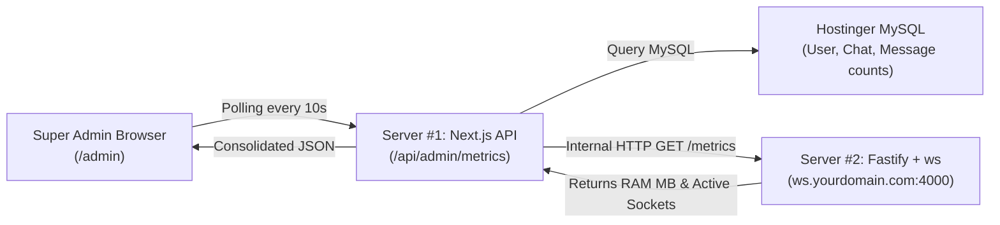

# Phase 29: Super Admin Console & Infrastructure Telemetry

## 1. Phase Overview & Objectives
**Target Workspace**: `web/` (Server #1) & `socket-server/` (Server #2)  
**Primary Goal**: Build an enterprise Super Admin Console and real-time Infrastructure Telemetry dashboard at **$0.00 additional monthly cost**. Administrators and infrastructure operators can monitor live server performance metrics directly from the `/admin` web interface, including Fastify Server #2 live RAM usage (RSS, Heap Used in MB), active concurrent WebSocket connection counts, MySQL row counts, and system uptime.

> [!IMPORTANT]
> **Zero Friction & Verification Guardrail**: Strictly **NO OTP**, **NO SMS**, and **NO phone verification**. Administrative access is enforced strictly via the user's verified `systemRole: "SUPER_ADMIN" | "ADMIN"` in HTTP-only session cookies.

---

## 2. Context & Prerequisites
- **Previous Phase**: [`28_COMPLIANCE_DATA_EXPORT_AND_LEGAL_HOLD.md`](28_COMPLIANCE_DATA_EXPORT_AND_LEGAL_HOLD.md) (Compliance and audit foundations established).
- **Environment**: Next.js 15 Standalone, Fastify 4+ & Native `ws` daemon, Hostinger MySQL via Prisma (`connection_limit=10`).
- **Telemetry Standard**: Server #2 exposes a secured internal health/telemetry endpoint consumed by Server #1 with zero third-party monitoring agents (No Datadog, No New Relic).

---

## 3. Architectural Structure & Target Files

```text
WebChat/
├── web/
│   ├── src/
│   │   ├── app/
│   │   │   ├── admin/
│   │   │   │   ├── layout.tsx               # Admin layout with sidebar navigation & role verification
│   │   │   │   └── page.tsx                 # Super Admin Overview dashboard with live stat cards
│   │   │   └── api/
│   │   │       └── admin/
│   │   │           └── metrics/
│   │   │               └── route.ts         # GET /api/admin/metrics (combines Fastify & MySQL telemetry)
│   │   ├── components/
│   │   │   └── admin/
│   │   │       ├── AdminSidebar.tsx         # Navigation: Overview, Users, Moderation, Storage, Audit, Broadcasts
│   │   │       ├── MetricStatCard.tsx       # Reusable card with icon, title, value, status indicator
│   │   │       ├── MemoryTelemetryCard.tsx  # Fastify RAM visual gauge (RSS vs Heap Used)
│   │   │       └── ActiveSocketsCard.tsx    # Live WebSocket connection count card
│   │   └── lib/
│   │       └── adminAuth.ts                 # Next.js middleware / helper enforcing SUPER_ADMIN or ADMIN role
├── socket-server/
│   └── src/
│       └── routes/
│           └── health.ts                    # Internal GET /metrics endpoint returning memory & socket counts
└── shared/
    └── src/
        └── types.ts                         # SystemMetricsPayload interface
```

---

## 4. Telemetry Aggregation Architecture



---

## 5. Database Schema & Prisma Migrations (`web/prisma/schema.prisma`)

```prisma
// Extension to User model:
// model User {
//   ...
//   systemRole  String   @default("USER") @db.VarChar(20) // "SUPER_ADMIN", "ADMIN", "MODERATOR", "USER"
// }

// Index optimization for admin role queries:
// @@index([systemRole], map: "idx_users_system_role")
```

---

## 6. Step-by-Step Implementation Tasks

- [ ] **1. Admin Route Guard & Role Verification (`adminAuth.ts`)**:
  - Middleware / layout guard for `/admin/*`:
    - Read JWT session cookie.
    - Fetch user from MySQL.
    - If `systemRole !== 'SUPER_ADMIN' && systemRole !== 'ADMIN'`:
      - Redirect to `/chat` with an unauthorized toast notice.
- [ ] **2. Fastify Server #2 Internal Telemetry Endpoint (`socket-server/src/routes/health.ts`)**:
  - Register Fastify route `GET /metrics`:
    - Secured via internal shared secret header `X-Internal-Secret: ${INTERNAL_API_SECRET}`.
    - Calculates current Node.js memory usage in Megabytes:
      ```typescript
      const memory = process.memoryUsage();
      const rssMB = Math.round(memory.rss / 1024 / 1024);
      const heapUsedMB = Math.round(memory.heapUsed / 1024 / 1024);
      const heapTotalMB = Math.round(memory.heapTotal / 1024 / 1024);
      ```
    - Queries active socket count: `roomManager.getActiveSocketCount()`.
    - Returns JSON payload:
      ```json
      {
        "status": "HEALTHY",
        "uptime": 128400,
        "activeSockets": 34,
        "memory": {
          "rssMB": 31,
          "heapUsedMB": 18,
          "heapTotalMB": 24
        },
        "nodeVersion": "v20.17.0"
      }
      ```
- [ ] **3. Consolidated Metrics API (`/api/admin/metrics`)**:
  - `GET /api/admin/metrics`:
    - Authenticate admin user.
    - Concurrently fetch:
      1. Fastify telemetry from Server #2 via internal HTTP GET.
      2. MySQL row counts via `prisma.$transaction([prisma.user.count(), prisma.chat.count(), prisma.message.count()])`.
      3. Messages sent in the last 24 hours (`createdAt >= yesterday`).
    - Return consolidated JSON response.
- [ ] **4. Admin Portal Layout (`admin/layout.tsx`)**:
  - Responsive layout tailored for desktop administration:
    - Left Sidebar `<AdminSidebar />`:
      - Brand logo: *"WebChat Admin"*.
      - Nav links: Overview (`/admin`), Users (`/admin/users`), Storage (`/admin/storage`), Moderation (`/admin/moderation`), Audit Logs (`/admin/audit`), Broadcasts (`/admin/broadcasts`), DLP (`/admin/dlp`).
      - Bottom: Logged-in admin pill with "Back to Chat" shortcut.
    - Top Bar: System status indicator (Green *"All systems operational"*), Hostinger server time, and Auto-refresh toggle (10s, 30s, Off).
- [ ] **5. Overview Dashboard Cards (`admin/page.tsx`)**:
  - **Memory Telemetry Card**:
    - Displays Fastify Server #2 RAM consumption: e.g. `29 MB / 1024 MB`.
    - Visual color-coded progress bar (Green < 60 MB, Yellow 60–100 MB, Red > 100 MB).
    - Subtitle: *"Fastify 4+ & Native ws Daemon (~70% lower than Socket.io)"*.
  - **Active Connections Card**:
    - Large number: e.g. `142 active sockets`.
    - Pulse green animation indicating live WebSocket health.
  - **Database Stat Cards**:
    - Total Users card.
    - Total Messages card with 24h delta.
    - Active Conversations card.

---

## 7. Quality Gate & Verification Criteria

1. Navigating to `/admin` as a standard user (`systemRole: "USER"`) is blocked and redirects away.
2. Navigating to `/admin` as an admin (`systemRole: "ADMIN"`) loads the dashboard with full telemetry.
3. Fastify Server #2 memory report reflects actual low-memory usage (~25–35 MB RAM).
4. Opening new chat sessions increments the active WebSocket connection count in real time.
5. Database counters accurately reflect the counts in the MySQL database.
6. The auto-refresh interval smoothly updates the metric cards without full page reloads.

---

## 8. Autonomous Multi-Agent Handoff Instructions
The next phase is [`30_STORAGE_GOVERNANCE_AND_ORPHAN_CLEANER.md`](30_STORAGE_GOVERNANCE_AND_ORPHAN_CLEANER.md). That agent will build Hostinger NVMe storage governance, media usage breakdowns, and an automated orphan file detection and purge engine.