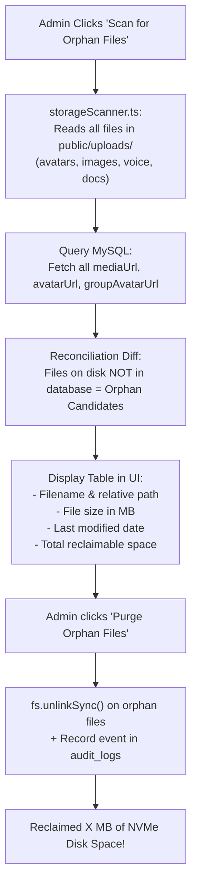

# Phase 30: Storage Management & Orphan Media Cleaner

## 1. Phase Overview & Objectives
**Target Workspace**: `web/` (Server #1)  
**Primary Goal**: Build a Storage Management and Orphan Media Cleaner module at **$0.00 additional monthly cost**. Administrators can inspect a live analytical breakdown of disk usage across all upload categories (Avatars, Images, Voice Notes, Documents). An automated disk scanner compares physical files against active MySQL records, detects orphaned media from interrupted uploads or deleted messages, and allows one-click safe purging to reclaim disk space.

> [!IMPORTANT]
> **Authentication Guardrail**: Strictly **NO OTP**, **NO SMS**, and **NO phone verification**. Storage management operations are restricted strictly by administrator session roles.

---

## 2. Context & Prerequisites
- **Previous Phase**: [`29_ADMIN_CONSOLE_AND_SYSTEM_METRICS.md`](29_ADMIN_CONSOLE_AND_SYSTEM_METRICS.md) (Admin portal layout and metrics dashboard operational).
- **Environment**: Next.js 15, Node.js `fs` / `path` modules on Hostinger NVMe storage (`web/public/uploads/`), Prisma ORM.
- **Safety Standard**: The orphan scanner performs a dry-run comparison first to ensure zero active user media files can ever be accidentally deleted.

---

## 3. Architectural Structure & Target Files

```text
WebChat/
├── web/
│   ├── src/
│   │   ├── app/
│   │   │   ├── admin/
│   │   │   │   └── storage/
│   │   │   │       └── page.tsx             # Storage Analytics & Orphan Cleaner page
│   │   │   └── api/
│   │   │       └── admin/
│   │   │           └── storage/
│   │   │               ├── analytics/
│   │   │               │   └── route.ts     # GET /api/admin/storage/analytics (disk usage breakdown)
│   │   │               ├── orphan-scan/
│   │   │               │   └── route.ts     # GET /api/admin/storage/orphan-scan (dry run scanner)
│   │   │               └── orphan-clean/
│   │   │                   └── route.ts     # POST /api/admin/storage/orphan-clean (executes purge)
│   │   ├── components/
│   │   │   └── admin/
│   │   │       ├── StorageBreakdownCard.tsx # Storage progress bar (Images, Voice, Docs, Avatars)
│   │   │       ├── OrphanFilesTable.tsx     # List of unreferenced files with size and path
│   │   │       └── CleanOrphansModal.tsx    # Confirmation dialog showing bytes to be reclaimed
│   │   └── lib/
│   │       └── storageScanner.ts            # Fast disk traversal & database reconciliation logic
└── shared/
    └── src/
        └── types.ts                         # StorageAnalyticsPayload, OrphanFileInfo interfaces
```

---

## 4. Orphan Media Detection & Purge Flow



---

## 5. Storage Directory Structure

```text
web/public/uploads/
├── avatars/          # User profile pictures (.webp, .jpg)
├── images/           # Compressed chat images (.webp)
├── voice/            # Voice recording audio clips (.opus, .webm)
└── docs/             # Document attachments (.pdf, .xlsx, .docx, .zip)
```

---

## 6. Step-by-Step Implementation Tasks

- [ ] **1. Storage Analytics Engine (`storageScanner.ts`)**:
  - Implement directory size calculator:
    ```typescript
    export async function getDirectorySize(dirPath: string): Promise<{ bytes: number; count: number }> {
      // Recursively traverse directory and sum file stats (size)
    }
    ```
  - Categorize usage into:
    - `avatars`: Bytes and file count in `/public/uploads/avatars/`.
    - `images`: Bytes and file count in `/public/uploads/images/`.
    - `voice`: Bytes and file count in `/public/uploads/voice/`.
    - `docs`: Bytes and file count in `/public/uploads/docs/`.
    - `total`: Sum of all media categories.
- [ ] **2. Storage Analytics API (`GET /api/admin/storage/analytics`)**:
  - Authenticate admin session.
  - Return JSON:
    ```json
    {
      "totalBytes": 142058200,
      "totalFiles": 1284,
      "categories": {
        "images": { "bytes": 84201000, "count": 640 },
        "voice": { "bytes": 22104000, "count": 312 },
        "docs": { "bytes": 31250000, "count": 92 },
        "avatars": { "bytes": 4503200, "count": 240 }
      }
    }
    ```
- [ ] **3. Orphan File Detection Scanner (`GET /api/admin/storage/orphan-scan`)**:
  - Read all file paths currently on disk under `/public/uploads/`.
  - Concurrently fetch all valid media URLs from MySQL:
    - `SELECT mediaUrl FROM messages WHERE mediaUrl IS NOT NULL;`
    - `SELECT avatarUrl FROM users WHERE avatarUrl IS NOT NULL;`
    - `SELECT groupAvatarUrl FROM chats WHERE groupAvatarUrl IS NOT NULL;`
  - Put all valid URLs into a high-speed `Set<string>`.
  - Filter files on disk whose URL path is NOT present in the valid set.
  - Filter out files created in the last 15 minutes (to avoid deleting uploads currently in-flight).
  - Return list of orphan candidates with file size, path, and last modified date.
- [ ] **4. Safe Orphan Purge Endpoint (`POST /api/admin/storage/orphan-clean`)**:
  - Accept list of approved orphan relative file paths.
  - Re-verify path safety (strictly inside `/public/uploads/`, no path traversal `..`).
  - Delete files using `fs.promises.unlink()`.
  - Record audit log: `STORAGE_ORPHANS_PURGED` with total files removed and bytes reclaimed.
  - Return summary: `{ filesDeleted: 24, bytesReclaimed: 45201000 }`.
- [ ] **5. Storage Management UI (`admin/storage/page.tsx`)**:
  - Top visual progress bar: Segmented colored bar showing relative storage distribution (Blue Images, Green Voice, Purple Docs, Yellow Avatars).
  - Stat cards showing total NVMe storage used and file count per category.
  - "Scan for Orphan Files" button with loading spinner.
  - `<OrphanFilesTable />`: Data table listing orphan files with checkboxes.
  - `<CleanOrphansModal />`: Prompts: *"Are you sure you want to delete [N] orphan files and reclaim [X] MB of disk space?"*.

---

## 7. Quality Gate & Verification Criteria

1. Admin can access `/admin/storage` and view live disk usage for avatars, images, voice, and docs.
2. Placing a dummy test file in `/public/uploads/images/test-orphan.jpg` (without a DB record) is flagged as an orphan by the scanner.
3. Files created less than 15 minutes ago are protected from purge candidates.
4. Clicking "Clean Orphan Files" deletes the unreferenced dummy file from disk.
5. Active user media files that are linked to database records are never flagged as orphans.
6. The deletion event is logged to the `audit_logs` table with total bytes reclaimed.

---

## 8. Autonomous Multi-Agent Handoff Instructions
The next phase is [`31_USER_ADMINISTRATION_AND_ROLE_DELEGATION.md`](31_USER_ADMINISTRATION_AND_ROLE_DELEGATION.md). That agent will build the Super Admin user management data grid, search/filter table, and role delegation workflows (`USER`, `MODERATOR`, `ADMIN`, `SUPER_ADMIN`).