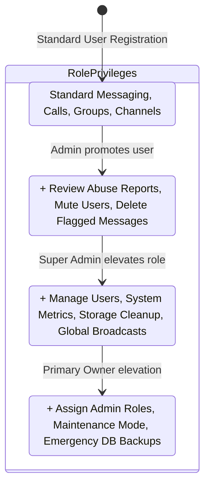

# Phase 31: User Administration & Role Management

## 1. Phase Overview & Objectives
**Target Workspace**: `web/` (Server #1)  
**Primary Goal**: Build a User Administration Data Grid and Role Management system at **$0.00 additional monthly cost**. Super Administrators can search, filter, and inspect all registered user accounts across the system. Administrators can view user details, message activity, active session counts, and delegate administrative privileges (`USER`, `MODERATOR`, `ADMIN`, `SUPER_ADMIN`) with full security audit logging.

> [!IMPORTANT]
> **Authentication Guardrail**: Strictly **NO OTP**, **NO SMS**, and **NO phone verification**. User lookup and role modifications operate strictly through administrative session privileges.

---

## 2. Context & Prerequisites
- **Previous Phase**: [`30_STORAGE_GOVERNANCE_AND_ORPHAN_CLEANER.md`](30_STORAGE_GOVERNANCE_AND_ORPHAN_CLEANER.md) (Storage management and admin portal layout operational).
- **Environment**: Next.js 15, Hostinger MySQL via Prisma (`connection_limit=10`).
- **Security Rule**: Role escalation is protected: Only a `SUPER_ADMIN` can promote another user to `ADMIN` or `SUPER_ADMIN`.

---

## 3. Architectural Structure & Target Files

```text
WebChat/
├── web/
│   ├── src/
│   │   ├── app/
│   │   │   ├── admin/
│   │   │   │   └── users/
│   │   │   │       ├── page.tsx             # User Directory data grid & filter console
│   │   │   │       └── [id]/
│   │   │   │           └── page.tsx         # Detailed User Profile & Activity overview
│   │   │   └── api/
│   │   │       └── admin/
│   │   │           └── users/
│   │   │               ├── route.ts         # GET /api/admin/users (paginated, multi-filter search)
│   │   │               └── [id]/
│   │   │                   ├── route.ts     # GET user details & statistics
│   │   │                   └── role/
│   │   │                       └── route.ts # PATCH /api/admin/users/:id/role (promote/demote role)
│   │   ├── components/
│   │   │   └── admin/
│   │   │       ├── UserDataGrid.tsx         # Sortable, paginated table of users with action dropdowns
│   │   │       ├── RoleBadge.tsx            # Colored role pills (Purple SuperAdmin, Blue Admin, Gold Mod, Grey User)
│   │   │       ├── ChangeRoleModal.tsx      # Modal to elevate or demote system role with reason input
│   │   │       └── UserFilterToolbar.tsx    # Search by username/email, filter by role, filter by status
│   │   └── lib/
│   │       └── rbac.ts                      # Role-Based Access Control hierarchy and permission helper
└── shared/
    └── src/
        └── types.ts                         # SystemRoleEnum, AdminUserView interfaces
```

---

## 4. Role Hierarchy & Delegation Flow



---

## 5. Database Schema & Prisma Migrations (`web/prisma/schema.prisma`)

```prisma
// Extension to User model:
// model User {
//   ...
//   systemRole  String   @default("USER") @db.VarChar(20) // "SUPER_ADMIN", "ADMIN", "MODERATOR", "USER"
//   isSuspended Boolean  @default(false)
// }

// Index optimization:
// @@index([systemRole], map: "idx_users_system_role")
// @@index([isSuspended], map: "idx_users_suspended")
// @@index([createdAt(sort: Desc)], map: "idx_users_created")
```

---

## 6. Step-by-Step Implementation Tasks

- [ ] **1. RBAC Permission Engine (`rbac.ts`)**:
  - Define role hierarchy:
    ```typescript
    export type SystemRole = 'SUPER_ADMIN' | 'ADMIN' | 'MODERATOR' | 'USER';

    export const ROLE_HIERARCHY: Record<SystemRole, number> = {
      SUPER_ADMIN: 4,
      ADMIN: 3,
      MODERATOR: 2,
      USER: 1,
    };

    export function canManageRole(actorRole: SystemRole, targetRole: SystemRole): boolean {
      return ROLE_HIERARCHY[actorRole] > ROLE_HIERARCHY[targetRole];
    }
    ```
- [ ] **2. Paginated User Directory API (`GET /api/admin/users`)**:
  - `GET /api/admin/users`:
    - Protected by `systemRole >= "MODERATOR"`.
    - Query parameters:
      - `search`: Filter by `@username`, `displayName`, or `email` prefix.
      - `role`: Filter by specific `systemRole`.
      - `status`: Filter by `active` or `suspended`.
      - `page` (default 1) and `limit` (default 25).
      - `sortBy` (default `createdAt`, order `desc`).
    - Returns paginated list with total count and metadata.
- [ ] **3. Role Elevation API (`PATCH /api/admin/users/:id/role`)**:
  - `PATCH /api/admin/users/:id/role`:
    - Verify requesting user has permission to assign target role (`canManageRole`).
    - Target user cannot be self (cannot demote yourself from Super Admin).
    - Update `User.systemRole` in MySQL.
    - Record event in `audit_logs`: `USER_ROLE_ELEVATED` with previous and new role.
    - Return updated user record.
- [ ] **4. User Directory Data Grid Component (`UserDataGrid.tsx`)**:
  - Layout:
    - Search input for instant query matching.
    - Filter dropdowns: Role (`All`, `Users`, `Moderators`, `Admins`, `Super Admins`) and Status (`All`, `Active`, `Suspended`).
    - Table columns:
      - User (avatar, display name, `@username`).
      - Email address.
      - Role (`<RoleBadge />`: Purple for Super Admin, Blue for Admin, Gold for Moderator, Slate for User).
      - Status (Green badge "Active", Red badge "Suspended").
      - Last seen timestamp (relative time).
      - Actions menu (Change Role, View Details, Suspend/Ban).
- [ ] **5. Role Delegation Modal (`ChangeRoleModal.tsx`)**:
  - Modal title: *"Change System Role for @[username]"*.
  - Radio selector with descriptions:
    - `USER`: Standard access to messages, calls, and groups.
    - `MODERATOR`: Can review abuse reports and delete violating messages.
    - `ADMIN`: Full access to user management, metrics, and system broadcasts.
    - `SUPER_ADMIN`: Root administrator privileges.
  - Mandatory audit reason text field: e.g. *"Promoting lead engineer to system admin"*.
  - Green "Save Changes" button.
- [ ] **6. User Details Drawer (`admin/users/[id]/page.tsx`)**:
  - Detailed card showing:
    - Account creation date and verified email.
    - Active device session count (from `user_sessions`).
    - Total messages sent and total media uploaded.
    - Group memberships list.

---

## 7. Quality Gate & Verification Criteria

1. Navigating to `/admin/users` displays the complete, paginated list of users.
2. Searching for `@bob` filters the grid to matching username/email accounts instantly.
3. Super Admin can open `<ChangeRoleModal />` and promote a user to `MODERATOR`.
4. The user's role badge immediately updates to gold `MODERATOR`.
5. The role change action is recorded in `audit_logs` with the actor ID and mandatory reason.
6. A standard user or moderator attempting to promote someone to Admin is blocked with a 403 error.

---

## 8. Autonomous Multi-Agent Handoff Instructions
The next phase is [`32_ACCOUNT_MODERATION_BANS_AND_SOCKET_KICKS.md`](32_ACCOUNT_MODERATION_BANS_AND_SOCKET_KICKS.md). That agent will build account suspension, permanent bans, and real-time WebSocket kicks terminating active connections.