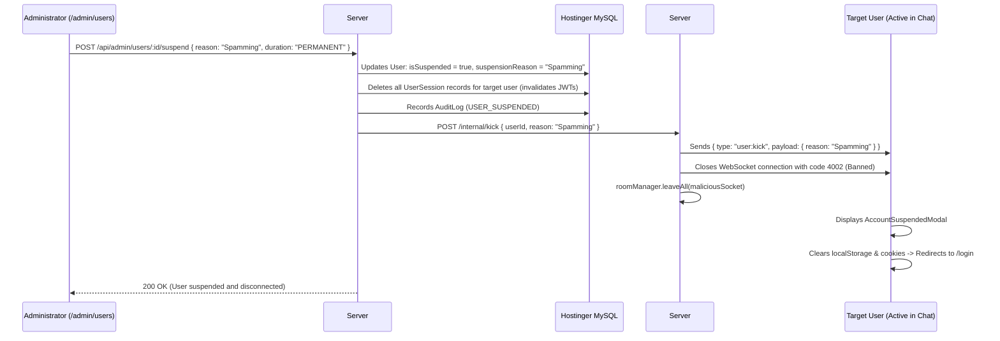

# Phase 32: Account Moderation, Bans & Real-Time Socket Kicks

## 1. Phase Overview & Objectives
**Target Workspace**: `web/` (Server #1) & `socket-server/` (Server #2)  
**Primary Goal**: Build an enterprise Account Moderation, Suspension, and Real-Time WebSocket Kick system at **$0.00 additional monthly cost**. Administrators and moderators can suspend or permanently ban malicious users with mandatory reason logging. When a user is suspended, Server #2 terminates all their active WebSocket connections in < 50ms, revokes all device session tokens, displays an explanatory suspension modal on the user's screen, and redirects them to the login screen.

> [!IMPORTANT]
> **Zero Friction & Verification Guardrail**: Strictly **NO OTP**, **NO SMS**, and **NO phone verification**. Account moderation operates via database flags (`isSuspended`) and immediate socket disconnects.

---

## 2. Context & Prerequisites
- **Previous Phase**: [`31_USER_ADMINISTRATION_AND_ROLE_DELEGATION.md`](31_USER_ADMINISTRATION_AND_ROLE_DELEGATION.md) (User management data grid and RBAC established).
- **Environment**: Next.js 15, Fastify 4+ & Native `ws` `RoomManager`, Hostinger MySQL via Prisma (`connection_limit=10`).
- **Real-Time Kick Standard**: Uses `user:kick` envelope delivered to the target user's active sockets before closing the TCP connection.

---

## 3. Architectural Structure & Target Files

```text
WebChat/
├── web/
│   ├── src/
│   │   ├── app/api/
│   │   │   └── admin/
│   │   │       └── users/
│   │   │           └── [id]/
│   │   │               ├── suspend/
│   │   │               │   └── route.ts     # POST /api/admin/users/:id/suspend (apply suspension/ban)
│   │   │               └── unsuspend/
│   │   │                   └── route.ts     # POST /api/admin/users/:id/unsuspend (reactivate account)
│   │   ├── components/
│   │   │   ├── admin/
│   │   │   │   ├── SuspendUserModal.tsx     # Modal with duration selector (24h, 7d, 30d, Permanent) & reason
│   │   │   │   └── UnsuspendUserModal.tsx   # Reactivation confirmation dialog
│   │   │   └── auth/
│   │   │       └── AccountSuspendedModal.tsx# Red modal shown on user's client when kicked
│   │   └── lib/
│   │       └── moderationAuth.ts            # Auth check blocking suspended users during login & token refresh
├── socket-server/
│   └── src/
│       ├── handlers/
│       │   └── kickHandler.ts               # Receives user:kick, terminates sockets with code 4002
│       └── routes/
│           └── internalKick.ts              # Internal HTTP endpoint triggered by Server #1
└── shared/
    └── src/
        └── events.ts                        # user:kick WebSocket envelope definition
```

---

## 4. Real-Time Account Suspension & Socket Kick Flow



---

## 5. Database Schema & Prisma Migrations (`web/prisma/schema.prisma`)

```prisma
// Extension to User model:
// model User {
//   ...
//   isSuspended      Boolean   @default(false)
//   suspendedAt      DateTime?
//   suspendedUntil   DateTime? // null = permanent ban
//   suspensionReason String?   @db.VarChar(255)
//   suspendedById    String?
// }

// Index optimization:
// @@index([isSuspended, suspendedUntil], map: "idx_users_suspended_until")
```

---

## 6. Step-by-Step Implementation Tasks

- [ ] **1. Account Suspension API (`/api/admin/users/:id/suspend`)**:
  - `POST /api/admin/users/:id/suspend`:
    - Protected by `systemRole >= "MODERATOR"`.
    - Input parameters:
      - `reason`: Required string (min 10 chars).
      - `duration`: `"24H"`, `"7D"`, `"30D"`, or `"PERMANENT"`.
    - Calculate `suspendedUntil` timestamp (or `null` for permanent).
    - Update `User` record in MySQL: `isSuspended: true`, `suspendedAt: new Date()`, `suspensionReason: reason`.
    - Invalidate all active sessions in `user_sessions` for that user.
    - Record audit log: `USER_SUSPENDED` with actor ID and reason.
    - Dispatch internal kick request to Server #2: `POST http://127.0.0.1:4000/internal/kick`.
- [ ] **2. Fastify Real-Time Socket Kick Handler (`internalKick.ts`)**:
  - Register Fastify endpoint `POST /internal/kick`:
    - Secured via `X-Internal-Secret` header.
    - Find all active sockets for `userId` in `roomManager`.
    - For each socket:
      - Send final envelope: `{ type: 'user:kick', payload: { reason, suspendedUntil } }`.
      - Close socket connection: `socket.close(4002, 'Account Suspended')`.
      - Remove socket from all room sets.
- [ ] **3. Login Guard Enforcement (`moderationAuth.ts`)**:
  - In `/api/auth/login`:
    - When user credentials are correct, check `user.isSuspended`:
      - If `suspendedUntil && suspendedUntil <= new Date()`:
        - Automatically unsuspend user (temporary ban expired).
      - Else if `user.isSuspended === true`:
        - Reject login: `403 Forbidden` with response:
          ```json
          {
            "error": "ACCOUNT_SUSPENDED",
            "reason": user.suspensionReason,
            "until": user.suspendedUntil
          }
          ```
- [ ] **4. Suspend User Modal Component (`SuspendUserModal.tsx`)**:
  - Opened from the user actions menu in the User Data Grid.
  - Displays user avatar, display name, and `@username`.
  - Radio options for Duration:
    - **24 Hours** (Temporary cooldown)
    - **7 Days** (Serious infraction)
    - **30 Days** (Severe policy violation)
    - **Permanent** (Permanent account termination)
  - Textarea: *"Mandatory suspension reason"* (e.g. *"Targeted harassment in community channel"*).
  - Red button: *"Suspend & Kick User"*.
- [ ] **5. Client-Side Kick Listener & Modal (`AccountSuspendedModal.tsx`)**:
  - In global WebSocket client listener:
    - On receiving `{ type: 'user:kick', payload }` or WebSocket close code `4002`:
      - Display un-dismissible red modal `<AccountSuspendedModal />`:
        - Shield alert icon.
        - Title: *"Your account has been suspended"*.
        - Reason: `payload.reason`.
        - Duration: `payload.suspendedUntil ? formatDistance(suspendedUntil) : "Permanent"`.
        - Button: *"Log Out"*.
      - Delete client-side tokens and redirect to `/login`.
- [ ] **6. Unsuspend / Reactivate Workflow (`UnsuspendUserModal.tsx`)**:
  - Route: `POST /api/admin/users/:id/unsuspend`.
  - Clears `isSuspended`, `suspensionReason`, and `suspendedUntil`.
  - Records audit log: `USER_UNSUSPENDED`.

---

## 7. Quality Gate & Verification Criteria

1. Administrator can select "Suspend User" on an account and provide a mandatory reason.
2. If the suspended user is actively connected on desktop or mobile Chrome, their WebSocket connection is terminated in < 50ms.
3. The suspended user's screen displays `<AccountSuspendedModal />` explaining the reason.
4. Attempting to log back in displays the suspension error message and prevents token issuance.
5. All active device sessions for that user are wiped from `user_sessions`.
6. Clicking "Unsuspend" reactivates the account and allows successful login once again.

---

## 8. Autonomous Multi-Agent Handoff Instructions
The next phase is [`33_ABUSE_REPORTING_AND_MODERATION_QUEUE.md`](33_ABUSE_REPORTING_AND_MODERATION_QUEUE.md). That agent will build the user-facing abuse reporting workflow and the admin moderation review queue with one-click message deletion.