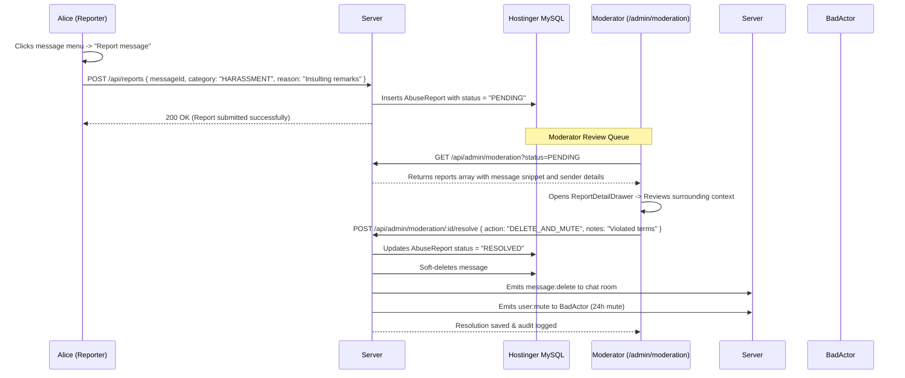

# Phase 33: Abuse Reporting & Moderation Queue

## 1. Phase Overview & Objectives
**Target Workspace**: `web/` (Server #1) & `socket-server/` (Server #2)  
**Primary Goal**: Build a Abuse Reporting workflow and Admin Moderation Review Queue at **$0.00 additional monthly cost**. Users can flag abusive messages or profiles with categorized complaints (Spam, Harassment, Phishing, Inappropriate Content). Community moderators and system administrators review flagged items inside `/admin/moderation`, inspect surrounding chat context, and execute one-click moderation actions (Purge Message, Issue Warning, 24h Mute, Suspend Account, or Dismiss Report).

> [!IMPORTANT]
> **Authentication Guardrail**: Strictly **NO OTP**, **NO SMS**, and **NO phone verification**. Abuse reports are submitted directly by authenticated members.

---

## 2. Context & Prerequisites
- **Previous Phase**: [`32_ACCOUNT_MODERATION_BANS_AND_SOCKET_KICKS.md`](32_ACCOUNT_MODERATION_BANS_AND_SOCKET_KICKS.md) (Suspensions and kicks operational).
- **Environment**: Next.js 15, Fastify 4+ & Native `ws`, Hostinger MySQL via Prisma (`connection_limit=10`).
- **Privacy Standard**: Reported message context captures only the surrounding 3 messages before and after the reported item to allow fair review while respecting conversation privacy.

---

## 3. Architectural Structure & Target Files

```text
WebChat/
├── web/
│   ├── src/
│   │   ├── app/
│   │   │   ├── admin/
│   │   │   │   └── moderation/
│   │   │   │       └── page.tsx             # Admin Moderation Queue console
│   │   │   └── api/
│   │   │       ├── reports/
│   │   │       │   └── route.ts             # POST /api/reports (submit new report)
│   │   │       └── admin/
│   │   │           └── moderation/
│   │   │               ├── route.ts         # GET /api/admin/moderation (list pending reports)
│   │   │               └── [id]/
│   │   │                   └── resolve/
│   │   │                       └── route.ts # POST /api/admin/moderation/:id/resolve (execute action)
│   │   ├── components/
│   │   │   ├── chat/
│   │   │   │   └── ReportMessageModal.tsx   # User modal with reason category & optional details
│   │   │   └── admin/
│   │   │       ├── ModerationQueueTable.tsx # Table listing pending reports with severity badge
│   │   │       ├── ReportDetailDrawer.tsx   # Drawer showing reported message with surrounding context
│   │   │       └── ModerationActionModal.tsx# Confirmation modal for action (Delete, Mute, Ban, Dismiss)
│   │   └── lib/
│   │       └── moderationService.ts         # Actions: delete message, warn, mute, suspend
├── socket-server/
│   └── src/
│       └── handlers/
│           └── moderationBroadcast.ts       # Broadcasts message deletions or kicks to rooms
└── shared/
    └── src/
        └── types.ts                         # AbuseReportPayload, ReportResolutionEnum interfaces
```

---

## 4. Abuse Reporting & Moderation Queue Workflow



---

## 5. Database Schema & Prisma Migrations (`web/prisma/schema.prisma`)

```prisma
// Extension to User model:
// model User {
//   ...
//   reportsFiled    AbuseReport[] @relation("ReportFiledBy")
//   reportsAgainst  AbuseReport[] @relation("ReportFiledAgainst")
//   reportsResolved AbuseReport[] @relation("ReportResolvedBy")
// }

model AbuseReport {
  id               String    @id @default(uuid())
  reporterId       String
  reportedUserId   String
  chatId           String
  messageId        String?
  category         String    @db.VarChar(50)  // "SPAM", "HARASSMENT", "PHISHING", "INAPPROPRIATE", "OTHER"
  reason           String    @db.VarChar(500)
  status           String    @default("PENDING") @db.VarChar(20) // "PENDING", "RESOLVED", "DISMISSED"
  resolvedById     String?
  resolutionAction String?   @db.VarChar(50)  // "DELETE_MESSAGE", "WARN_USER", "MUTE_USER", "SUSPEND_USER", "DISMISSED"
  resolutionNotes  String?   @db.Text
  createdAt        DateTime  @default(now())
  resolvedAt       DateTime?

  reporter     User     @relation("ReportFiledBy", fields: [reporterId], references: [id], onDelete: Cascade)
  reportedUser User     @relation("ReportFiledAgainst", fields: [reportedUserId], references: [id], onDelete: Cascade)
  resolvedBy   User?    @relation("ReportResolvedBy", fields: [resolvedById], references: [id], onDelete: SetNull)
  chat         Chat     @relation(fields: [chatId], references: [id], onDelete: Cascade)
  message      Message? @relation(fields: [messageId], references: [id], onDelete: SetNull)

  @@index([status, createdAt(sort: Desc)], map: "idx_reports_status_created")
  @@index([reportedUserId], map: "idx_reports_reported_user")
  @@map("abuse_reports")
}
```

---

## 6. Step-by-Step Implementation Tasks

- [ ] **1. User Abuse Reporting API (`/api/reports`)**:
  - `POST /api/reports`:
    - Authenticate user.
    - Validate parameters: `chatId`, `messageId` (optional), `reportedUserId`, `category`, and `reason` (min 5 chars).
    - Rate limit: Max 5 reports per user per hour to prevent griefing.
    - Insert `AbuseReport` record with `status: "PENDING"`.
    - Return `200 OK` with confirmation message.
- [ ] **2. Report Message Modal Component (`ReportMessageModal.tsx`)**:
  - Opened via message hover dropdown -> "Report message".
  - Category selector radio pills:
    - **Spam**: Unsolicited advertising, repetitive messages.
    - **Harassment**: Bullying, abusive insults, hate speech.
    - **Phishing**: Malicious links, impersonation, credential theft.
    - **Inappropriate Content**: Explicit or illegal media.
    - **Other**.
  - Textarea for additional comments (optional).
  - Checkbox: *"Block this user"* (automatically adds contact to blocklist).
  - Red "Submit Report" button.
- [ ] **3. Moderation Review Queue API (`/api/admin/moderation`)**:
  - `GET /api/admin/moderation`:
    - Protected by `systemRole >= "MODERATOR"`.
    - Filter by `status` (default `PENDING`), `category`, and date range.
    - Include reporter information, reported user information, and reported message content.
- [ ] **4. Report Resolution API (`/api/admin/moderation/:id/resolve`)**:
  - `POST /api/admin/moderation/:id/resolve`:
    - Accept `action`:
      - `DELETE_MESSAGE`: Soft-deletes or removes message and unlinks media from NVMe disk.
      - `WARN_USER`: Dispatches an automated moderation warning message to the user.
      - `MUTE_USER`: Restricts user from sending messages for 24 hours.
      - `SUSPEND_USER`: Calls suspension engine from Phase 32.
      - `DISMISSED`: Closes report with note "No violation found".
    - Update `AbuseReport`: `status: "RESOLVED"`, `resolvedById: admin.id`, `resolutionAction: action`, `resolvedAt: new Date()`.
    - Record audit log: `ABUSE_REPORT_RESOLVED`.
- [ ] **5. Moderation Queue Dashboard (`admin/moderation/page.tsx`)**:
  - Stat cards: Total Pending Reports, Resolved Today, Average Response Time.
  - `<ModerationQueueTable />`:
    - Severity badge (Red for Harassment/Phishing, Yellow for Spam).
    - Reported user name & avatar.
    - Reporter name.
    - Snippet of flagged message.
    - Date reported.
    - "Review" button.
- [ ] **6. Report Detail Drawer with Context (`ReportDetailDrawer.tsx`)**:
  - Clicking "Review" opens slide-out drawer:
    - Shows reported user profile (account age, previous violations count).
    - Context View: Displays the reported message highlighted in red, with the preceding 2 messages and succeeding 2 messages for conversational context.
    - Action buttons: "Delete Message", "Issue Warning", "Mute 24h", "Suspend Account", "Dismiss".

---

## 7. Quality Gate & Verification Criteria

1. User can click "Report message", pick a category, and submit the report.
2. The report appears in `/admin/moderation` with status `PENDING`.
3. Moderator can open the detail drawer and inspect the reported message with surrounding context.
4. Clicking "Delete Message" removes the message from the chat, emits `message:delete` via WebSockets, and marks the report `RESOLVED`.
5. Clicking "Suspend Account" triggers the socket kick engine and disconnects the malicious user.
6. Dismissing a report marks it `DISMISSED` without altering user messages.

---

## 8. Autonomous Multi-Agent Handoff Instructions
The next phase is [`34_REALTIME_DLP_REGEX_SCANNER.md`](34_REALTIME_DLP_REGEX_SCANNER.md). That agent will build high-speed in-memory Data Loss Prevention (DLP) regex scanners to preflight and block credential/credit card leaks in real time over WebSockets.