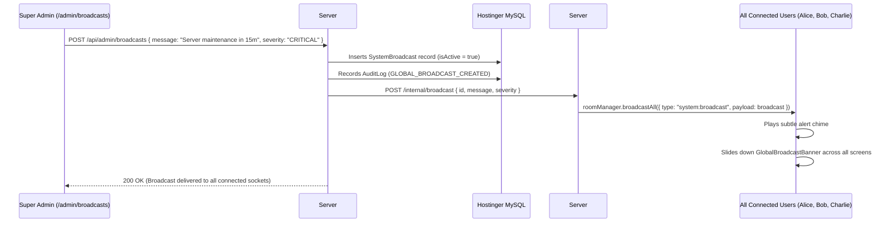

# Phase 35: Real-Time Global Broadcasts

## 1. Phase Overview & Objectives
**Target Workspace**: `web/` (Server #1) & `socket-server/` (Server #2)  
**Primary Goal**: Build an enterprise Real-Time Global System Broadcast system at **$0.00 additional monthly cost**. Super Administrators can compose platform-wide announcements with color-coded severity levels (**INFO**, **WARNING**, **CRITICAL**). Server #2 dispatches broadcasts over WebSockets to 100% of connected clients in **< 50ms**, rendering an animated sliding top banner with an alert chime across all active chat windows.

> [!IMPORTANT]
> **Zero Friction & Verification Guardrail**: Strictly **NO OTP**, **NO SMS**, and **NO phone verification**. Broadcast dispatch is governed directly by Super Administrator credentials.

---

## 2. Context & Prerequisites
- **Previous Phase**: [`34_REALTIME_DLP_REGEX_SCANNER.md`](34_REALTIME_DLP_REGEX_SCANNER.md) (Security and DLP engines established).
- **Environment**: Next.js 15, Fastify 4+ & Native `ws` `RoomManager`, Hostinger MySQL via Prisma (`connection_limit=10`).
- **Low Overhead Rule**: Fastify uses `roomManager.broadcastAll()` to transmit the JSON envelope to all active sockets with zero database querying during broadcast dispatch.

---

## 3. Architectural Structure & Target Files

```text
WebChat/
├── web/
│   ├── src/
│   │   ├── app/
│   │   │   ├── admin/
│   │   │   │   └── broadcasts/
│   │   │   │       └── page.tsx             # Broadcast Composer & History Manager
│   │   │   └── api/
│   │   │       ├── broadcasts/
│   │   │       │   └── active/
│   │   │       │       └── route.ts         # GET /api/broadcasts/active (fetch currently active broadcast)
│   │   │       └── admin/
│   │   │           └── broadcasts/
│   │   │               ├── route.ts         # POST /api/admin/broadcasts (create & dispatch)
│   │   │               └── [id]/
│   │   │                   └── route.ts     # DELETE /api/admin/broadcasts/:id (deactivate)
│   │   ├── components/
│   │   │   ├── layout/
│   │   │   │   └── GlobalBroadcastBanner.tsx# Animated sliding banner mounted on chat layout
│   │   │   └── admin/
│   │   │       ├── BroadcastComposer.tsx    # Composer form with severity selector & live preview
│   │   │       └── BroadcastHistoryTable.tsx# Table of past broadcasts with deactivate button
│   │   └── hooks/
│   │       └── useGlobalBroadcast.ts        # Listens for system:broadcast envelopes and manages dismiss state
├── socket-server/
│   └── src/
│       ├── handlers/
│       │   └── broadcastHandler.ts          # Dispatches system:broadcast to all connected sockets
│       └── routes/
│           └── internalBroadcast.ts         # Internal HTTP endpoint triggered by Server #1
└── shared/
    └── src/
        └── events.ts                        # system:broadcast WebSocket envelope definition
```

---

## 4. Real-Time Global Broadcast Architecture



---

## 5. Database Schema & Prisma Migrations (`web/prisma/schema.prisma`)

```prisma
// Extension to User model:
// model User {
//   ...
//   broadcasts SystemBroadcast[]
// }

model SystemBroadcast {
  id        String    @id @default(uuid())
  creatorId String
  severity  String    @default("INFO") @db.VarChar(20) // "INFO", "WARNING", "CRITICAL"
  message   String    @db.VarChar(500)
  isActive  Boolean   @default(true)
  expiresAt DateTime?
  createdAt DateTime  @default(now())

  creator User @relation(fields: [creatorId], references: [id], onDelete: Cascade)

  @@index([isActive, createdAt(sort: Desc)], map: "idx_broadcast_active")
  @@map("system_broadcasts")
}
```

---

## 6. Step-by-Step Implementation Tasks

- [ ] **1. Broadcast Management API Routes (`/api/admin/broadcasts`)**:
  - `POST /api/admin/broadcasts`:
    - Protected by `systemRole: "SUPER_ADMIN" | "ADMIN"`.
    - Accept `{ message: string, severity: "INFO" | "WARNING" | "CRITICAL", durationHours?: number }`.
    - Deactivate any previously active broadcasts (only 1 active broadcast at a time).
    - Calculate `expiresAt` (e.g. `NOW + durationHours`).
    - Insert `SystemBroadcast` row in MySQL.
    - Post to Server #2 internal endpoint `POST http://127.0.0.1:4000/internal/broadcast`.
  - `DELETE /api/admin/broadcasts/:id`:
    - Set `isActive: false`.
    - Trigger Server #2 to broadcast `{ type: "system:broadcast_dismiss", payload: { id } }`.
- [ ] **2. Fastify Broadcast Route & Handler (`internalBroadcast.ts`)**:
  - Register Fastify route `POST /internal/broadcast`:
    - Verify `X-Internal-Secret` header.
    - Execute:
      ```typescript
      roomManager.broadcastAll({
        type: 'system:broadcast',
        payload: req.body,
      });
      ```
- [ ] **3. Active Broadcast Polling Endpoint (`/api/broadcasts/active`)**:
  - `GET /api/broadcasts/active`:
    - Returns the latest broadcast where `isActive = true` and `(expiresAt IS NULL OR expiresAt > NOW())`.
    - Called on client application mount to catch announcements made while the user was offline.
- [ ] **4. Responsive In-App Sliding Banner (`GlobalBroadcastBanner.tsx`)**:
  - Mounted at the top of `ChatLayout.tsx`:
    - Color-coded severity styling:
      - **INFO**: `bg-[#00a884] text-white` (WhatsApp Emerald).
      - **WARNING**: `bg-amber-600 text-white` (Amber Alert).
      - **CRITICAL**: `bg-rose-700 text-white animate-pulse` (Urgent Incident).
    - Icon: Megaphone for Info, Alert Triangle for Warning, Siren for Critical.
    - Message body with support for bold formatting.
    - Right side: Close / Dismiss button (`X`) that stores dismissed ID in `sessionStorage`.
    - Smooth slide-down animation (`transition-all duration-300 ease-out`).
- [ ] **5. Audio Alert Chime**:
  - Play brief, elegant web audio chime using the Web Audio API (synthesizer oscillator: 520Hz ➔ 660Hz dual-tone, 150ms) without needing external audio file assets.
- [ ] **6. Admin Broadcast Composer UI (`admin/broadcasts/page.tsx`)**:
  - Composer card:
    - Textarea for message (max 500 chars).
    - Severity radio buttons (**Info**, **Warning**, **Critical**).
    - Duration picker (**1 Hour**, **6 Hours**, **24 Hours**, **Until Dismissed**).
    - Live Banner Preview rendering exactly what users will see.
    - Red/Green "Dispatch Broadcast to All Users" button.
  - History Table: List of past broadcasts with author, date, severity badge, and "Deactivate" button.

---

## 7. Quality Gate & Verification Criteria

1. Super Admin can compose a message, select "CRITICAL", and dispatch the broadcast.
2. All open browser tabs across all user accounts receive the WebSocket envelope in < 50ms.
3. The sliding banner appears at the top of every screen with the red alert theme and plays a soft audio chime.
4. Users logging in 10 minutes later immediately see the active banner on startup.
5. Clicking "Deactivate" in the admin console sends an event that removes the banner from all users' screens.
6. The broadcast creation is recorded in `audit_logs`.

---

## 8. Autonomous Multi-Agent Handoff Instructions
The next phase is [`36_MAINTENANCE_MODE_AND_EMERGENCY_BACKUPS.md`](36_MAINTENANCE_MODE_AND_EMERGENCY_BACKUPS.md). That agent will build the Enterprise Maintenance Mode switch and the on-demand emergency `mysqldump` database backup trigger.