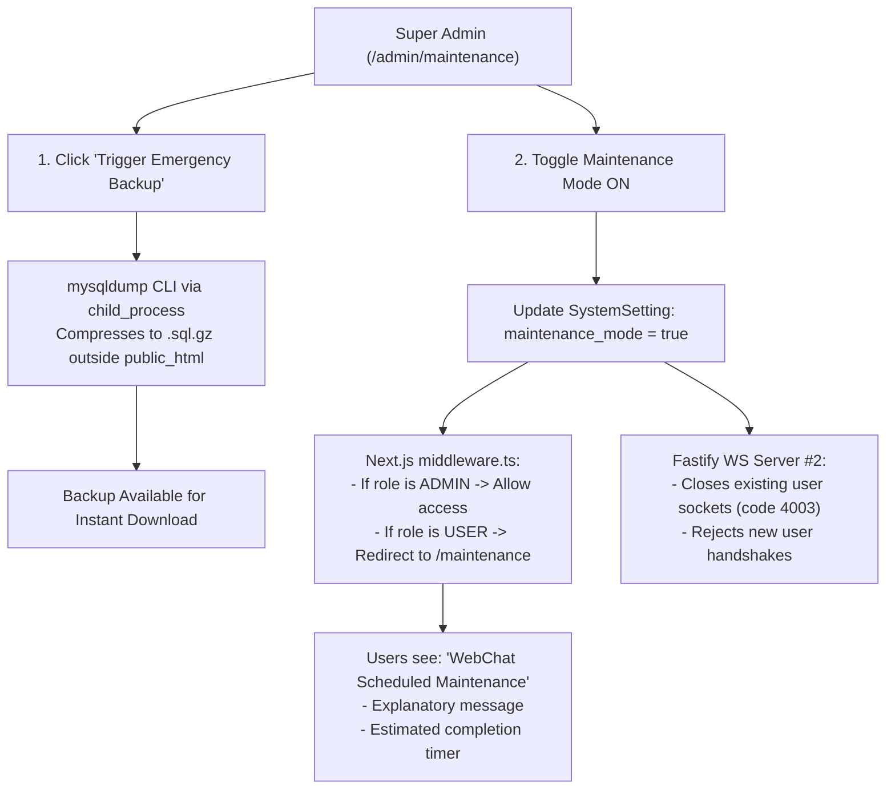

# Phase 36: Maintenance Mode & Emergency Database Backups

## 1. Phase Overview & Objectives
**Target Workspace**: `web/` (Server #1) & `socket-server/` (Server #2)  
**Primary Goal**: Build an enterprise Maintenance Mode switch and On-Demand Emergency Database Backup trigger at **$0.00 additional monthly cost**. When major database migrations or infrastructure maintenance is required, Super Administrators can toggle Maintenance Mode. Non-admin users are blocked with an informative "Scheduled Maintenance" landing screen with a live countdown, while admins retain full access via bypass tokens. In addition, admins can trigger an on-demand, compressed `mysqldump` backup with one-click download before performing system upgrades.

> [!IMPORTANT]
> **Zero Friction & Verification Guardrail**: Strictly **NO OTP**, **NO SMS**, and **NO phone verification**. Administrative bypass is validated through the user's authenticated `systemRole: "SUPER_ADMIN" | "ADMIN"`.

---

## 2. Context & Prerequisites
- **Previous Phase**: [`35_REALTIME_GLOBAL_BROADCASTS.md`](35_REALTIME_GLOBAL_BROADCASTS.md) (Global broadcast system operational).
- **Environment**: Next.js 15, Fastify 4+ & Native `ws`, Hostinger MySQL native `mysqldump` tool via Node.js `child_process`.
- **Backup Security**: Backups are stored in a secured directory outside `public_html` to prevent public URL access.

---

## 3. Architectural Structure & Target Files

```text
WebChat/
├── web/
│   ├── src/
│   │   ├── app/
│   │   │   ├── maintenance/
│   │   │   │   └── page.tsx                 # Public Maintenance Mode splash page with countdown
│   │   │   ├── admin/
│   │   │   │   └── maintenance/
│   │   │   │       └── page.tsx             # Maintenance Mode controls & Backups manager
│   │   │   └── api/
│   │   │       └── admin/
│   │   │           └── maintenance/
│   │   │               ├── toggle/route.ts  # POST /api/admin/maintenance/toggle (enable/disable)
│   │   │               └── backup/
│   │   │                   ├── route.ts     # POST /api/admin/maintenance/backup (runs mysqldump)
│   │   │                   └── [filename]/
│   │   │                       └── route.ts # GET /api/admin/maintenance/backup/:filename (downloads .sql.gz)
│   │   ├── components/
│   │   │   └── admin/
│   │   │       ├── MaintenanceToggleCard.tsx# Switch with estimated downtime input & reason
│   │   │       └── BackupHistoryTable.tsx   # Table of generated backups with size & download link
│   │   └── middleware.ts                    # Next.js middleware routing non-admin traffic to /maintenance
├── socket-server/
│   └── src/
│       └── middleware/
│           └── maintenanceGuard.ts          # Rejects non-admin WebSocket connections with code 4003
└── shared/
    └── src/
        └── types.ts                         # MaintenanceState, BackupInfo interfaces
```

---

## 4. Maintenance Mode & Backup Architecture



---

## 5. Database Schema & Prisma Migrations (`web/prisma/schema.prisma`)

```prisma
model SystemSetting {
  id          String   @id @default(uuid())
  key         String   @unique(map: "idx_system_settings_key") @db.VarChar(50)
  value       String   @db.Text
  description String?  @db.VarChar(255)
  updatedAt   DateTime @updatedAt

  @@map("system_settings")
}
```

---

## 6. Step-by-Step Implementation Tasks

- [ ] **1. Maintenance Mode Toggle API (`/api/admin/maintenance/toggle`)**:
  - `POST /api/admin/maintenance/toggle`:
    - Protected by `systemRole === "SUPER_ADMIN"`.
    - Accept `{ isEnabled: boolean, estimatedEnd?: string, reason?: string }`.
    - Upsert `SystemSetting` key `maintenance_mode`:
      ```json
      {
        "enabled": true,
        "reason": "Upgrading database cluster",
        "estimatedEnd": "2026-10-27T03:00:00Z"
      }
      ```
    - Record audit log: `MAINTENANCE_TOGGLED` with actor ID.
    - Trigger Server #2 internal notification to drop non-admin sockets.
- [ ] **2. Next.js Routing Middleware Guard (`middleware.ts`)**:
  - In `middleware.ts`:
    - Read cached maintenance state.
    - If maintenance is enabled:
      - Exclude paths: `/_next/*`, `/maintenance`, `/api/admin/*`, `/admin/*`, `/api/auth/*`.
      - Inspect JWT cookie:
        - If user `systemRole` is `SUPER_ADMIN` or `ADMIN`, allow request (bypass).
        - Otherwise, redirect to `/maintenance`.
- [ ] **3. Fastify WebSocket Maintenance Guard (`maintenanceGuard.ts`)**:
  - On incoming WebSocket upgrade:
    - If `maintenance_mode === true`:
      - Verify user is admin.
      - If non-admin: Close socket with code `4003 (Service Unavailable - Maintenance)`.
- [ ] **4. Public Maintenance Splash Page (`app/maintenance/page.tsx`)**:
  - WhatsApp Web themed full-page splash (`#111b21` background):
    - Brand logo with glowing gear / wrench animation.
    - Title: *"WebChat is temporarily under maintenance"*.
    - Description: *"We are performing scheduled infrastructure upgrades to improve speed and reliability. We will be back shortly."*
    - Live countdown clock displaying remaining time until `estimatedEnd`.
    - "Refresh Page" button.
- [ ] **5. Emergency Database Backup Generator (`/api/admin/maintenance/backup`)**:
  - `POST /api/admin/maintenance/backup`:
    - Protected by `systemRole === "SUPER_ADMIN"`.
    - Parse MySQL connection details from `DATABASE_URL` (host, user, password, database, port).
    - Generate timestamped filename: `backup_webchat_${Date.now()}.sql.gz`.
    - Target directory: `../backups/` (strictly outside web root `public_html`).
    - Execute native `mysqldump` piped through `gzip` via Node.js `child_process.spawn()`:
      ```bash
      mysqldump -u ${user} -p${password} -h ${host} -P ${port} ${database} | gzip > ${filePath}
      ```
    - Record audit log: `EMERGENCY_BACKUP_CREATED` with file size.
    - Return backup metadata `{ filename, sizeBytes, createdAt }`.
- [ ] **6. Backup Downloader & History Table (`admin/maintenance/page.tsx`)**:
  - List existing backups in `../backups/` with file size and timestamp.
  - "Download" button: Streams `.sql.gz` securely to admin's browser.
  - "Run Emergency Backup Now" button with confirmation prompt and loading spinner.

---

## 7. Quality Gate & Verification Criteria

1. Super Admin toggling Maintenance Mode ON redirects normal users attempting to load `/chat` to `/maintenance`.
2. Normal users connected over WebSockets receive code 4003 and are redirected to the maintenance splash page.
3. Super Admins and Admins can continue browsing `/admin` and testing `/chat` without disruption.
4. The maintenance splash page displays the live countdown timer.
5. Clicking "Run Emergency Backup Now" generates a valid compressed `.sql.gz` database dump on disk.
6. Downloading and inspecting the backup confirms it contains all MySQL schema statements and row data.
7. Toggling Maintenance Mode OFF instantly restores access for all users.

---

## 8. Autonomous Multi-Agent Handoff Instructions
The next phase is [`37_CURRENT_STATIC_LOCATION_SHARING.md`](37_CURRENT_STATIC_LOCATION_SHARING.md). That agent will build static GPS location sharing using Leaflet and OpenStreetMap Nominatim reverse geocoding with zero paid map APIs.