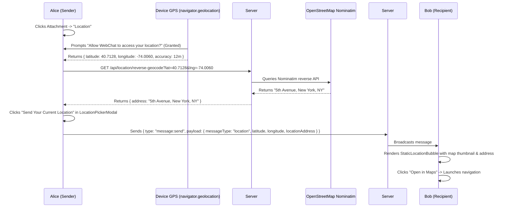

# Phase 37: Current Static GPS Location Sharing

## 1. Phase Overview & Objectives
**Target Workspace**: `web/` (Server #1)  
**Primary Goal**: Implement WhatsApp-style Current Static GPS Location Sharing at **$0.00 additional monthly cost**. Users can share their instantaneous location directly into 1-on-1 chats and group conversations. Coordinates are acquired via the browser Geolocation API (`navigator.geolocation`), reverse-geocoded to a human-readable street address via free **OpenStreetMap Nominatim** with a server-side LRU cache, and rendered inside an interactive Leaflet map card with one-click external navigation links (Google Maps, OpenStreetMap, Apple Maps).

> [!IMPORTANT]
> **Zero Cost & Verification Guardrail**: Strictly **NO OTP**, **NO SMS**, and **NO phone verification**. Absolutely **NO paid Google Maps Platform or Mapbox API keys**. All mapping utilizes open-source **Leaflet.js** and free OpenStreetMap raster tiles.

---

## 2. Context & Prerequisites
- **Previous Phase**: [`36_MAINTENANCE_MODE_AND_EMERGENCY_BACKUPS.md`](36_MAINTENANCE_MODE_AND_EMERGENCY_BACKUPS.md) (Operations and backup infrastructure complete).
- **Environment**: Next.js 15, `leaflet` (`^1.9.4`) + `@types/leaflet`, Browser Geolocation API, OpenStreetMap Nominatim.
- **Privacy Standard**: Geolocation is only accessed when the user explicitly clicks the "Location" button in the chat attachment menu.

---

## 3. Architectural Structure & Target Files

```text
WebChat/
├── web/
│   ├── src/
│   │   ├── app/api/
│   │   │   └── location/
│   │   │       └── reverse-geocode/
│   │   │           └── route.ts             # GET /api/location/reverse-geocode?lat=...&lng=... (OSM Nominatim cache)
│   │   ├── components/
│   │   │   ├── location/
│   │   │   │   ├── LocationPickerModal.tsx  # Map modal showing GPS pin & "Send Current Location"
│   │   │   │   └── StaticLocationBubble.tsx # Chat card with map thumbnail, address, coordinates, nav links
│   │   │   └── chat/
│   │   │       └── AttachmentMenu.tsx       # Adds "Location" (green map pin icon)
│   │   ├── hooks/
│   │   │   └── useGeolocation.ts            # Wrapper for navigator.geolocation.getCurrentPosition
│   │   └── lib/
│   │       ├── nominatimCache.ts            # In-memory LRU cache for reverse geocoding lookups
│   │       └── mapTiles.ts                  # Leaflet OpenStreetMap tile provider configuration
└── shared/
    └── src/
        └── types.ts                         # StaticLocationPayload interface
```

---

## 4. Static Location Sharing Architecture



---

## 5. Database Schema & Prisma Migrations (`web/prisma/schema.prisma`)

```prisma
// Extension to Message model:
// model Message {
//   ...
//   latitude        Float?
//   longitude       Float?
//   locationAddress String?  @db.VarChar(255)
// }
```

---

## 6. Step-by-Step Implementation Tasks

- [ ] **1. Geolocation Wrapper Hook (`useGeolocation.ts`)**:
  - Implement wrapper around `navigator.geolocation.getCurrentPosition`:
    ```typescript
    export function useGeolocation() {
      // Handles prompt, granted, denied permissions
      // enableHighAccuracy: true, timeout: 10000, maximumAge: 60000
      // Returns { coords, accuracy, error, isLoading, requestLocation }
    }
    ```
- [ ] **2. Reverse Geocoding with LRU Cache (`nominatimCache.ts` & API Route)**:
  - In `nominatimCache.ts`:
    - Cache key: `Math.round(lat * 1000) / 1000, Math.round(lng * 1000) / 1000` (~100m accuracy bucket).
    - In-memory cache holding up to 10,000 entries (prevents duplicate requests).
  - In `GET /api/location/reverse-geocode`:
    - Query OSM Nominatim:
      `https://nominatim.openstreetmap.org/reverse?format=json&lat=${lat}&lon=${lng}&zoom=18&addressdetails=1`
    - Custom User-Agent header (required by OSM Nominatim usage policy):
      `User-Agent: WebChat-Enterprise/1.0 (support@yourdomain.com)`
    - Formats concise address: e.g. *"Starbucks, 5th Avenue, Manhattan, New York"*.
- [ ] **3. Leaflet OpenStreetMap Tile Provider (`mapTiles.ts`)**:
  - Tile URL: `https://{s}.tile.openstreetmap.org/{z}/{x}/{y}.png`.
  - Attribution: `&copy; <a href="https://www.openstreetmap.org/copyright">OpenStreetMap</a>`.
  - Zero API billing, zero credit card required.
- [ ] **4. Location Attachment Trigger in Chat (`AttachmentMenu.tsx`)**:
  - Add green location pin icon (**"Location"**) to chat attachment menu.
  - Clicking "Location" invokes `requestLocation()` and opens `<LocationPickerModal />`.
- [ ] **5. Interactive Location Picker Modal (`LocationPickerModal.tsx`)**:
  - Layout:
    - Interactive Leaflet map centered on current GPS coordinates.
    - Blue pulsing circular marker showing current user position and accuracy circle radius.
    - Geocoded address display card showing resolved street name.
    - Green button: *"Send Your Current Location"* (with accuracy text: *"Accurate to 12 meters"*).
- [ ] **6. Static Location Chat Bubble (`StaticLocationBubble.tsx`)**:
  - Renders inside chat stream:
    - Leaflet static thumbnail snapshot (280px width) with red pin marker.
    - Bold address label: *"Starbucks, 5th Avenue"*.
    - Coordinates text: `40.7128° N, 74.0060° W`.
    - Clickable navigation link:
      - Opens external routing based on device:
        - Google Maps: `https://www.google.com/maps/search/?api=1&query=${lat},${lng}`
        - Apple Maps on iOS devices: `https://maps.apple.com/?q=${lat},${lng}`
        - OpenStreetMap on desktop: `https://www.openstreetmap.org/?mlat=${lat}&mlon=${lng}#map=16/${lat}/${lng}`

---

## 7. Quality Gate & Verification Criteria

1. Clicking "Location" in the attachment menu requests browser GPS permission.
2. Centering works accurately, and the reverse geocoder resolves the street name.
3. Clicking "Send Your Current Location" posts a location card into the chat timeline.
4. The message bubble displays the map thumbnail, address, and coordinates.
5. Clicking the card opens external Google Maps / OpenStreetMap centered on the exact coordinates.
6. The entire implementation functions with zero Google Maps API keys or third-party billing.

---

## 8. Autonomous Multi-Agent Handoff Instructions
The next phase is [`38_REALTIME_LIVE_LOCATION_TRACKING.md`](38_REALTIME_LIVE_LOCATION_TRACKING.md). That agent will build real-time dynamic live location streaming with battery-friendly throttling (8s / 10m displacement), countdown timers, and collaborative group maps.