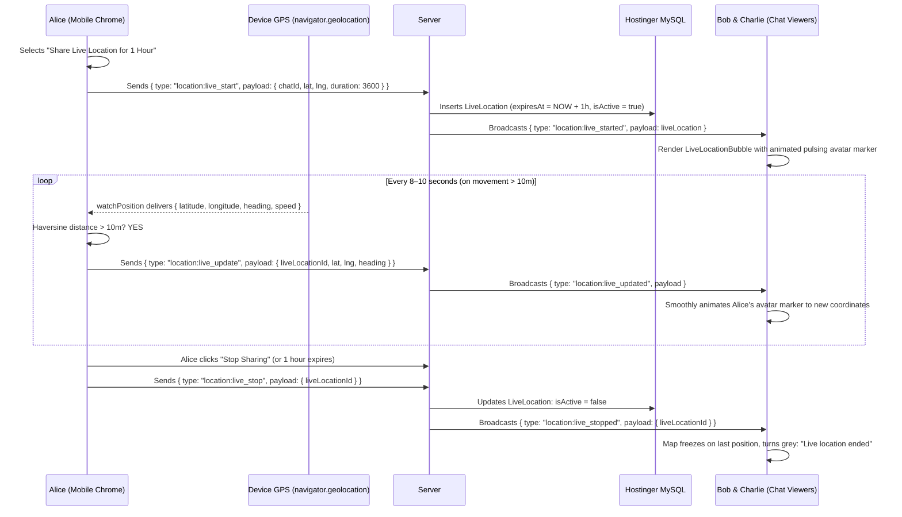

# Phase 38: Real-Time Live Location Tracking & Collaborative Maps

## 1. Phase Overview & Objectives
**Target Workspace**: `web/` (Server #1) & `socket-server/` (Server #2)  
**Primary Goal**: Build WhatsApp-style Real-Time Live GPS Location Streaming and Collaborative Multi-User Maps at **$0.00 additional monthly cost**. Users can share their live location dynamically for **15 Minutes**, **1 Hour**, or **8 Hours**. Device GPS coordinates (`navigator.geolocation.watchPosition`) are throttled for mobile battery optimization (updates emit only on **> 10 meters displacement** or every **8 seconds**). Recipient devices watch moving avatar pins and directional arrows animate in real time over Fastify WebSockets. In group chats, multiple users sharing location render simultaneously on a single collaborative auto-centering map.

> [!IMPORTANT]
> **Zero Cost & Verification Guardrail**: Strictly **NO OTP**, **NO SMS**, and **NO phone verification**. Absolutely **NO paid Google Maps Platform or Mapbox API keys**. All mapping utilizes open-source **Leaflet.js** and free OpenStreetMap raster tiles.

---

## 2. Context & Prerequisites
- **Previous Phase**: [`37_CURRENT_STATIC_LOCATION_SHARING.md`](37_CURRENT_STATIC_LOCATION_SHARING.md) (Static location sharing & Leaflet setup operational).
- **Environment**: Next.js 15, Fastify 4+ & Native `ws` `RoomManager`, Leaflet.js (`leaflet`), Browser Geolocation API.
- **Battery Optimization Standard**: Continuous raw GPS streaming causes severe mobile battery drain. The client-side tracker strictly enforces an 8-second throttle and 10-meter minimum displacement barrier.

---

## 3. Architectural Structure & Target Files

```text
WebChat/
├── web/
│   ├── src/
│   │   ├── app/api/
│   │   │   └── location/
│   │   │       └── live/
│   │   │           ├── start/route.ts       # POST /api/location/live/start (initiates session in DB)
│   │   │           └── stop/route.ts        # POST /api/location/live/stop (terminates session)
│   │   ├── components/
│   │   │   └── location/
│   │   │       ├── LiveDurationSelector.tsx # 15 Minutes / 1 Hour / 8 Hours picker with status comment
│   │   │       ├── LiveLocationBubble.tsx   # Interactive Leaflet map with moving avatar pins & countdown
│   │   │       ├── MultiUserMapViewer.tsx   # Collaborative map showing all active live locations in group
│   │   │       └── LiveMarkerAvatar.tsx     # Custom Leaflet circular avatar marker with heading arrow
│   │   ├── hooks/
│   │   │   └── useLiveLocationTracker.ts    # Throttled watchPosition socket dispatcher & lifecycle manager
│   │   └── lib/
│   │       └── geoMath.ts                   # Haversine distance calculation & heading math
├── socket-server/
│   └── src/
│       ├── handlers/
│       │   └── liveLocationHandler.ts       # Dispatches location:live_start, update, and stop envelopes
│       └── jobs/
│           └── liveLocationCleanupJob.ts    # 60-second timer deactivating expired live locations
└── shared/
    └── src/
        └── events.ts                        # location:live_* WebSocket envelope definitions
```

---

## 4. Real-Time Live Location Streaming Flow



---

## 5. Database Schema & Prisma Migrations (`web/prisma/schema.prisma`)

```prisma
// Extension to Chat model:
// model Chat {
//   ...
//   liveLocations LiveLocation[]
// }

// Extension to User model:
// model User {
//   ...
//   liveLocations LiveLocation[]
// }

model LiveLocation {
  id         String    @id @default(uuid())
  chatId     String
  userId     String
  latitude   Float
  longitude  Float
  heading    Float?    // Direction in degrees (0–360)
  speed      Float?    // Speed in m/s
  accuracy   Float?    // Accuracy in meters
  comment    String?   @db.VarChar(255)
  isActive   Boolean   @default(true)
  startedAt  DateTime  @default(now())
  expiresAt  DateTime
  updatedAt  DateTime  @updatedAt

  chat     Chat      @relation(fields: [chatId], references: [id], onDelete: Cascade)
  user     User      @relation(fields: [userId], references: [id], onDelete: Cascade)
  messages Message[]

  @@index([chatId, isActive], map: "idx_live_location_chat")
  @@index([expiresAt, isActive], map: "idx_live_location_expires")
  @@map("live_locations")
}
```

---

## 6. Step-by-Step Implementation Tasks

- [ ] **1. Live Duration Selector Component (`LiveDurationSelector.tsx`)**:
  - Opened from `<LocationPickerModal />` when clicking "Share Live Location".
  - Duration picker pills:
    - **15 Minutes**
    - **1 Hour** (Default)
    - **8 Hours**
  - Optional comment input: *"Heading home now"*, *"At the conference"*.
  - Red security note: *"Participants in this chat will see your real-time location. You can stop sharing at any time."*
  - Green button: *"Share Live Location"*.
- [ ] **2. Throttled Geolocation Watcher Hook (`useLiveLocationTracker.ts`)**:
  - Initiates `navigator.geolocation.watchPosition`:
    ```typescript
    const watchId = navigator.geolocation.watchPosition(
      (position) => handlePositionUpdate(position),
      (error) => handleError(error),
      { enableHighAccuracy: true, maximumAge: 0, timeout: 10000 }
    );
    ```
  - Throttling barrier:
    - Track `lastSentCoords` and `lastSentTime`.
    - Compute distance using Haversine formula (`computeDistanceMeters(p1, p2)`).
    - If `distance < 10` meters AND `Date.now() - lastSentTime < 8000` ms: Skip broadcast.
    - Otherwise: Emit `location:live_update` over WebSocket.
- [ ] **3. Fastify Live Location Handlers (`liveLocationHandler.ts`)**:
  - Handle `location:live_start`:
    - Insert `LiveLocation` record in MySQL.
    - Broadcast `location:live_started` to room participants.
  - Handle `location:live_update`:
    - Broadcast coordinates `{ liveLocationId, lat, lng, heading }` directly to room participants.
    - Asynchronously update `LiveLocation` coordinates in MySQL without blocking broadcast.
  - Handle `location:live_stop`:
    - Update `LiveLocation.isActive = false`.
    - Broadcast `location:live_stopped`.
- [ ] **4. Live Location Chat Bubble (`LiveLocationBubble.tsx`)**:
  - Embedded Leaflet map (height 200px):
    - Marker: `<LiveMarkerAvatar />` displaying user's circular avatar image with a pulsing green aura.
    - Directional arrow pointing in direction of movement (`heading` degrees).
  - Status strip below map:
    - Countdown timer: *"Live until 04:30 PM (28m remaining)"*.
    - Optional commentary text: *"On the highway, arriving shortly"*.
    - Red button: *"Stop Sharing"* (only visible to the sharing user).
  - When ended:
    - Map converts to greyscale styling.
    - Status changes to: *"Live location ended"*.
- [ ] **5. Collaborative Multi-User Group Map (`MultiUserMapViewer.tsx`)**:
  - If multiple group members are sharing live location simultaneously:
    - Renders unified full map view.
    - Automatically computes Leaflet bounding box (`map.fitBounds(allActiveLocations)`) to keep all participants visible.
    - Each participant's avatar marker shows their name initials.
    - Distance pill: Calculates relative distance from viewer (e.g. *"Alice is 1.2 km away"*, *"Bob is 3.4 km away"*).
- [ ] **6. Fastify 60-Second Auto-Expiration Daemon (`liveLocationCleanupJob.ts`)**:
  - Scheduled interval on Server #2 running every 60 seconds:
    - Query `live_locations` where `expiresAt <= NOW()` and `isActive = true`.
    - Update `isActive = false`.
    - Emit `{ type: 'location:live_ended', payload: { liveLocationId } }` to affected chat rooms.

---

## 7. Quality Gate & Verification Criteria

1. User can choose a duration (15m, 1h, 8h) and initiate live location sharing.
2. The live location bubble renders with a moving avatar marker and a live countdown timer.
3. Coordinates update smoothly over Fastify WebSockets when the user moves > 10m or 8 seconds elapse.
4. In a group chat with 2 users sharing location, both avatars render concurrently on the collaborative map.
5. Clicking "Stop Sharing" immediately halts the device GPS watcher and updates the card to "Live location ended".
6. When the duration countdown expires, Server #2 automatically marks the session ended.
7. The entire live streaming stack runs on existing Hostinger Node.js WebSockets at **$0.00 / month added cost**.

---

## 8. Master 38-Phase Enterprise Architecture Completion
With Phase 38 complete, the WebChat enterprise architecture is fully specified across all 38 granular runbooks. The application delivers consumer excellence, enterprise security, compliance governance, administrative operations, and real-time geolocation mobility—all operating strictly within the client's existing Hostinger subscription at **$0.00 / month added cost**.