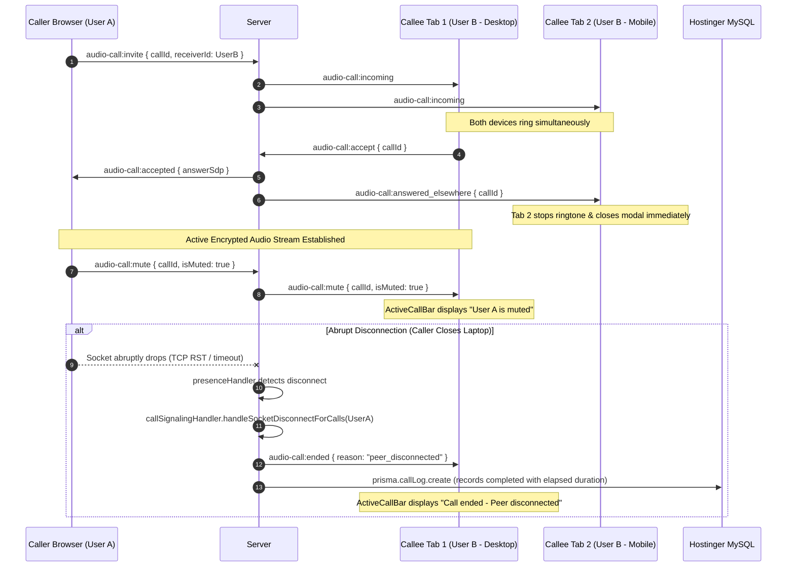

# Phase 39: Voice Call Signaling Hardening, Multi-Device Synchronization & Zombie Cleanup

## 1. Phase Overview & Objectives
**Target Workspace**: `socket-server/` (Server #2), `web/` (Server #1), and `shared/`  
**Primary Goal**: Harden the WebRTC audio call signaling engine on Server #2 (**Fastify 4+ & Native `ws`**) to resolve critical concurrency flaws, memory leaks, and race conditions identified in the voice calling audit at **$0.00 additional monthly cost**. This phase implements automated cleanup of in-memory call sessions upon abrupt client socket disconnections, introduces multi-device/multi-tab call synchronization (`audio-call:answered_elsewhere`), adds a callee-side incoming call ringing timeout, resolves WebRTC simultaneous dialing glare (RFC 8829), synchronizes peer microphone mute states (`audio-call:mute` / `audio-call:unmute`), and hardens MySQL call outcome persistence against missing `chatId` foreign keys.

> [!IMPORTANT]
> **Hostinger CloudLinux Memory & Cost Guardrail**:
> Server #2 must maintain an idle footprint of **~25–35 MB RAM**. In-memory call session tracking (`activeSessions`) must never leak memory on crashed or abruptly closed client connections. All database writes must strictly adhere to the `connection_limit=10` pooling constraint. Strictly **NO phone numbers, NO SMS, NO OTP, and NO paid media servers**.

---

## 2. Context & Prerequisites
- **Previous Phase**: [`38_REALTIME_LIVE_LOCATION_TRACKING.md`](38_REALTIME_LIVE_LOCATION_TRACKING.md) (Live GPS streaming operational).
- **Core Calling Reference**: [`11_AUDIO_CALLING_WEBRTC_VOICE.md`](11_AUDIO_CALLING_WEBRTC_VOICE.md) (Base WebRTC audio calling implementation).
- **Audit Findings**: Documented in `audio_call_forensic_analysis_report.md` (identifying zombie sessions, multi-tab answering race conditions, callee infinite ringing, and unhandled glare).
- **Environment**: Fastify 4+, Native `ws`, RoomManager, Prisma ORM (MySQL), React 19 Client Hooks.

---

## 3. Architectural Structure & Target Files

```text
WebChat/
├── shared/
│   └── src/
│       └── events.ts                        # New call envelopes: answered_elsewhere, mute, unmute
├── socket-server/
│   └── src/
│       ├── handlers/
│       │   ├── callSignalingHandler.ts      # Zombie session cleanup, multi-device sync, glare tie-breaker
│       │   └── presenceHandler.ts           # Disconnect hook invoking call cleanup
│       └── lib/
│           └── roomManager.ts               # Enhanced sendToUser excluding originating socket
└── web/
    └── src/
        ├── hooks/
        │   ├── useCallSignaling.ts          # Callee 45s ringing timeout, multi-tab cancel listener, peer mute
        │   └── useWebRTC.ts                 # Peer mute state synchronization & safe state guards
        └── components/
            └── call/
                └── ActiveCallBar.tsx        # Visual remote peer muted indicator badge
```

---

## 4. Multi-Device Answering & Disconnect Cleanup Flow



---

## 5. Detailed Step-by-Step Implementation Tasks

### 5.1 Protocol Contracts & Envelopes (`shared/src/events.ts`)
- [ ] Add the following typed envelopes to `WsEventType` and export corresponding payload interfaces:
  ```typescript
  export type WsEventType =
    // Existing events...
    | 'audio-call:answered_elsewhere'
    | 'audio-call:mute'
    | 'audio-call:unmute';

  export interface AudioCallAnsweredElsewherePayload {
    callId: string;
    chatId?: string;
  }

  export interface AudioCallMutePayload {
    callId: string;
    chatId?: string;
    userId: string;
    isMuted: boolean;
  }
  ```

### 5.2 Server #2 Zombie Cleanup & Socket Disconnect Hook (`callSignalingHandler.ts` & `presenceHandler.ts`)
- [ ] In `socket-server/src/handlers/callSignalingHandler.ts`:
  - Export `handleSocketDisconnectForCalls(socket: AuthenticatedWebSocket)`:
    - Iterate over `activeSessions.entries()`.
    - If `session.callerId === socket.userId` or `session.receiverId === socket.userId`:
      - Remove the session from `activeSessions`.
      - Identify the remaining peer: `peerId = (session.callerId === socket.userId ? session.receiverId : session.callerId)`.
      - Notify remaining peer:
        ```typescript
        roomManager.sendToUser(peerId, {
          type: 'audio-call:ended',
          payload: {
            callId,
            chatId: session.chatId,
            duration: session.connectedAt ? Math.max(1, Math.floor((Date.now() - session.connectedAt.getTime()) / 1000)) : 0,
            status: session.status === 'connected' ? 'completed' : 'missed',
            reason: 'peer_disconnected',
          },
        });
        ```
      - Asynchronously invoke `recordCallOutcome` to persist the record in MySQL.
- [ ] In `socket-server/src/handlers/presenceHandler.ts`:
  - In `handleUserDisconnect(socket: AuthenticatedWebSocket)`:
    - Invoke `await handleSocketDisconnectForCalls(socket)` before cleaning presence rooms to guarantee zero orphaned sessions in CloudLinux RAM.

### 5.3 Multi-Device Answering Synchronization (`callSignalingHandler.ts`)
- [ ] In `handleCallAccept`:
  - Once the call is accepted on a specific socket, notify all *other* sockets of the callee to stop ringing:
    ```typescript
    roomManager.sendToUser(socket.userId, {
      type: 'audio-call:answered_elsewhere',
      payload: { callId, chatId: session?.chatId },
    }, socket); // Exclude the socket that accepted
    ```
- [ ] In `handleCallReject`:
  - If a rejection envelope arrives for an already `connected` call session, ignore the rejection rather than destroying the ongoing conversation.

### 5.4 WebRTC Glare / Simultaneous Dialing Tie-Breaker (`callSignalingHandler.ts`)
- [ ] In `handleCallInvite`:
  - Detect if Caller A and Callee B are inviting each other simultaneously:
    - If an active session already exists where `session.callerId === targetReceiverId && session.receiverId === callerId && session.status === 'ringing'`:
      - Implement RFC 8829 tie-breaker: compare `callerId` and `targetReceiverId` lexicographically (`callerId < targetReceiverId`).
      - The higher ID becomes the "polite peer" which automatically yields, cancels its outgoing invitation, and accepts the incoming invitation.
      - Send a clean rollback notification rather than rejecting with `audio-call:busy`.

### 5.5 Peer Mute Synchronization (`callSignalingHandler.ts` & `router.ts`)
- [ ] In `socket-server/src/handlers/callSignalingHandler.ts`:
  - Export `handleCallMute(socket: AuthenticatedWebSocket, payload: AudioCallMutePayload)`:
    - Relay `{ type: 'audio-call:mute', payload: { callId, userId: socket.userId, isMuted: payload.isMuted } }` to the remote peer.
- [ ] Register `'audio-call:mute'` in `socket-server/src/router.ts`.

### 5.6 Callee Incoming Ringing Timeout & Client Handlers (`useCallSignaling.ts`)
- [ ] In `web/src/hooks/useCallSignaling.ts`:
  - Maintain `incomingTimeoutRef = useRef<NodeJS.Timeout | null>(null)`.
  - When `audio-call:incoming` arrives, set an automatic 45-second timer:
    ```typescript
    incomingTimeoutRef.current = setTimeout(() => {
      if (callStateRef.current === 'incoming_ringing') {
        rejectCall('timeout');
      }
    }, 45000);
    ```
  - Clear `incomingTimeoutRef` in `acceptCall`, `rejectCall`, and `transitionToEnded`.
  - Subscribe to `audio-call:answered_elsewhere`:
    - Immediately stop ringtone, cleanup WebRTC, and return state to `'idle'`.
  - Subscribe to `audio-call:mute`:
    - Maintain state `isRemoteMuted: boolean` and expose it to consumers.

### 5.7 Database Write Hardening (`callSignalingHandler.ts`)
- [ ] In `recordCallOutcome`:
  - If `chatId` is empty string or invalid:
    - Attempt to find the 1-on-1 direct chat between `callerId` and `receiverId` in `chat_participants`.
    - If no chat exists, create a direct chat row before inserting `CallLog` to satisfy foreign key constraints.
  - Wrap Prisma operations in a `try/catch` with a lightweight in-memory retry queue (up to 3 retries with exponential backoff) if `PrismaClientKnownRequestError` indicates pool exhaustion (`connection_limit=10`).

### 5.8 UI Visual Mute Indicator (`ActiveCallBar.tsx`)
- [ ] In `web/src/components/call/ActiveCallBar.tsx`:
  - Accept prop `isRemoteMuted?: boolean`.
  - If `isRemoteMuted` is true, display a pill badge next to participant name:
    ```tsx
    {isRemoteMuted && (
      <span className="inline-flex items-center gap-1 px-1.5 py-0.5 rounded-full bg-amber-500/15 text-[10px] font-semibold text-amber-500">
        <MicOff className="w-2.5 h-2.5" />
        <span>Muted</span>
      </span>
    )}
    ```

---

## 6. Quality Gate & Verification Criteria

Before marking Phase 39 complete, verify:
1. **Zombie Cleanup Verification**:
   - User A calls User B. While ringing, User A closes the browser tab.
   - User B's incoming modal stops ringing and dismisses within 1 second with a "Caller disconnected" toast.
   - Fastify `activeSessions` map is completely empty (`size === 0`).
2. **Multi-Tab Answering Verification**:
   - User B opens WebChat on two separate browser tabs.
   - User A calls User B. Both tabs display the incoming call modal and ring.
   - User B clicks "Accept" on Tab 1.
   - Tab 1 connects to audio. Tab 2 immediately ceases ringing and closes the modal without affecting Tab 1.
   - User B clicking "Decline" on Tab 2 does NOT disconnect Tab 1.
3. **Callee Timeout Verification**:
   - User A calls User B. User B does not interact.
   - After exactly 45 seconds, User B's incoming modal dismisses automatically and logs a missed call badge.
4. **Peer Mute Verification**:
   - During an active call, User A clicks "Mute".
   - User B's `ActiveCallBar` immediately renders the amber "Muted" badge.
   - User A unmutes; the badge disappears in < 100ms.
5. **Database Constraint Safety**:
   - A call started without a prior chat history successfully auto-creates the direct chat and writes `CallLog` without Prisma foreign key violations.

---

## 7. Handoff to Phase 40
Phase 40 will implement [`40_MOBILE_PWA_VOICE_WAKELOCK_AND_BACKGROUND_ALERTS.md`](40_MOBILE_PWA_VOICE_WAKELOCK_AND_BACKGROUND_ALERTS.md) to integrate the Screen WakeLock API, MediaSession API call controls, and high-priority Web Push wake-up for offline and backgrounded mobile devices.
