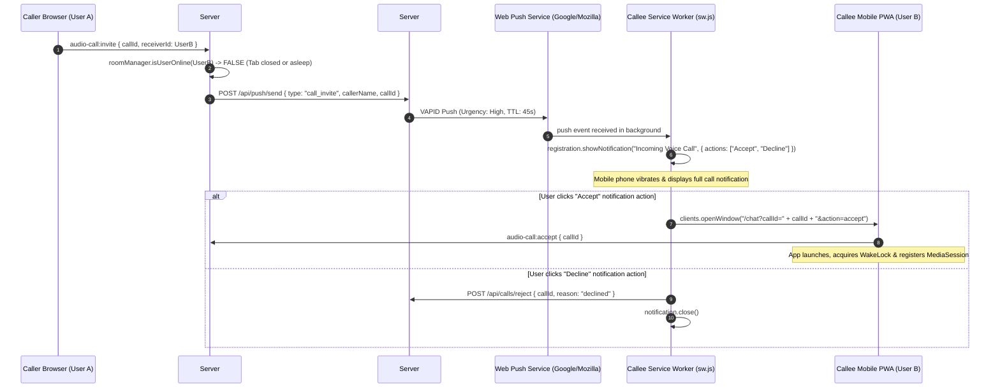

# Phase 40: Mobile PWA Voice Ergonomics, WakeLock, MediaSession & Background Call Alerts

## 1. Phase Overview & Objectives
**Target Workspace**: `web/` (Server #1) and `socket-server/` (Server #2)  
**Primary Goal**: Elevate the WebChat Progressive Web App (PWA) on Mobile Chrome to a native-like audio calling experience at **$0.00 additional monthly cost**. When a recipient is offline or their mobile browser is suspended in the background, Server #2 dispatches a high-priority W3C VAPID Web Push notification with inline "Accept" and "Decline" actions. During active voice calls, the application acquires the **Screen Wake Lock API** (`navigator.wakeLock`) to prevent Android OS display sleep and CPU throttling, registers the **MediaSession API** (`navigator.mediaSession`) to expose call metadata and mute/hang-up controls on the mobile lock screen and notification pull-down shade, and gracefully handles Android Chrome's `setSinkId` limitations with device feature detection.

> [!IMPORTANT]
> **Zero Added Cost & Mobile Battery Guardrail**:
> Strictly **NO paid push services** (use W3C VAPID `web-push` on Hostinger NVMe). Screen wake lock must be released immediately upon call termination to conserve device battery. Strictly **NO phone numbers, NO SMS, NO OTP, and NO paid telephony gateways**.

---

## 2. Context & Prerequisites
- **Previous Phase**: [`39_VOICE_CALL_SIGNALING_HARDENING_AND_ZOMBIE_CLEANUP.md`](39_VOICE_CALL_SIGNALING_HARDENING_AND_ZOMBIE_CLEANUP.md) (Signaling hardening & multi-device sync complete).
- **Core PWA Reference**: [`12_PWA_AND_MOBILE_CHROME_INSTALLATION.md`](12_PWA_AND_MOBILE_CHROME_INSTALLATION.md) (Service worker & Web App Manifest).
- **Push Reference**: [`23_BACKGROUND_WEB_PUSH_NOTIFICATIONS.md`](23_BACKGROUND_WEB_PUSH_NOTIFICATIONS.md) (VAPID push subscription infrastructure).
- **Environment**: Next.js 15 Standalone, Fastify 4+, Chrome for Android (PWA standalone mode), Service Worker (`sw.js`).

---

## 3. Architectural Structure & Target Files

```text
WebChat/
├── web/
│   ├── public/
│   │   └── sw.js                            # Push event listener for call_invite & action button handlers
│   ├── src/
│   │   ├── app/api/push/
│   │   │   └── send/route.ts                # High-priority call push dispatcher endpoint
│   │   ├── components/
│   │   │   └── call/
│   │   │       └── ActiveCallBar.tsx        # Responsive mobile layout & setSinkId feature detection
│   │   ├── hooks/
│   │   │   ├── useScreenWakeLock.ts         # Screen Wake Lock API lifecycle manager
│   │   │   ├── useMediaSessionCall.ts       # Android notification shade & lock screen audio session
│   │   │   └── useCallSignaling.ts          # Integrates wake lock & media session during connected state
│   │   └── lib/
│   │       ├── audio.ts                     # Autoplay recovery & silent audio unlock pattern
│   │       └── pushService.ts               # Urgency: high VAPID payload generator for calls
└── socket-server/
    └── src/
        └── handlers/
            └── callSignalingHandler.ts      # Invokes Server #1 push endpoint when recipient is offline
```

---

## 4. Background Push & Mobile Call Lifecycle Flow



---

## 5. Detailed Step-by-Step Implementation Tasks

### 5.1 High-Priority Call Push Dispatcher (`pushService.ts` & `/api/push/send`)
- [ ] In `web/src/lib/pushService.ts`:
  - Add helper function `sendIncomingCallPush(subscription, payload)`:
    - Set push headers: `Urgency: 'high'`, `TTL: 45` (time-to-live matches call ringing timeout).
    - Construct payload:
      ```json
      {
        "type": "call_invite",
        "title": "📞 Incoming Voice Call",
        "body": "Incoming voice call from User A",
        "callId": "call-123",
        "chatId": "chat-456",
        "callerName": "Alice",
        "callerAvatar": "/uploads/avatars/alice.webp",
        "tag": "incoming-call-call-123",
        "requireInteraction": true,
        "actions": [
          { "action": "accept", "title": "Accept" },
          { "action": "decline", "title": "Decline" }
        ]
      }
      ```
- [ ] In `socket-server/src/handlers/callSignalingHandler.ts`:
  - In `handleCallInvite`:
    - If `!isReceiverOnline`:
      - Instead of immediately failing with `'offline'`, invoke Server #1's internal push endpoint: `POST http://127.0.0.1:3000/api/push/send`.
      - Allow a 20-second grace window for the callee device to wake up, launch the PWA, and establish a WebSocket connection before logging as missed.

### 5.2 Service Worker Notification Actions (`web/public/sw.js`)
- [ ] In `web/public/sw.js`:
  - In `push` event handler:
    - Detect `data.type === 'call_invite'`:
      - Trigger rhythmic call vibration pattern: `vibrate: [500, 250, 500, 250, 500, 250, 500]`.
      - Display notification with `requireInteraction: true` so the alert remains on the lock screen.
  - In `notificationclick` event handler:
    - If `event.action === 'accept'`:
      - Focus existing WebChat window or open a new window to `/chat?autoAcceptCall=${data.callId}&chatId=${data.chatId}`.
      - Close notification.
    - If `event.action === 'decline'`:
      - Dispatch background fetch to `/api/calls/reject` with `{ callId, reason: 'declined' }`.
      - Close notification.

### 5.3 Screen Wake Lock API Hook (`useScreenWakeLock.ts`)
- [ ] Create `web/src/hooks/useScreenWakeLock.ts`:
  - Check for `navigator.wakeLock`:
    ```typescript
    export function useScreenWakeLock(isActive: boolean) {
      const wakeLockRef = useRef<WakeLockSentinel | null>(null);

      useEffect(() => {
        if (!isActive || typeof navigator === 'undefined' || !('wakeLock' in navigator)) return;

        let released = false;
        async function requestLock() {
          try {
            const sentinel = await navigator.wakeLock.request('screen');
            if (!released) {
              wakeLockRef.current = sentinel;
              sentinel.addEventListener('release', () => {
                wakeLockRef.current = null;
              });
            } else {
              sentinel.release();
            }
          } catch (err) {
            console.warn('[useScreenWakeLock] WakeLock acquisition failed:', err);
          }
        }

        requestLock();

        // Re-acquire lock if user switches back to tab
        const handleVisibilityChange = () => {
          if (document.visibilityState === 'visible' && !wakeLockRef.current && !released) {
            requestLock();
          }
        };
        document.addEventListener('visibilitychange', handleVisibilityChange);

        return () => {
          released = true;
          document.removeEventListener('visibilitychange', handleVisibilityChange);
          if (wakeLockRef.current) {
            wakeLockRef.current.release().catch(() => {});
            wakeLockRef.current = null;
          }
        };
      }, [isActive]);
    }
    ```

### 5.4 MediaSession API Call Integration (`useMediaSessionCall.ts`)
- [ ] Create `web/src/hooks/useMediaSessionCall.ts`:
  - When call state is `'connected'`:
    - Populate `navigator.mediaSession.metadata`:
      - `title`: `Voice Call with ${partnerName}`
      - `artist`: `@${partnerUsername}`
      - `artwork`: `[{ src: partnerAvatar, sizes: '512x512', type: 'image/webp' }]`
    - Bind media session action handlers:
      - `hangup`: invoke `endCall()`
      - `togglemicrophone`: invoke `toggleMute()`
  - On call termination, reset `navigator.mediaSession.metadata = null`.

### 5.5 Mobile Audio Routing & Autoplay Fallback (`ActiveCallBar.tsx` & `audio.ts`)
- [ ] In `web/src/components/call/ActiveCallBar.tsx`:
  - Feature-detect `setSinkId`:
    ```typescript
    const supportsSetSinkId = typeof window !== 'undefined' && 'HTMLMediaElement' in window && 'setSinkId' in HTMLMediaElement.prototype;
    ```
  - If `!supportsSetSinkId` (Google Chrome on Android), hide the output dropdown menu completely.
  - Render an unobtrusive helper tip for mobile users: *"Switch between earpiece & speakerphone using phone hardware controls."*
- [ ] In `web/src/lib/audio.ts`:
  - Implement a silent audio buffer unlock helper:
    - On the very first user interaction (touch/click anywhere on page), resume any suspended `AudioContext` and play an inaudible 1-millisecond silent buffer.
    - If `audio.play()` is blocked by autoplay policy, dispatch a custom event `webchat:autoplay-blocked` so the UI can render a pulsating "Tap to Unmute Call" overlay.

---

## 6. Quality Gate & Verification Criteria

Before marking Phase 40 complete, verify:
1. **Background Call Push Verification**:
   - Callee closes the WebChat tab completely on Android Chrome.
   - Caller initiates an audio call.
   - Callee's Android device receives an incoming call notification with sound/vibration and "Accept" / "Decline" buttons.
   - Clicking "Accept" opens the WebChat PWA directly into the active call.
2. **Screen Wake Lock Verification**:
   - Establish an active audio call on mobile Chrome.
   - Leave phone untouched for 3 minutes.
   - The screen remains illuminated and does not sleep; audio playback remains crystal clear without stuttering.
   - Ending the call immediately releases the wake lock, allowing normal display sleep.
3. **Lock Screen / Notification Shade Verification**:
   - During an active call, swipe down the Android notification shade.
   - A media notification displays caller name, avatar, and an active "End Call" button.
   - Clicking "End Call" terminates the conversation and cleans up the session.
4. **Mobile setSinkId Resilience**:
   - On Android Chrome, no broken audio device dropdown is rendered; no `setSinkId is not a function` console errors occur.
5. **Autoplay Resilience**:
   - If a call arrives before user interaction, a visible "Tap to listen" prompt allows one-click audio recovery without call failure.

---

## 7. Handoff to Phase 41
Phase 41 will implement [`41_WEBRTC_NETWORK_RESILIENCE_AND_TLS_TURN_TRAVERSAL.md`](41_WEBRTC_NETWORK_RESILIENCE_AND_TLS_TURN_TRAVERSAL.md) to add TLS TURN over TCP port 443 (`turns:`), automated ICE restart on network handovers, and relayed bandwidth telemetry.
