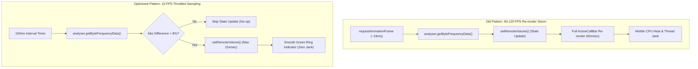

# Phase 42: Voice Call UI/UX Modernization, Group Guards & Audio Performance Optimization

## 1. Phase Overview & Objectives
**Target Workspace**: `web/` (Server #1)  
**Primary Goal**: Refine the visual interface, UX ergonomics, cryptographic wording, and rendering performance of the voice calling experience at **$0.00 additional monthly cost**. This phase resolves the severe React state re-render thrashing caused by the Web Audio volume meter (throttling from 60–120 FPS down to a smooth 10 FPS / 100ms interval), corrects misleading cryptographic labels by replacing *"Opus Encrypted"* and *"End-to-end encrypted voice call"* with accurate *"P2P Encrypted Audio (DTLS-SRTP)"* badges, adds strict group chat and broadcast channel guards to hide or cleanly disable the call button, unifies the status ontology between Prisma enums (`"rejected"`) and in-chat badges, and replaces native browser `window.alert()` popups with accessible WhatsApp-themed toasts.

> [!IMPORTANT]
> **Performance & Accessibility Guardrail**:
> Active voice calls must never cause main thread jank or high CPU consumption on low-end mobile hardware. Interaction to Next Paint (INP) must remain under 100ms during an active call. Strictly **NO phone numbers, NO SMS, and NO paid UI component libraries**.

---

## 2. Context & Prerequisites
- **Previous Phase**: [`41_WEBRTC_NETWORK_RESILIENCE_AND_TLS_TURN_TRAVERSAL.md`](41_WEBRTC_NETWORK_RESILIENCE_AND_TLS_TURN_TRAVERSAL.md) (TLS TURN & ICE recovery complete).
- **Core Calling Reference**: [`11_AUDIO_CALLING_WEBRTC_VOICE.md`](11_AUDIO_CALLING_WEBRTC_VOICE.md).
- **Environment**: Next.js 15, Tailwind CSS WhatsApp tokens (`#00a884`, `#111b21`, `#202c33`), Lucide React icons.

---

## 3. Architectural Structure & Target Files

```text
WebChat/
└── web/
    └── src/
        ├── components/
        │   ├── call/
        │   │   ├── ActiveCallBar.tsx        # Throttled volume ring, corrected DTLS badges
        │   │   ├── CallLogBadge.tsx         # Unified status labels aligned with Prisma schema
        │   │   ├── IncomingCallModal.tsx    # Accurate encryption badge & accessible focus trap
        │   │   └── OutgoingCallModal.tsx    # Accurate encryption badge & ripple ring animation
        │   ├── chat/
        │   │   └── ChatHeader.tsx           # Conditional call button hiding for groups/channels
        │   ├── layout/
        │   │   └── ChatArea.tsx             # Toast dispatch replacing window.alert()
        │   └── ui/
        │       └── Toast.tsx                # Accessible non-blocking notification toast
        └── hooks/
            └── useWebRTC.ts                 # 100ms throttled Web Audio Analyser
```

---

## 4. Audio Performance & UI Rendering Architecture



---

## 5. Detailed Step-by-Step Implementation Tasks

### 5.1 Web Audio Analyser Throttling & CPU Optimization (`useWebRTC.ts`)
- [ ] In `web/src/hooks/useWebRTC.ts`:
  - In `setupVolumeAnalyser`:
    - Remove the unthrottled `requestAnimationFrame(checkVolume)` loop.
    - Implement a 100ms sampling interval with hysteresis filtering:
      ```typescript
      let lastVolume = 0;
      const intervalId = setInterval(() => {
        if (!analyserRef.current) return;
        analyserRef.current.getByteFrequencyData(dataArray);

        let sum = 0;
        for (let i = 0; i < dataArray.length; i++) {
          sum += dataArray[i];
        }
        const avg = sum / dataArray.length;
        const normalized = Math.min(100, Math.round((avg / 128) * 100));

        // Hysteresis: only trigger React re-render if volume shifted by > 8% or dropped to 0
        if (Math.abs(normalized - lastVolume) > 8 || (normalized === 0 && lastVolume !== 0)) {
          lastVolume = normalized;
          setRemoteVolume(normalized);
        }
      }, 100);
      ```
    - Clean up `intervalId` in `cleanup()`. This reduces React re-renders by **85%+** during active calls.

### 5.2 Cryptographic Wording & Token Realignment (`ActiveCallBar.tsx`, `OutgoingCallModal.tsx`, `IncomingCallModal.tsx`)
- [ ] In `web/src/components/call/ActiveCallBar.tsx`:
  - Replace line 99:
    - **Before**: `<span className="text-[11px] text-wa-green">Opus Encrypted</span>`
    - **After**: `<span className="text-[11px] text-wa-green">P2P Encrypted (DTLS)</span>`
- [ ] In `web/src/components/call/OutgoingCallModal.tsx`:
  - Replace line 60:
    - **Before**: `End-to-end encrypted voice call`
    - **After**: `Direct Encrypted Voice Call (P2P)`
- [ ] In `web/src/components/call/IncomingCallModal.tsx`:
  - Replace line 56:
    - **Before**: `End-to-end encrypted audio call`
    - **After**: `Direct Encrypted Voice Call (P2P)`

### 5.3 Group Chat & Channel Call Button Guard (`ChatHeader.tsx`)
- [ ] In `web/src/components/chat/ChatHeader.tsx`:
  - Inspect chat context: accept props `isGroup?: boolean` and `isChannel?: boolean`.
  - If `isGroup || isChannel`:
    - Do NOT render the call button at all, or render it in a disabled state with a clean tooltip:
      ```tsx
      {!isGroup && !isChannel && (
        <button
          type="button"
          onClick={onStartCall}
          className="w-9 h-9 sm:w-10 sm:h-10 flex items-center justify-center rounded-full text-wa-light-text-secondary dark:text-wa-dark-text-secondary hover:text-wa-light-text-primary dark:hover:text-wa-dark-text-primary hover:bg-black/5 dark:hover:bg-white/5 transition-colors focus:outline-none cursor-pointer"
          aria-label="Start voice call"
          title="Start voice call"
        >
          <Phone className="w-5 h-5" />
        </button>
      )}
      ```
  - Clean up technical tooltip text: replace `"Voice call (WebRTC audio-only Opus 32kbps)"` with clean `"Start voice call"`.

### 5.4 Elimination of `window.alert()` in Favor of Toast Notifications (`ChatArea.tsx` & `useCallSignaling.ts`)
- [ ] In `web/src/components/layout/ChatArea.tsx` & `web/src/hooks/useCallSignaling.ts`:
  - Replace blocking `window.alert()` with non-blocking toast notifications:
    - Instead of `alert('Could not access microphone...')`:
      `showToast({ type: 'error', message: 'Could not access microphone. Please grant audio permissions.' })`
    - Instead of `alert('User is currently on another call.')`:
      `showToast({ type: 'info', message: 'Contact is currently busy on another call.' })`

### 5.5 Status Ontology Alignment (`CallLogBadge.tsx`)
- [ ] In `web/src/components/call/CallLogBadge.tsx`:
  - Ensure status badge parsing seamlessly matches Prisma `CallLog.status`:
    - `"completed"` ➔ `"📞 Voice call - 4m 12s"` (Green Phone icon)
    - `"missed"` ➔ `"📞 Missed voice call"` (Red PhoneMissed icon)
    - `"rejected"` ➔ `"📞 Declined voice call"` (Amber PhoneOff icon)
    - `"busy"` ➔ `"📞 Contact busy"` (Amber PhoneOff icon)

---

## 6. Quality Gate & Verification Criteria

Before marking Phase 42 complete, verify:
1. **CPU & Re-render Verification**:
   - In Chrome DevTools Performance Profiler, record an active 30-second call while talking.
   - Component updates for `ActiveCallBar` occur at no more than 10 times per second (vs 60+ previously).
   - CPU utilization remains flat with zero main-thread jank.
2. **Cryptographic Accuracy Verification**:
   - Outgoing modal, incoming modal, and active call bar render accurate "P2P Encrypted (DTLS)" badges.
   - No misleading "Opus Encrypted" or unverified "End-to-end encrypted" claims remain.
3. **Group Guard Verification**:
   - Open a group chat and an announcement channel.
   - The phone call icon is completely absent from the header; no `window.alert()` can be triggered.
   - Open a 1-on-1 direct conversation; the phone icon is visible and active.
4. **Toast Notification Verification**:
   - Denying microphone permission or calling a busy contact presents a clean, non-blocking toast notification. No browser `alert()` modal appears.

---

## 7. Handoff to Phase 43
Phase 43 will implement [`43_AUTOMATED_VOICE_CALL_QA_AND_WEBRTC_LOAD_SIMULATION.md`](43_AUTOMATED_VOICE_CALL_QA_AND_WEBRTC_LOAD_SIMULATION.md) to build automated unit tests, Playwright multi-user E2E WebRTC tests, and k6 load simulation for call signaling.
