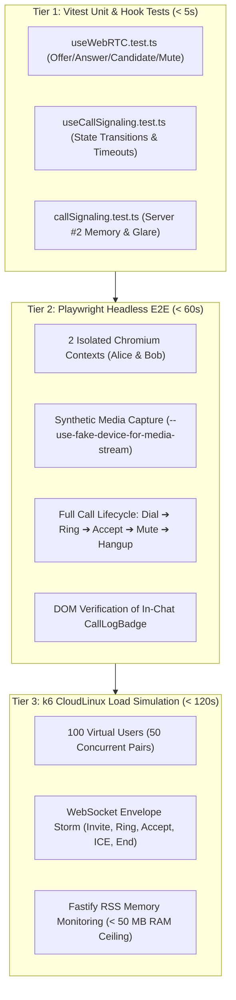

# Phase 43: Automated Voice Call QA, Playwright WebRTC Testing & Load Simulation

## 1. Phase Overview & Objectives
**Target Workspace**: `web/src/__tests__/`, `socket-server/tests/`, `e2e/`, and `scripts/`  
**Primary Goal**: Establish an end-to-end automated testing and load simulation suite for real-time WebRTC audio calling at **$0.00 additional monthly cost**. This phase implements comprehensive **Vitest unit and integration tests** for the WebRTC peer connection hook (`useWebRTC.ts`), call signaling hook (`useCallSignaling.ts`), and Fastify server handler (`callSignalingHandler.ts`). It creates an automated **Playwright E2E browser test** that launches two isolated Chromium browser contexts with fake media devices (`--use-fake-ui-for-media-stream`, `--use-fake-device-for-media-stream`) to simulate a real User A to User B call (invite, ringtone, accept, mute, end call, and verify call log badges). Finally, it authors a **k6 virtual user load simulation script** (`scripts/call-signaling-load-test.js`) testing 100 concurrent call signaling sessions to guarantee Server #2 stays strictly within Hostinger's CloudLinux memory ceiling (~25–35 MB RAM).

> [!IMPORTANT]
> **Deterministic Testing & Headless Guardrail**:
> Automated tests must never depend on real microphone hardware or physical audio inputs. Tests must run deterministically in headless CI/CD environments (GitHub Actions) using mock media tracks and synthetic WebRTC peer connections. Strictly **NO paid testing cloud subscriptions (Sauce Labs, BrowserStack)**.

---

## 2. Context & Prerequisites
- **Previous Phase**: [`42_VOICE_CALL_UI_UX_MODERNIZATION_AND_PERFORMANCE.md`](42_VOICE_CALL_UI_UX_MODERNIZATION_AND_PERFORMANCE.md) (UI modernization & performance optimization complete).
- **Core Calling Reference**: [`11_AUDIO_CALLING_WEBRTC_VOICE.md`](11_AUDIO_CALLING_WEBRTC_VOICE.md).
- **Test Framework Reference**: [`13_AUTOMATED_TESTING_AND_LOAD_SIMULATION.md`](13_AUTOMATED_TESTING_AND_LOAD_SIMULATION.md) (Vitest, Playwright, and k6 foundation).
- **Environment**: Vitest 1.4+, `@testing-library/react`, Playwright Test 1.42+, k6 load generator.

---

## 3. Architectural Structure & Target Files

```text
WebChat/
├── web/
│   └── src/
│       └── __tests__/
│           ├── useWebRTC.test.ts            # Vitest unit tests for RTCPeerConnection lifecycle
│           ├── useCallSignaling.test.ts     # Vitest tests for call state machine & 45s timeouts
│           └── callModals.test.tsx          # Component tests for Outgoing, Incoming, ActiveCallBar
├── socket-server/
│   └── tests/
│       └── callSignaling.test.ts            # Fastify tests for invite, accept, reject, end, disconnect
├── e2e/
│   ├── playwright.config.ts                 # Chromium args: --use-fake-ui-for-media-stream
│   └── voice-call-flow.spec.ts              # 2-User live voice call E2E test suite
└── scripts/
    └── call-signaling-load-test.js          # k6 script simulating 100 concurrent call sessions
```

---

## 4. Multi-Tiered Verification Matrix



---

## 5. Detailed Step-by-Step Implementation Tasks

### 5.1 WebRTC Hook & State Machine Unit Tests (`web/src/__tests__/`)
- [ ] Create `web/src/__tests__/useWebRTC.test.ts`:
  - Mock `navigator.mediaDevices.getUserMedia` returning synthetic `MediaStream` with audio track.
  - Mock `RTCPeerConnection` with spy methods: `createOffer`, `createAnswer`, `setLocalDescription`, `setRemoteDescription`, `addIceCandidate`, and `close`.
  - Test cases:
    1. `acquireLocalAudio` requests `audio: true` and strictly `video: false`.
    2. `createOffer` adds audio tracks and produces local description.
    3. `createAnswer` queues ICE candidates until remote description is set.
    4. `toggleMute` toggles `track.enabled` correctly.
    5. `cleanup` halts all media tracks and closes peer connection cleanly.
- [ ] Create `web/src/__tests__/useCallSignaling.test.ts`:
  - Test state machine transitions:
    1. Initial state is `'idle'`.
    2. `startCall` transitions to `'outgoing_calling'` and starts 45s timer.
    3. `audio-call:ring` transitions to `'outgoing_ringing'`.
    4. `audio-call:accepted` transitions to `'connecting'` ➔ `'connected'`.
    5. Callee 45s timeout automatically triggers `rejectCall('timeout')`.
    6. `audio-call:answered_elsewhere` cancels ringing and returns to `'idle'`.

### 5.2 Server #2 Fastify Signaling Handler Tests (`socket-server/tests/callSignaling.test.ts`)
- [ ] Create `socket-server/tests/callSignaling.test.ts`:
  - Initialize Fastify test instance with mock WebSockets.
  - Test cases:
    1. `audio-call:invite` dispatches `audio-call:incoming` to recipient.
    2. If recipient is offline, dispatches `audio-call:reject` with `reason: 'offline'`.
    3. If recipient is in another call, dispatches `audio-call:busy`.
    4. Disconnecting socket cleans up `activeSessions` and informs remote peer with `reason: 'peer_disconnected'`.
    5. Simultaneous dialing resolves via RFC 8829 tie-breaker without throwing unhandled exceptions.

### 5.3 Playwright WebRTC End-to-End Suite (`e2e/voice-call-flow.spec.ts`)
- [ ] Configure `e2e/playwright.config.ts`:
  - Add launch args to `use.launchOptions`:
    ```typescript
    args: [
      '--use-fake-ui-for-media-stream',
      '--use-fake-device-for-media-stream',
      '--allow-file-access',
    ],
    ```
- [ ] Create `e2e/voice-call-flow.spec.ts`:
  - Step 1: Register User A (`alice_call`) and User B (`bob_call`) in isolated browser contexts.
  - Step 2: User A opens direct chat with User B and clicks the phone call icon.
  - Step 3: User A's screen displays `OutgoingCallModal` with *"Calling..."* ➔ *"Ringing..."*.
  - Step 4: User B's screen displays `IncomingCallModal` with "Accept" and "Decline" buttons.
  - Step 5: User B clicks "Accept".
  - Step 6: Both contexts display `ActiveCallBar` with counting duration timer (`00:01`).
  - Step 7: User A clicks "Mute"; verify mute state.
  - Step 8: User A clicks "End Call".
  - Step 9: Verify both chat windows render the in-feed call log badge: `📞 Voice call - Xs`.

### 5.4 k6 Call Signaling Load Simulation (`scripts/call-signaling-load-test.js`)
- [ ] Create `scripts/call-signaling-load-test.js`:
  - Simulate 100 virtual users (50 concurrent pairs).
  - Open WebSocket connections to `ws://localhost:4000`.
  - Simulate realistic call signaling:
    1. Send `audio-call:invite` with dummy SDP offer.
    2. Callee replies with `audio-call:ring` and `audio-call:accept` with dummy SDP answer.
    3. Exchange 4 synthetic ICE candidates over 10 seconds.
    4. Send `audio-call:end`.
  - Enforce thresholds:
    - 95% of signaling envelopes roundtrip in `< 50ms`.
    - Server error rate: `0.00%`.
    - Fastify RSS memory usage remains `< 50 MB`.

---

## 6. Quality Gate & Verification Criteria

Before marking Phase 43 complete, verify:
1. **Unit Test Pass**:
   - `npm run test` executes all unit tests in `web/` and `socket-server/` with 100% pass rate.
2. **Playwright E2E Pass**:
   - `npx playwright test e2e/voice-call-flow.spec.ts` passes cleanly in headless mode.
   - Verified that synthetic media streams connect and call log badges persist in MySQL.
3. **k6 Load Simulation Pass**:
   - `k6 run scripts/call-signaling-load-test.js` completes with 100 VUs and 0 failed socket connections.
   - Fastify memory stays firmly within Hostinger CloudLinux limits (~30 MB RAM).

---

## 7. Handoff & Project Milestone Completion
With Phases 39 through 43 complete, the entire WebChat Real-Time Audio Calling platform is fully hardened, resilient against network handovers, optimized for mobile PWAs, and thoroughly verified by automated tests—all at strictly **$0.00 additional monthly cost**.
